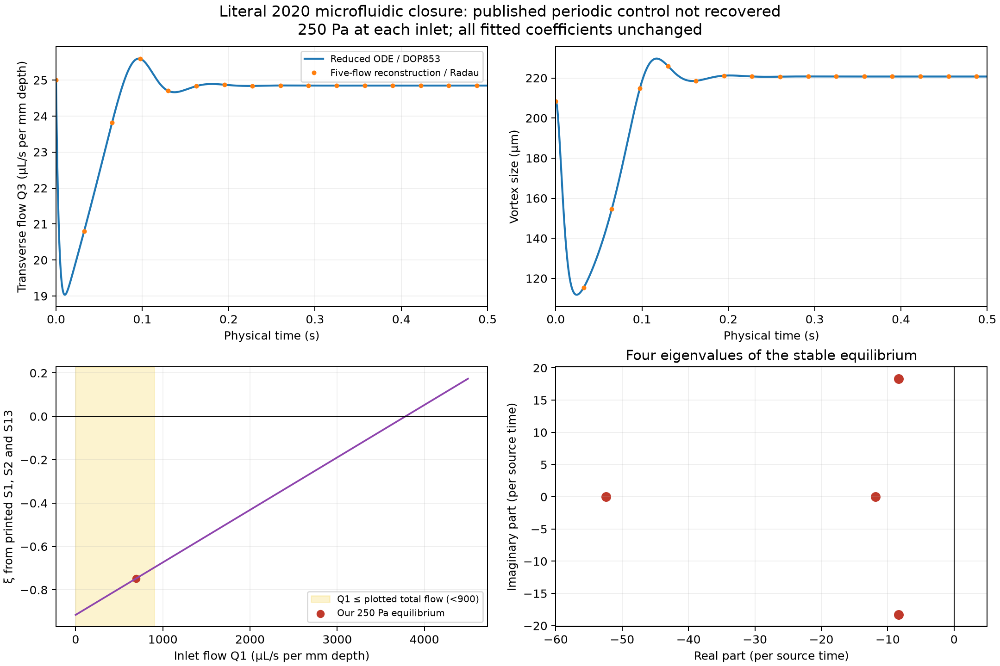

# Microfluidic feedback: a periodic control that did not reproduce

**Status: 30 October 2026. The literal printed four-state model did not recover its published periodic example. We therefore paused the proposed GPU chaos search.** This is a source-reproduction issue, not a demonstration that the physical network cannot oscillate and not a global no-chaos theorem.



Case, Angilella and Motter [1] describe a rigid five-channel network in which flow changes a vortex, the vortex changes hydraulic resistance, and pressure coupling feeds back on the flows. The full Navier–Stokes simulations and the fitted dynamical closure are distinct models. Our [equation and unit extraction](late-candidate-screening-4.md) gives the four independent states, algebraic pressure solve and all fitted constants. We implement those printed equations without modifying their signs or refitting coefficients.

## Numerical source control

The source's Fig. S5 shows oscillations at equal inlet pressures of **250 Pa**, equivalent to dimensionless inlet pressures `(62500, 62500)`. We tried three explicitly chosen initial states `(Q1,Q2,Q3,r)`:

```text
(650, 50, 25, 5)
(650, 50, 25, 3)
(550, 50, 20, 2)
```

These are our starts; the supplement does not supply exact initial conditions. Each was integrated for 100 source-time units, equivalent to 25 seconds, using DOP853 with relative tolerance `1e-10`, absolute tolerance `1e-12` and maximum step `0.01`. All three approach the same fixed point:

```text
Q1 = 694.316102856
Q2 =  36.429512430
Q3 =  24.847426203
r  =   5.297268464
```

The final ten source-time units show only floating-point-scale variation. The Jacobian eigenvalues at this point, per source-time unit, are

```text
-11.85304726,  -52.39025782,
 -8.37345678 + 18.32414871 i,
 -8.37345678 - 18.32414871 i.
```

This supports local asymptotic stability of the equilibrium. It does not rule out a coexisting periodic orbit or another attractor with a different basin.

Several checks distinguish the model mismatch from a simple integration or differentiation mistake:

| Check | Measured error |
| --- | ---: |
| Analytic Jacobian versus complex-step differentiation, 128 seeded states | `7.21e-15` maximum componentwise scaled error |
| Independently reconstructed five-flow equations versus reduced vector field | `1.26e-15` maximum scaled error |
| Both differentiated flow-conservation identities | `2.50e-15` maximum scaled residual |
| Reduced DOP853 versus five-flow pressure reconstruction with implicit Radau, 10 source-time units | `1.08e-11` maximum componentwise scaled state difference |

The independent trajectory uses tighter tolerances `1e-11` and `1e-13`, maximum step `0.005`, and a fresh linear pressure solve. Its vortex equation uses the algebraically equivalent factored expression rather than the cubic implementation. It agrees on the damped oscillations and final equilibrium. The [structural audit](microfluidic-structure.md) independently reduces the stationary equations and checks their stability.

## A coefficient inconsistency that matters dynamically

Equations S1, S2 and S13 give

```math
\eta(x)=0.12+8\times10^{-6}x,\qquad
\xi(x)=\frac{5.5^3\eta(x)-25}{5.5}.
```

At the fixed point above, these imply `eta = 0.1255545288` and **`xi = -0.7474300486`**. Positive xi would require

```math
x>\frac{25/5.5^3-0.12}{8\times10^{-6}}
\approx3782.8700.
```

In the forward-flow interpretation, Q1 cannot exceed the plotted total inlet flow, which remains below approximately 900 dimensionless units in Fig. S5. Thus the coefficient is negative throughout that plotted range if all three printed formulas are used together. This conflicts with the main text's positive-coefficient description of its cubic vortex response. With fixed x and negative xi,

```math
\frac{\partial\dot r}{\partial r}
=10.9\left[\xi(x)-3\eta(x)(r-5.5)^2\right]<0.
```

The vortex's stationary relation is then single-valued and strictly increasing in r, rather than S-shaped. This observation concerns the vortex relation at a fixed inlet flow; it does not by itself exclude oscillations of the coupled four-state system.

The [source follow-up](microfluidic-source-audit.md) checks the final publisher supplement as well as the author manuscript. Both print the same coefficients. We have not recovered the implementation used for the source figure, identified an authoritative correction, or established which expression should change. Freezing xi, changing q by an order of magnitude or inventing a new vortex law would define a different computational experiment and would not resolve this reproduction issue.

## Physical domain and search decision

The algebraic pressure solve is nonsingular for positive channel lengths, but the vector field contains division by Q1 and is fitted for forward flows. Positive inlet pressures do **not** make the whole forward-flow domain invariant. The structural audit gives an explicit outward-pointing boundary example and a conditional energy estimate for trajectories that remain in that domain.

Only the small CPU controls above were integrated. There was **no GPU mass survey**, no Lyapunov-spectrum search and no new attractor candidate in this block. A verified source baseline is needed before spending substantial GPU time or interpreting parameter extrapolation as physical prediction. No changed-coefficient surrogate has been substituted.

The broader mechanism already supports published chaos in a different serialized network [2]. Even a future chaotic result in this literal closure would require exact-model and equivalence checks before any novelty claim.

## Reproduction and records

```bash
python research/microfluidic.py
python research/audit_microfluidic_structure.py
python research/plot_microfluidic.py
```

The first command repeats the algebra/Jacobian checks, three source-control trajectories and independent-solver comparison. The second repeats structural checks without a trajectory search. The third uses saved arrays only. Settings, late traces, independent transient traces and eigenvalues are in [results/microfluidic](../results/microfluidic). Source materials are cached outside the tracked repository and are not redistributed under its MIT license.

## References

1. Case, D. J., Angilella, J.-R., and Motter, A. E. (2020). *Spontaneous oscillations and negative-conductance transitions in microfluidic networks*. Science Advances **6**, eaay6761. [DOI](https://doi.org/10.1126/sciadv.aay6761), [primary article and final supplement](https://pmc.ncbi.nlm.nih.gov/articles/PMC7220308/), [author manuscript](https://arxiv.org/abs/2006.09400). Source equations S1–S2 and S5–S13; model Fig. S5.
2. Shao, Y., Angilella, J.-R., and Motter, A. E. (2025). *Emergent oscillations and chaos in noncompliant microfluidic networks*. Physical Review Fluids **10**, 054401. [DOI](https://doi.org/10.1103/PhysRevFluids.10.054401), [primary author manuscript](https://arxiv.org/html/2505.00068v1). A different network and hydrodynamic model, not an established equivalence to S5–S13.
