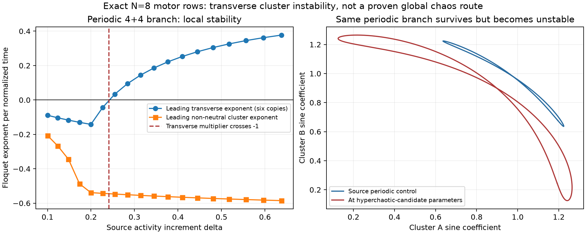

# How the periodic motor clusters lose transverse stability

The source's periodic four-plus-four cluster motion can be continued to the same parameters as the [eight-row hyperchaotic candidate](motor-rows-activity-path.md). It remains attracting **inside its five-dimensional cluster subspace**, but loses stability to differences between rows. At the candidate parameters it has **six independent expanding transverse directions**. This supplies a local mechanism clue for the collective dynamics; it does not prove a complete route from the periodic cycle to the observed hyperchaotic set.

These are new numerical observations in the existing Alouges et al. equations, obtained on 30 October 2026. No feedback law, forcing, coupling or state variable was added. Scientific priority remains unresolved; see the [primary priority audit](motor-rows-priority-audit.md).



The left panel separates perturbations that preserve both clusters from perturbations that split their rows. The right panel shows the continued periodic orbit, including where it is unstable in the full system. It is not a picture of the hyperchaotic trajectory.

## Exact restriction and transverse perturbations

Set $N=8$, with rows 1–4 in cluster A and rows 5–8 in cluster B. The exact five-state restriction is

```math
\begin{aligned}
h'&=[-\rho+r(1-Z)]h-rY, & Y'&=h(1-Z)-Y,\\
Z'&=hY-Z, & u'&=-u+hv, & v'&=-v-hu+b.
\end{aligned}
```

Its embedding in the [published row equations](motor-rows-source-audit.md) is

```math
\begin{aligned}
X_A&=(h-rY)/\rho,&X_B&=-X_A,\\
c_A&=1-Z+u,&c_B&=1-Z-u,\\
s_A&=v-Y,&s_B&=v+Y,\\
V_A&=-h,&V_B&=h.
\end{aligned}
```

The first three states form the already identified Oriola motor core. The two remaining population modes are driven by that core. This cluster restriction is an invariant subspace of the full 23-dimensional model, not a replacement for its general dynamics.

Consider perturbations whose sum vanishes within one cluster. They leave the mean response unchanged at linear order. Each independent row contrast obeys

```math
\frac{d}{d\tau}
\begin{pmatrix}\delta c\\\delta s\\\delta X\end{pmatrix}
=J_{\perp}(\tau)
\begin{pmatrix}\delta c\\\delta s\\\delta X\end{pmatrix},\qquad
J_{\perp}=
\begin{pmatrix}
-1&-V-rs&\rho s\\
V&-1+rc&-\rho c\\
0&r&-\rho
\end{pmatrix}.
```

There are three independent contrasts in each group of four. Thus the full tangent system decomposes into a five-state cluster block, three copies of the A block and three copies of the B block: $5+3\times3+3\times3=23$. A leading tangent vector of the whole system was not projected to estimate these exponents; the dedicated blocks were integrated directly.

On the computed cycle the clusters exchange after half a period. The corresponding base-state transformation is $(h,Y,Z,u,v)\mapsto(-h,-Y,Z,-u,v)$. The sampled identity agrees within $8\times10^{-13}$ at the endpoints. Accordingly, the A and B Floquet spectra coincide numerically. This spatiotemporal symmetry explains why each transverse multiplier has six copies in the full eight-row system.

## Source activity path and the crossing

All calculations keep $r=4.755146047751339$ and $b=1$, with the source Table 1 mechanical constants unchanged. Chemical activity follows $\Omega_{\rm src}=(1+\delta)\Omega_0$. The published positive control has $\delta=0.1$ and $\rho=3.580391273684344$. Increasing activity reduces $\rho$ while preserving $r$.

We first integrated a declared near-equilibrium cluster start $(h,Y,Z,u,v)=(0.02,0,0,0,1)$ for 300 normalized time units, then used section returns to initialize shooting. This is our explicit start, not a recovered random source seed. The phase condition is $h(0)=0$ with $h'(0)>0$. Eighteen continued cycles connect the source control to the candidate parameter point.

The initially stable transverse spectrum develops a negative real multiplier that crosses $-1$ at approximately

```math
\rho_*=3.37021839958,\qquad
\delta_*=0.24147384541,\qquad
T_*=3.34200881522.
```

A centered derivative gives $d m_{\perp}/d\rho\simeq6.7333191$. Halving the difference step from $10^{-4}$ to $5\times10^{-5}$ changes that estimate by about $8.2\times10^{-8}$. Radau independently reproduces the multiplier at the crossing and the near-unit flow multiplier. This is a resolved numerical crossing with nonzero slope.

It is a **symmetry-degenerate transverse flip candidate**: the multiplier $-1$ occurs six times in the full system. The generic theorem for a single simple flip multiplier cannot be applied without further work. We did not compute the nonlinear equivariant normal form, establish doubled branches, or demonstrate a period-doubling cascade.

At the same point as the independently checked hyperchaotic candidate,

```math
\rho=2.934090909090909,\qquad \delta=0.63797222637,
```

the periodic cycle has period $T=3.47405656015$. Its cluster-subspace Floquet exponents are approximately

```math
(0,-0.585054,-0.585054,-1,-1).
```

Each transverse block has multipliers

```math
(-3.707987645, 0.421614726, -0.010978186),
```

and Floquet exponents

```math
(0.377222,-0.248604,-1.298725).
```

The full periodic orbit therefore has six positive exponents, one neutral exponent and sixteen negative exponents. **These are exponents of the unstable periodic orbit.** They are not the six unequal positive Lyapunov exponents measured on the hyperchaotic candidate. The matching count makes transverse cluster breakup a useful hypothesis to investigate; it does not identify the global connecting dynamics or prove that the candidate is created at this crossing.

## Complete continued branch

All exponents below use the original normalized time $\tau$. The neutral flow exponent is omitted from the cluster column. Each transverse exponent listed has six copies.

| rho | Source delta | Period | Largest non-neutral cluster exponent | Largest transverse exponent |
| ---: | ---: | ---: | ---: | ---: |
| 3.580391274 | 0.100000 | 3.285893351 | -0.206663 | -0.089079 |
| 3.542373605 | 0.123738 | 3.295723868 | -0.267697 | -0.103685 |
| 3.504355937 | 0.148252 | 3.305692173 | -0.344839 | -0.117283 |
| 3.466338268 | 0.173578 | 3.315801242 | -0.487309 | -0.130000 |
| 3.428320600 | 0.199750 | 3.326054156 | -0.538733 | -0.141931 |
| 3.390302931 | 0.226808 | 3.336454103 | -0.542842 | -0.043767 |
| 3.352285263 | 0.254792 | 3.347004386 | -0.546864 | +0.033963 |
| 3.314267594 | 0.283744 | 3.357708424 | -0.550800 | +0.094596 |
| 3.276249926 | 0.313710 | 3.368569765 | -0.554646 | +0.144217 |
| 3.238232257 | 0.344738 | 3.379592086 | -0.558402 | +0.186008 |
| 3.200214589 | 0.376878 | 3.390779204 | -0.562068 | +0.221876 |
| 3.162196920 | 0.410184 | 3.402135080 | -0.565640 | +0.253062 |
| 3.124179252 | 0.444714 | 3.413663830 | -0.569119 | +0.280428 |
| 3.086161583 | 0.480527 | 3.425369731 | -0.572502 | +0.304598 |
| 3.048143915 | 0.517689 | 3.437257230 | -0.575789 | +0.326038 |
| 3.010126246 | 0.556267 | 3.449330956 | -0.578978 | +0.345109 |
| 2.972108578 | 0.596336 | 3.461595726 | -0.582066 | +0.362095 |
| 2.934090909 | 0.637972 | 3.474056560 | -0.585054 | +0.377222 |

## Validation and numerical limits

The [reproduction script](../research/analyze_motor_cluster_cycle.py) checks the five-state field against the independently implemented source force constraint, and checks both transverse embeddings against the full reduced Jacobian at 64 seeded random states. Maximum normalized errors are below $6.5\times10^{-15}$. These are algebraic implementation checks, not proofs of numerical bifurcation statements.

Periodic shooting uses DOP853 with relative tolerance $2\times10^{-11}$, absolute tolerance $2\times10^{-13}$ and maximum step 0.05. All 18 declared branch points completed. The largest achieved closure residual is $5.8\times10^{-12}$. The section remains transverse; $h'$ is about 1.23 at the source control and 2.25 at the target.

Independent Radau integrations check both the orbit and its variational matrices at the source control, target and refined crossing. Maximum DOP853/Radau transverse matrix discrepancy at the target is $2.8\times10^{-12}$. At the crossing, base closure is below $1.9\times10^{-14}$ and the complete augmented endpoint discrepancy is below $9.3\times10^{-13}$.

An additional integration of the complete **23-state field and 23-by-23 monodromy** verifies the repeated-block decomposition at both endpoint cycles. The matrix reconstruction errors are $5.1\times10^{-14}$ at the source control and $1.35\times10^{-12}$ at the target. The time-translation direction is checked separately through $M f(y_0)=f(y_0)$; its residual at the crossing is below $3.6\times10^{-14}$.

The branch stays inside the stated physical domain. Sampled row radii satisfy $c_j^2+s_j^2<2$, and the invariant-disk argument bounds the complete trajectories. The source rate harmonic amplitude is at most 0.025853, well below its nonnegativity limit of 0.5. The disk therefore bounds the reconstructed density throughout this branch within approximately $0.4741\leq\ell Q_j\leq0.5259$; saved samples give narrower bounds. No state clipping or fitted correction is used.

The three recorded blocks took about 14 seconds of CPU wall time in total, within the declared 600-second budget. There were no hidden failed shooting attempts or filtered branch points. Accuracy statements are numerical comparisons, not interval-arithmetic proofs of an exact bifurcation location.

## Reproduction and data

```bash
python research/analyze_motor_cluster_cycle.py
python research/analyze_motor_cluster_cycle.py --refine-and-plot
python research/analyze_motor_cluster_cycle.py --crossing-check
```

- [Initial continuation and complete solver records](../results/motor-rows/cluster-cycles/analysis.json).
- [Crossing refinement and independent variational checks](../results/motor-rows/cluster-cycles/refinement.json).
- [Independent crossing, slope and physical-path checks](../results/motor-rows/cluster-cycles/crossing-check.json).
- [Data and executed-source manifest](../results/motor-rows/cluster-cycles/manifest.json).

Each branch point retains the full physical cycle, five-state cycle and three monodromy matrices in an NPZ file. The original two executed script versions are archived and hash-matched to their records; the current script includes the final independent crossing check. No author implementation was executed or relicensed.

## References

1. F. Alouges et al., “Some mathematical models for flagellar activation mechanisms,” *Mathematical Models and Methods in Applied Sciences* **35**, 2395–2424 (2025). [DOI](https://doi.org/10.1142/S0218202525500423); [complete primary v2](https://arxiv.org/html/2409.03506v2). Published model and source controls.
2. D. Oriola et al., “Subharmonic oscillations of collective molecular motors,” *EPL* **107**, 18002 (2014). [DOI](https://doi.org/10.1209/0295-5075/107/18002). Existing two-row core; see the [exact equivalence audit](motor-pair-source-audit.md).
3. [Primary literature priority audit](motor-rows-priority-audit.md). Related sarcomere and collective cluster chaos already exists; novelty and the global mechanism remain open.
