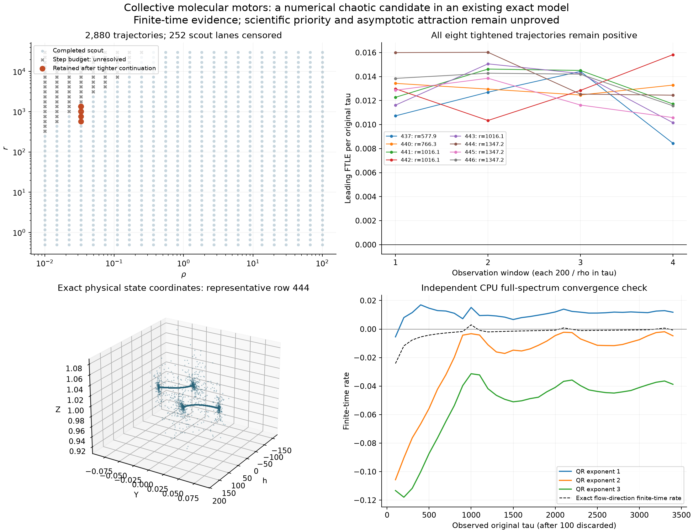
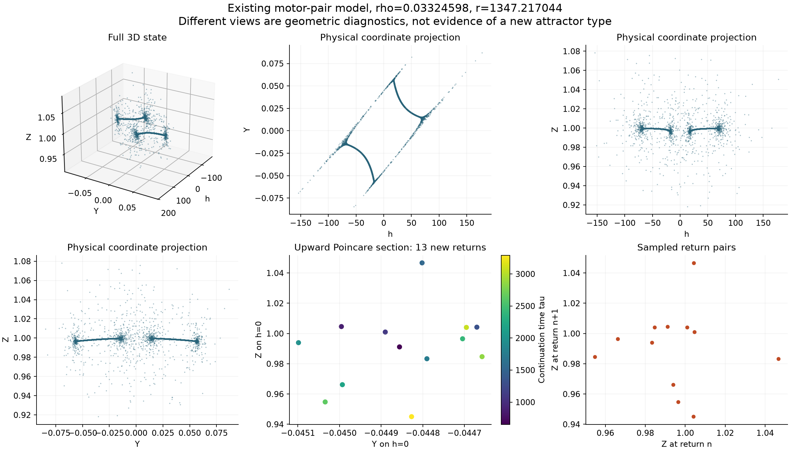

# A chaotic numerical candidate in the exact collective-motor model

Status: 30 October 2026. Eight trajectories retain positive leading finite-time Lyapunov estimates after a tighter, longer GPU continuation. An independent CPU calculation supports positive growth in one representative. **This is a numerical candidate in a previously published model, not a confirmed new attractor or a scientific-priority claim.**

The exact equations, their physical assumptions, equivalence to Oriola et al. (2014), and the published periodic control are documented in the [source audit](motor-pair-source-audit.md). The 2014 authors already investigated chaos and reported periodic/subharmonic behavior in the cases they checked. Our audit has not established that the present parameter tuples were covered, or that later work has not found similar behavior.

A subsequent [equation-level memory comparison](motor-memory-priority-audit.md) also identifies this core as the zero-inertia boundary of an established four-state trapped pilot-wave model. The located finite-inertia chaos results do not settle the boundary case, but this prior model connection further limits any claim of a new mechanism.



## What was actually computed

The survey used the exact three-state field, without extra forcing, delay, clipping or phenomenological feedback. For conditioning, the internal state was the constant linear transformation

```math
Q=h/r-Y,
\qquad
Q'=-\rho(Q+Y),
\qquad
Y'=r(Q+Y)(1-Z)-Y,
\qquad
Z'=r(Q+Y)Y-Z.
```

Tangents use the Euclidean norm in $(Q,Y,Z)$. Figures display the original $(h,Y,Z)$ coordinates. A constant invertible coordinate transformation preserves asymptotic exponents; finite-time estimates can depend on the norm.

The analytic invariant cylinder is $|Q|\leq1$ and $Y^2+(1-Z)^2\leq1$. The code checks it without projecting trajectories back inside. These bounds provide actual boundedness information for the model, but do not prove that a chaotic invariant set attracts the tested starts.

A logarithmic rectangle used 24 values of $\rho$ between 0.01 and 100, and 40 values of $r$ between 0.5 and 30,000. Each tuple had three explicitly declared starts, in $(Q,Y,Z)$:

```text
start 0: ( 0.01, 0.0, 0.0)
start 1: ( 0.20, 0.2, 0.5)
start 2: (-0.50, 0.3, 1.2)
```

The computational clock was $s=\min(1,\rho)\tau$. Every published exponent below is converted back to the original transition-rate time $\tau$. The scout discarded 200 units of $s$ and observed 400, split into four equal windows. It used FP64 adaptive Dormand–Prince 5(4), analytic tangent equations, relative tolerance $10^{-8}$, and a local Jacobian step cap. The per-lane cap was eight million attempted steps.

Of **2,880 trajectories**, **2,628 completed** and **252 exhausted the step budget**. The latter remain unresolved. They occur mainly in the slow, stiff part of the rectangle; they must not be drawn as regular regimes or used to delimit a chaos island. Eight completed scouts met the selection rule: mean leading estimate above 0.01, with every window above 0.005. Failure to meet that screening rule is not a proof of periodicity.

## Tightened continuation: all eight retained

All eight selected trajectories have $\rho=0.03324597932270942$. Their states and aligned tangents were carried into a new run that discarded another 400 units of $s$ and observed 800. The relative tolerance was reduced to $10^{-10}$ and the step cap halved. These are approximately **12,031.53 discarded and 24,063.06 observed units of original time**, following the scout. The combined endpoint is about 54,141.89 original time units after the declared initial start.

| Scout ID | Start | $r$ | Scout mean | Tightened mean | Smallest tightened window |
| ---: | ---: | ---: | ---: | ---: | ---: |
| 437 | 2 | 577.946280 | 0.011876 | 0.011574 | 0.008445 |
| 440 | 2 | 766.309432 | 0.012226 | 0.013036 | 0.012464 |
| 441 | 0 | 1016.063546 | 0.013384 | 0.013280 | 0.011714 |
| 442 | 1 | 1016.063546 | 0.014939 | 0.013000 | 0.010341 |
| 443 | 2 | 1016.063546 | 0.011862 | 0.012772 | 0.010160 |
| 444 | 0 | 1347.217044 | 0.015146 | 0.014251 | 0.012447 |
| 445 | 1 | 1347.217044 | 0.014618 | 0.012232 | 0.010582 |
| 446 | 2 | 1347.217044 | 0.012699 | 0.013472 | 0.011564 |

All **32 tightened windows** remain positive; their minimum is 0.00844486 per original time unit. Mean divergences are negative, between approximately −0.02708 and −0.01814. All three starts retain positive growth at the two largest listed $r$ values. Only one sampled $\rho$ column contains these retained cases, so this is not yet a verified open parameter neighborhood.

The first tightened run reached its 600-second wall budget with two completed and six partial trajectories. Its exact checkpoint is retained unchanged. The remaining six were continued without resetting states, tangents, clocks, step counts, observation boundaries, or accumulated logarithms. The two already completed lanes stayed bitwise unchanged. All eight then completed, using 20.5–32.0 million attempted steps each and about 767.34 seconds of total GPU wall time. There were no invariant-cylinder or numerical-failure statuses in this cohort.

Choosing $\Omega=0.2$ maps the four $r$ values to $\mu$ approximately 2,890–6,736, within the source's rough order-of-magnitude estimates. Shared physical dependencies still matter: this rectangular survey is not a calibrated apparatus or a prediction that a particular experiment will show chaos.

## Independent CPU check and its limits

Representative row 444 was checked independently in original time. A two-unit DOP853/Radau comparison integrated the full variational matrix; an additional implementation used Oriola's original Eq. (7) and transformed the result back. Across the saved-endpoint and original-start short controls, state differences were below $6\times10^{-13}$ and variational-matrix differences below $1.4\times10^{-10}$.

The saved scout endpoint then received 100 units of full-basis warmup and 400 observed units. This short observation contained only two upward $h=0$ returns. Its positive leading estimate was encouraging, but the full spectrum was not converged. The original-start 100+400 control was visibly transient and is retained separately; its temporarily positive second and third estimates are not interpreted as hyperchaos.

The first control did not save its final QR frame. To recover it honestly, only that representative saved-endpoint path was replayed deterministically: its final state and all three averaged QR logarithms matched the earlier record **exactly**. The recovered state and basis were then extended by another 3,000 original time units. Complete QR frames, accumulated logarithms, trace integrals and section data were saved every 100 units. No parameter grid was rerun.

Over the combined **3,400 observed time units**, the CPU QR estimates are

```math
(0.01179751,\;-0.00473578,\;-0.03875399).
```

Their sum agrees with the independently integrated divergence, −0.03169226, to about $6.7\times10^{-12}$. The variational image of the instantaneous flow was also checked against the actual vector field. Its accumulated rate, −0.000714657, agrees with the exact telescopic endpoint norm ratio to about $3.5\times10^{-14}$. The largest local flow-identity residual was about $5.4\times10^{-12}$.

This supports an independent positive leading rate of the same scale as the GPU estimate. It does **not** establish an asymptotic full spectrum. There were only 15 upward section returns, and the middle QR estimate still depends appreciably on the observation interval: the added 3,000 units alone give approximately $(0.011107,0.003502,-0.030573)$. The known flow direction must not be assigned a second positive asymptotic exponent from this finite interval. No Kaplan–Yorke dimension is reported from these unconverged values.

The resumed CPU path stays inside the invariant cylinder: sampled maximum $|Q|$ is 0.04550 and maximum $Y^2+(1-Z)^2$ is 0.012545. Original-start transients and this late trajectory have different sampled ranges and are not conflated.

## Geometry




These are actual three-dimensional state samples, not projections of a higher-dimensional model. The panels use the original variables, several projections, and the upward $h=0$ section. The rotating point cloud covers the final 2,000 units of the CPU path. Saved QR endpoints are approximately 0.05 units apart; the fastest excursions are sparsely sampled, so points are deliberately not joined by straight lines that would introduce artificial spikes. This sampling is insufficient to settle the detailed geometry. The section panel contains 13 new returns from the 3,000-unit extension; it is far too small a sample for a fractal-dimension or return-map topology claim.

The existing symmetry $(h,Y,Z)\mapsto(-h,-Y,Z)$ helps organize the shape. A distinctive-looking rotation is not evidence of a new dynamical mechanism or a geometrically new attractor class. The useful result here is repeatable positive growth in an exact, previously studied physical model, with boundedness, step refinement and independent solver checks.

Longer aligned spectra, additional returns, nearby parameter tests, basin/lifetime checks, and a deeper exact-model literature audit remain necessary. Long chaotic transients or an unstable chaotic set have not been excluded.

## Reproduction and evidence

From the repository root, with the normal project dependencies and an FP64 OpenCL device:

```bash
python research/motor_pair_gpu.py --validate
python research/motor_pair_gpu.py --regular-controls
python research/motor_pair_gpu.py --survey --output outputs/motor-scout.npz
python research/motor_pair_gpu.py --refine results/motor-pair/gpu-scout.npz --output outputs/motor-refined.npz --wall 600
python research/motor_pair_gpu_resume.py results/motor-pair/gpu-refined.npz outputs/motor-refined-complete.npz --wall 600
```

The resume command uses the **saved wall-censored checkpoint**, not a newly generated approximation to it. CPU reproduction and rendering are separate:

```bash
python research/check_motor_pair_gpu_candidate.py --index 444 --warm 100 --observe 400 --wall 300
python research/continue_motor_pair_cpu.py --index 444 --duration 3000 --wall 1000
python research/report_motor_pair_survey.py --gif
```

The latter CPU commands write their named results under `results/motor-pair/`; use a disposable checkout to preserve published records while reproducing them. The plotting script performs no integration.

- [Machine-readable summary](../results/motor-pair/gpu-summary.json), [short GPU validation](../results/motor-pair/gpu-validation.json), and [periodic/theorem-backed control gate](../results/motor-pair/gpu-regular-control-gate.json).
- [Scout metadata](../results/motor-pair/gpu-scout.json), [first tightened checkpoint](../results/motor-pair/gpu-refined.json), and [completed exact continuation](../results/motor-pair/gpu-refined-complete.json). Matching NPZ files retain individual trajectories' states, tangents, windows, clocks, statistics and statuses.
- [Initial independent CPU audit](../results/motor-pair/gpu-cpu-444.json) and [longer full-spectrum audit](../results/motor-pair/gpu-cpu-444-extended.json), with plot-ready NPZ trajectories, sections and complete QR checkpoints.
- [Archived scout driver](../results/motor-pair/source-versions/scout-driver.py) and [tightened driver](../results/motor-pair/source-versions/refinement-driver.py). The scout source was reconstructed by undoing the later refinement-cap argument and verified byte-for-byte after canonical LF normalization against the already stored SHA256. These are provenance copies; the runnable scripts remain under `research/`.

NPZ integrity uses exact-byte SHA256; text integrity uses explicitly declared CRLF-to-LF normalization for portable Git checkouts. Historical incomplete NPZ `mean_divergence_original` entries are partial integrals divided by the **requested** observation duration, so they are not valid means. Only status-zero values are used in this report. Partial raw logarithms and integrals are retained for exact continuation, not interpreted as completed observations.

## References

1. D. Oriola, H. Gadêlha, C. Blanch-Mercader, J. Casademunt, “Subharmonic oscillations of collective molecular motors,” *EPL* **107**, 18002 (2014). [DOI](https://doi.org/10.1209/0295-5075/107/18002).
2. F. Alouges, I. Anello, A. DeSimone, A. Lefebvre-Lepot, J. Levillain, “Some mathematical models for flagellar activation mechanisms,” *Mathematical Models and Methods in Applied Sciences* **35**, 2395–2424 (2025). [DOI](https://doi.org/10.1142/S0218202525500423); [arXiv v2](https://arxiv.org/html/2409.03506v2).
3. The [source/equivalence audit](motor-pair-source-audit.md) records additional primary sources, physical constraints, prior negative chaos checks and the unresolved priority limitations.
