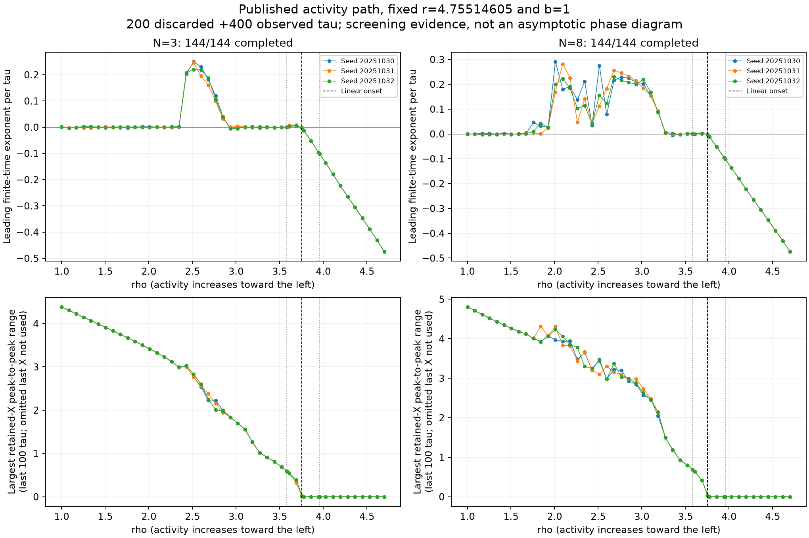
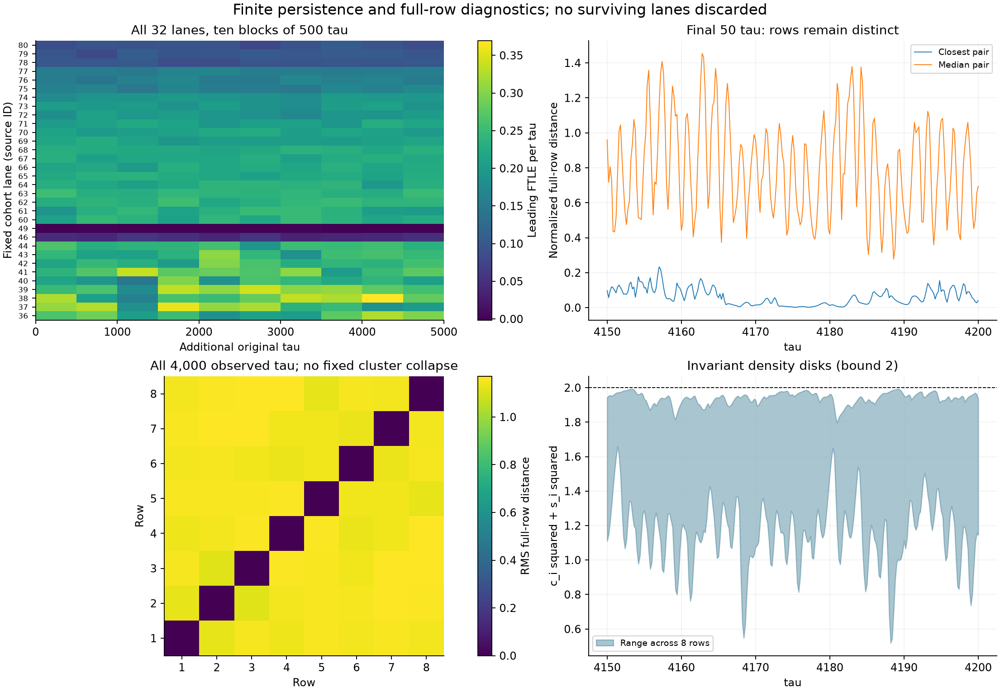
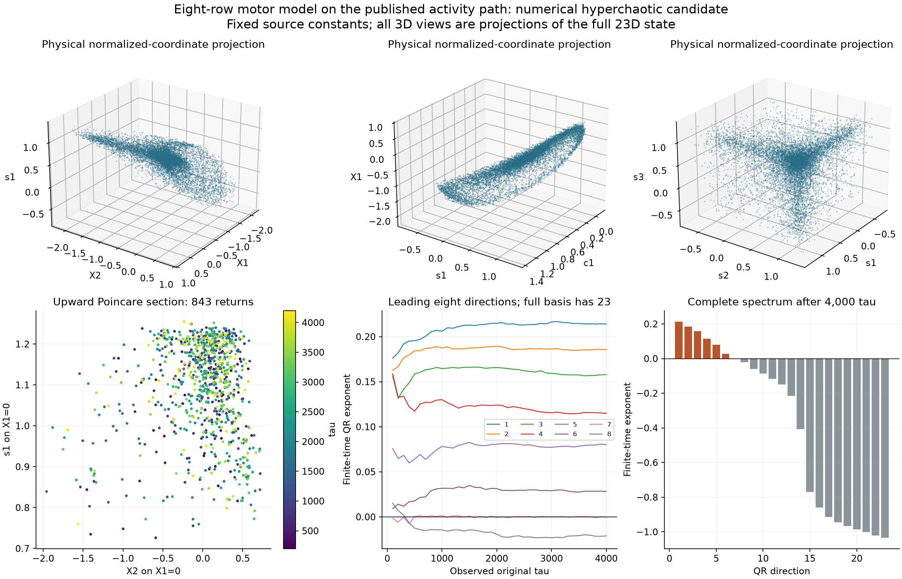
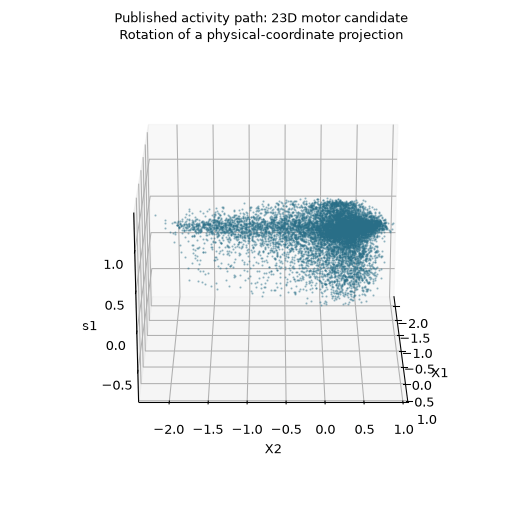

# Hyperchaotic numerical candidate along the published activity path

Status: 30 October 2026. The exact eight-row model of Alouges et al. gives a strong **numerical hyperchaotic candidate while only its prescribed chemical activity is changed**. All mechanical constants and the transition-rate coefficients' defining law remain those of the source. An independent 23-dimensional CPU calculation has six substantial positive finite-time exponents, a near-zero flow direction, and sixteen negative estimates. Scientific priority and an asymptotic attractor are not proved.

This follows the [exact model/source audit](motor-rows-source-audit.md). It addresses a more specific question than the earlier independent $(\rho,r)$ rectangle: can the phenomenon occur on the source's own one-parameter activity path?



## Keeping the source constants fixed

Section 3.1 of arXiv v2 defines $a_0=c\sqrt\Omega$ and $a_1=b_1=d\Omega$, with $d$ determined once by Eq. (65) at the chosen $\Omega_0$. Table 1 is held fixed. Under the normalization in our source audit,

```math
\Omega=\left(\frac{k}{\eta c\rho}\right)^2,
\qquad a_0=\frac{k}{\eta\rho},
\qquad A=B=\frac{d k}{\eta c^2\rho},
\qquad b=1,
```

```math
r=-\frac{2\pi^2 U d}{\eta\ell^2c^2}
=4.7551460477513405.
```

Thus changing activity moves $\rho$ while leaving $r$ fixed. The critical value is $\rho_0=r-1=3.75514604775134$. The source's two illustrated controls, $\delta=(\Omega-\Omega_0)/\Omega_0=\pm0.1$, are included exactly.

The same numerical activity convention that reproduces the source's printed $d=-56.4588$ is used: $\Omega_0=15k_BT=0.064002$ in its numerical nN nm convention. This is not a new experimental calibration of the rate law. For $\rho\in[1,4.7]$, the activity ranges from approximately 0.9025 to 0.0408556, corresponding to $\delta\in[-0.36165,13.10112]$. The full survey therefore extends well beyond the illustrated $\pm0.1$ interval.

The first-harmonic rates remain positive throughout: $|A|\sqrt2\leq0.0758526<1/2$. From the source's equilibrium-density starts, the invariant disks $c_j^2+s_j^2\leq2$ also keep the reconstructed densities positive. The exact activity, rates, density bounds and physical-time conversion for every tuple are retained in [mapping.json](../results/motor-rows/activity-path/mapping.json).

## Screen and tighter continuation

The grid contains 45 equally spaced $\rho$ values plus the exact below-onset, above-onset and critical control values: **48 distinct tuples**. Each has three source-style starts, with seeds 20251030–20251032. The Fourier densities start at equilibrium, $c_j=s_j=1$; absolute interior shifts are drawn uniformly from $[-0.01,0.01]$ nm, endpoints fixed, then differenced. These are declared seeds, not recovered source random draws.

All durations here are original normalized time $\tau=a_0t$. No slow-time multiplier is applied. The initial FP64 OpenCL calculation discarded 200 units and observed 400, using four windows, relative tolerance $10^{-9}$ and the validated analytic tangent equations. Every lane completed within the domain checks.

| System | State dimension | Scout trajectories | Preliminary positive | Retained after tighter continuation |
| --- | ---: | ---: | ---: | ---: |
| Three rows | 8 | 144 | 18 | 18 |
| Eight rows | 23 | 144 | 42 | 32 |

The screening rule is mean leading estimate above 0.005, with each of four windows above 0.001. All 60 selected states and aligned tangents were then continued: another 300 discarded and 1,200 observed units, tolerance $10^{-10}$ and half the step cap. No failures or censored trajectories occurred. The initial screen used about 21.65 GPU seconds; the tighter runs about 64.81 seconds.

All three starts at six consecutive sampled $\rho$ values, 2.42955–2.85, retained positive growth for three rows. Eight-row results span a wider sampled interval with gaps and start dependence. These counts are conditional numerical screening results, not probabilities or a complete phase diagram. In particular, subthreshold trajectories and the slowly converging critical point are not classified by exclusion.

The exact source controls behave consistently with the established implementation controls: below onset the mean estimates are approximately −0.10156; the source's above-onset oscillatory control gives estimates near zero. Their finite residuals are retained rather than rounded into exact zero.

## Eight-row persistence without pruning

All **32** retained eight-row trajectories were carried forward together for another **5,000 units**, in ten consecutive 500-unit blocks. No further warmup or basin selection was used, and no trajectory was removed after losing the screening threshold. Each block contains four 125-unit windows.

All 320 lane-block integrations completed. **31 of 32 trajectories remain above the screening thresholds in all 40 windows and all ten block means**, reaching a total of 7,100 units from their original starts. Among those 31, the smallest individual window is 0.0146712. Source lane 49 falls to estimates near zero and remains in every subsequent block; this is loss of sustained positive growth, not a certified periodic capture. It would require a separate return/closure check to identify its limiting motion.



The cohort is selected from earlier positive screens. Its 31/32 count is not an estimate of the fraction of physical initial conditions that are chaotic, a universal escape rate, or proof of infinite lifetime. [lifetime-summary.json](../results/motor-rows/activity-path/lifetime-summary.json) and each immutable block record preserve all IDs and outcomes.

## Independent full 23-dimensional spectrum

The representative is source lane 69, with

```math
(\rho,r,b)=(2.934090909090909,\;4.7551460477513405,\;1).
```

It corresponds to $\delta=0.63797223$, $\Omega=0.10483350$, $a_0=323.7800$ s⁻¹ and $A=B=-0.01828024$ under the source convention. Its activity is about 64% above the specified onset activity; the source's illustrated oscillatory control was 10% above it. The rate/density lower bound is 0.47414784 in normalized units.

The CPU check uses all 23 reduced states and the complete $23\times23$ variational basis. Before it, analytic Jacobians were checked by complex differentiation and the field was reconstructed independently from the source force-difference constraints. DOP853 and Radau agreed over two time units in the full state and an analytic tangent to about $2.4\times10^{-14}$; the independent force reconstruction agreed in state to $3.6\times10^{-15}$.

After 200 discarded units, the initial 1,000-unit full-spectrum record was preserved. Its exact endpoint, QR frame, accumulated logarithms, trace integral and flow-vector diagnostic were loaded for a further 3,000 units. The original JSON and NPZ remain unchanged. Complete checkpoints were saved every 100 units. The resulting **4,000-unit observed spectrum** begins

```math
(0.213909,\;0.185666,\;0.157829,\;0.114946,\;
0.080106,\;0.028208,\;-0.000331,\;-0.021117,\ldots).
```

All remaining estimates are negative. The first six stay positive separately in **each of the four consecutive 1,000-unit blocks**. For example, the sixth is 0.03177, 0.03099, 0.02446 and 0.02561. The near-zero seventh direction is not counted as an additional expanding direction when a shorter interval gives a tiny positive value.

The exact flow-vector finite-time rate is 0.000128929, consistent with the near-zero direction. It agrees with the telescopic vector-field norm ratio to about $9\times10^{-16}$. The sum of all 23 QR estimates agrees with the time-averaged divergence, −8.76809255, to $8.9\times10^{-14}$. Local QR conditioning and flow identities are retained in the records. There are **843 upward $X_1=0$ section returns**. The GPU representative's mean over the additional 5,000 units is 0.209217, consistent in scale with the independent CPU leading estimate.

These are strong numerical indications of hyperchaos: expansion in several independent tangent directions. They do not establish an exact asymptotic count of positive exponents or a mathematical attractor proof. No fractal dimension is inferred from these finite records.



## Geometry and row structure



Every three-dimensional view is a **projection of a 23-dimensional state**. The figures show normalized row shifts and motor Fourier coefficients, without inventing dimensional laboratory coordinates. The constraint on the sum of all eight shifts is retained exactly. Sampled points are not connected across unresolved motion; the rotation makes no topology or geometric-originality claim.

The calculation did not impose a cluster reduction. Over the 4,000 observed units, all 28 row-pair RMS distances lie between about 1.1155 and 1.1704, and every pair reaches a separation above 3.138. Thus this observed trajectory does not collapse into a fixed set of synchronized rows such as the source's illustrated two groups of four.

Temporary proximity does occur. The closest pair's identity changes 5,449 times in the saved samples. At a normalized full-row distance threshold of 0.01, 18,984 of 20,000 samples have eight separate connected components, and 1,016 have seven. At a looser threshold, more rows can form short-lived proximity groups. These threshold-graph diagnostics describe sampled similarity, including transitive chains; they do not prove invariant clusters, symbolic dynamics or a new mechanism.

The invariant density disks remain respected: maximum sampled $c_j^2+s_j^2=1.9967645<2$, and the reconstructed sum of row shifts remains below $9\times10^{-16}$ in magnitude. The model's boundedness argument comes from the exact equations, independently of the finite-time plot.

## Reproduction and remaining questions

A [separate periodic-cluster continuation](motor-cluster-transverse.md) locates a sixfold transverse multiplier crossing at approximately 24% above onset. The continued four-plus-four cycle has six unstable transverse directions at the present candidate parameters. This is a specific local mechanism clue, not a proof of the global route to hyperchaos or identification of its attracting set.

The driver is [motor_rows_activity_path.py](../research/motor_rows_activity_path.py). It uses the already validated shared N-row implementation without modifying that implementation. To preserve published outputs, reproduce in a disposable checkout or choose a new output directory:

```bash
python research/motor_rows_activity_path.py --prepare-only
python research/motor_rows_activity_path.py --wall 600
python research/motor_rows_activity_path.py --refine --wall 600
python research/motor_rows_activity_path.py --cpu-check 69 --wall 600
python research/motor_rows_activity_path.py --lifetime --wall 600
python research/motor_rows_activity_path.py --cpu-extend 69 --wall 600
python research/motor_rows_activity_path.py --postprocess --gif
```

The last command only processes saved data. [diagnostics-summary.json](../results/motor-rows/activity-path/diagnostics-summary.json) collects the convergence, persistence and row diagnostics, and portable source hashes. Raw NPZ files, the immutable initial CPU record, each persistence block, and the executed driver versions are retained under [activity-path](../results/motor-rows/activity-path). NPZ integrity uses exact-byte SHA256; the portable text manifest normalizes CRLF to LF. Historical checkpoint records also retain their original byte hashes.

The [collective-motor priority audit](motor-rows-priority-audit.md) did not verify an earlier positive-chaos result for this exact N-row model, but it does not establish its absence. Related sarcomere chaos was already published in 2010, and the source author's full 2025 thesis remains unread. Priority, basin structure, bifurcation routes, longer lifetimes and rigorous attraction remain open. The present contribution is reproducible numerical evidence on the prescribed activity path, with independent integration and full-spectrum controls.

## References

1. F. Alouges, I. Anello, A. DeSimone, A. Lefebvre-Lepot, J. Levillain, “Some mathematical models for flagellar activation mechanisms,” *Mathematical Models and Methods in Applied Sciences* **35**, 2395–2424 (2025). [DOI](https://doi.org/10.1142/S0218202525500423); [primary arXiv v2](https://arxiv.org/html/2409.03506v2). Equations (15), (16), (65), Table 1 and Section 3.5 define the model and activity path used here.
2. D. Oriola, H. Gadêlha, C. Blanch-Mercader, J. Casademunt, “Subharmonic oscillations of collective molecular motors,” *EPL* **107**, 18002 (2014). [DOI](https://doi.org/10.1209/0295-5075/107/18002). Prior two-row-equivalent work, including an explicit negative chaos check; not the same-dimensional N-row calculation.
3. The [N-row source audit](motor-rows-source-audit.md) and [two-row equivalence audit](motor-pair-source-audit.md) record the physical assumptions, numerical controls, related primary literature and unresolved priority scope.
