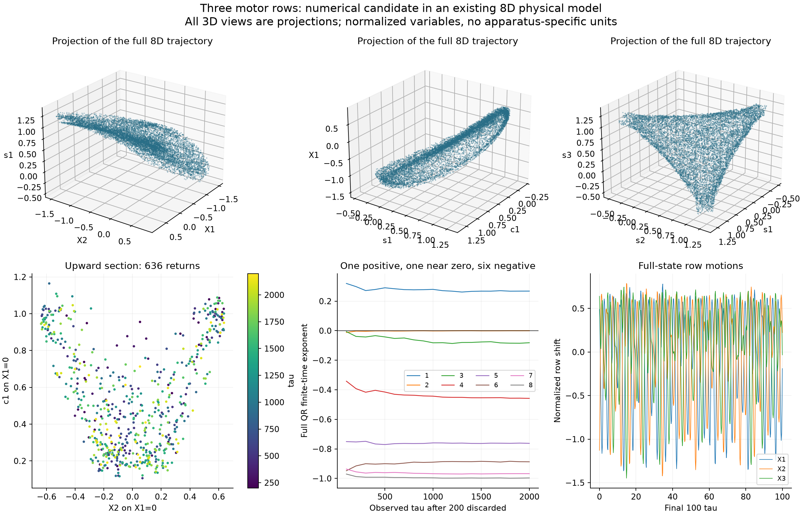
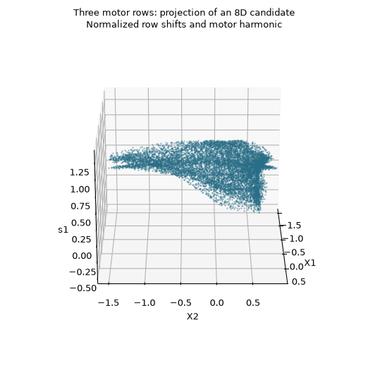

# Collective motor rows: a numerically supported chaos candidate

The strongest result is a bounded, persistently irregular regime of the **published three-row motor model**, at

```math
N=3,\qquad \rho=4.609100387635,\qquad r=7.026038245590061,\qquad b=1.
```

Three seeded starts retain substantial positive finite-time growth under longer, tighter GPU integration. An independent CPU calculation of the complete eight-dimensional Lyapunov spectrum gives one positive exponent, one near zero and six negative exponents. The rows remain distinct rather than settling into a fixed two-plus-one cluster.

This is a **numerically supported candidate in an existing model**. Its scientific priority is unverified. Finite-time computations, including the long continuations below, do not prove an asymptotic strange attractor. The model, parameter search, unsuccessful candidates and numerical limits are retained together.



## What the system represents

The source describes molecular motor populations driving relative sliding between elastically coupled rows. Constant total transition rate and a cosine motor potential yield an exact first-harmonic closure of the population equations. Mechanical force balance supplies the mean coupling; it is not an added feedback term selected for this search.

For row $j$, $c_j$ and $s_j$ are normalized cosine and sine population coefficients, and $X_j$ is normalized relative displacement. With $\bar s$ denoting the row mean, the implemented equations are

```math
V_j=-\rho X_j+r(s_j-\bar s),\qquad
c_j'=-c_j-V_js_j+1,\qquad
s_j'=-s_j+V_jc_j+b,\qquad
X_j'=V_j,\qquad \sum_jX_j=0.
```

Time is the dimensionless source time $\tau$. Eliminating the last displacement gives $3N-1$ independent states: eight for three rows, eleven for four, and twenty-three for eight. The [source audit](motor-rows-source-audit.md) derives the normalization, independent force-constraint reconstruction, Jacobian, invariant bounds, source parameters and initial-condition mapping.

All searches here fix $b=1$. They vary dimensionless ratios independently, so they cover a broader family than the source's single calibrated activity path. Admissible transition-rate amplitudes can still be chosen within that family: for example $A=-0.1$ satisfies $|A|\sqrt{2}\lt1/2$. This does not turn the exploratory tuples into predictions for a particular apparatus.

## Search and verification

The first survey used an NVIDIA GTX 1080 through OpenCL with FP64 arithmetic. It covered 16 logarithmically spaced values of $\rho$ from 0.03 to 10 and 20 values of $r/(\rho+1)$ from 1.05 to 30, with three declared seeded starts at each tuple. The starts follow the source prescription of equilibrium populations and small random **absolute** shifts; relative displacements are then obtained by differencing fixed-endpoint positions.

| Rows | Independent states | Completed lanes | Wall-censored lanes | Preliminary positive lanes |
| ---: | ---: | ---: | ---: | ---: |
| 3 | 8 | 954 | 6 | 40 |
| 4 | 11 | 945 | 15 | 175 |
| 8 | 23 | 861 | 99 | 272 |

These are trajectories at parameter/start combinations, not counts of distinct attractors. None of the 2,880 lanes failed a numerical or invariant-domain check. The 120 wall-censored lanes remain unresolved. Four-row and eight-row positives have screening-level evidence only.

The scout discarded 100 and observed 300 units of computational time $s=\min(1,\rho)\tau$. Every saved exponent is converted to original $\tau$. The preliminary rule required all four original-time windows to exceed 0.001 and their mean to exceed 0.005. This arbitrary screening cutoff is documented; values below it do not prove absence of chaos.

Before the survey, nine short state/tangent controls across three dimensions and stiff parameter choices agreed with independent DOP853 and Radau solutions. The largest GPU state difference was about $2.04\times10^{-10}$. Both published eight-row source regimes were also checked to $\tau=300$: the oscillatory control differed from independent Radau by $5.05\times10^{-11}$, and the resting control by $2.22\times10^{-14}$. The [validation record](../results/motor-rows/gpu-validation.json) retains these results.

All forty three-row positives then continued from their saved states and aligned tangents, with an additional 300 discarded and 1,200 observed units of **original** time, requested relative tolerance $10^{-10}$ and half the scout's step cap. All completed. Twenty-four lanes across nine tuples retained the four-window screen; sixteen weaker candidates relaxed to near-zero or mixed-sign windows. No candidate or failed check was silently discarded. The [refinement data](../results/motor-rows/gpu-refined-N3.npz) and [metadata](../results/motor-rows/gpu-refined-N3.json) preserve the complete cohort.

The final-quarter distances between each pair of full row states $(c_j,s_j,X_j)$ remained macroscopic for the twenty-four retained lanes. For the strongest tuple, all three pair RMS distances were approximately 1.27–1.42. This rules out a fixed two-plus-one collapse at the observed numerical resolution; it does not rule out close approaches, changing approximate clusters, or a different lower-dimensional description.

## A fixed-cohort long continuation

All twenty-four retained lanes subsequently continued for **another 10,000 original time units**, without new starts, additional warm-up or removal of weaker trajectories. The existing aligned tangent vectors were carried forward. The run used the same tighter tolerance and half step cap and completed in about 314 GPU seconds, within its 900-second limit. Twenty separate 500-time-unit blocks preserve the state, tangent, four growth windows, numerical status and row-distance statistics at every checkpoint.

At the strongest tuple, the results are:

| Original scout start ID | Mean exponent over the additional 10,000 | Smallest of 80 consecutive 125-unit windows |
| ---: | ---: | ---: |
| 783 | 0.25649 | 0.18933 |
| 784 | 0.26034 | 0.18058 |
| 785 | 0.25689 | 0.15491 |

All eighty windows remain positive for each of these starts. This makes a short transient explanation less plausible, while remaining a finite-time result.

The complete cohort gives a more qualified picture. Twenty-two lanes remain above 0.005 cumulatively, and twenty-one exceed 0.005 over the final 2,000 units. Starts 483 and 485, at approximately $\rho=0.665,r=2.085$, relax to near-zero growth; start 291 weakens substantially late in the run. These outcomes remain in the data. Negative short windows alone also do not exclude chaos, so the full histories matter more than a single screening count.

There are no numerical or domain failures. The largest motor-disk radius squared is below 1.999, and the largest observed relative-displacement magnitude is about 7.26 across the cohort. Row-pair ranges were recorded at accepted endpoints in the **last 125 units of each block**; they show no fixed pair collapse in those sampled windows. They do not continuously cover the entire continuation.

The [manifest](../results/motor-rows/lifetimes/manifest.json), [all block histories](../results/motor-rows/lifetimes/summary.json) and [derived analysis](../results/motor-rows/lifetimes/analysis.json) preserve the fixed cohort, original clocks, initial endpoints, tolerances, source hashes and downgraded candidates. Longer trajectories reduce one concern; they do not prove asymptotic attraction, uniqueness of a basin, or priority over unpublished or unlocated work.

## Independent full-spectrum evidence

The separate CPU calculation starts from scout row 783, discards another 200 and observes 2,000 original time units. It integrates all eight tangent directions, with QR reorthogonalization, and cross-checks the short augmented trajectory against DOP853 and Radau. Its final finite-time spectrum is approximately

```math
(0.26795,\;-0.00014,\;-0.08156,\;-0.45801,\;-0.76242,\;-0.88742,\;-0.96765,\;-0.99672).
```

The sum matches integrated divergence to $1.96\times10^{-14}$, while the independently tracked flow direction has exponent $0.000116$, consistent with the neutral direction expected in a nonstationary autonomous flow. There are 636 upward returns to $X_1=0$. The maximum sampled motor-disk radius squared is below 1.974, within the exact bound 2. The eliminated displacement preserves the sum constraint.

These checks support a dissipative chaotic candidate, with one expanding direction. They do not establish hyperchaos. The finite-time Kaplan–Yorke estimate is approximately **3.41**, which is a numerical descriptor rather than a rigorous dimension calculation. Full settings, local identity checks, solver limits and data are in [the independent CPU record](../results/motor-rows/cpu-candidate-N3-783.json).

## What the pictures show

Every three-dimensional picture is a **projection of the eight-dimensional state**. The curved triangular envelope in $(s_1,s_2,s_3)$ is visually interesting, and the $(X_1,X_2,s_1)$ view displays a folded sheet. The figures use the source's physical normalized coordinates.

The equations are symmetric under permutation of the three rows. In the saved trajectory, only about 3.58% of the total variance of $(s_1,s_2,s_3)$ lies along the fixed common-mode direction $(1,1,1)/\sqrt{3}$. The contrast directions dominate. This is consistent with a flattened, permutation-symmetric envelope, but the common mode is not conserved: its row mean ranges from about 0.583 to 0.941. The [derived geometry summary](../results/motor-rows/cpu-candidate-N3-783-summary.json) records the calculation and its sampling convention.



An unusual projection is not a proof of new topology. The full system has no equilibrium homoclinic orbit above its Hopf threshold, as derived in the source audit, but periodic-orbit connections and other mechanisms remain possible. No specific global route to chaos has yet been established.

## Reproduction and provenance

The main files are [motor_rows.py](../research/motor_rows.py), [motor_rows_gpu.py](../research/motor_rows_gpu.py), [the OpenCL kernel](../research/motor_rows_gpu.cl), [refine_motor_rows.py](../research/refine_motor_rows.py), and the independent [CPU checker](../research/check_motor_rows_candidate.py). They use NumPy, SciPy and PyOpenCL; figures use Matplotlib and Pillow. The model implementation is independent and does not execute author code.

```bash
python research/motor_rows.py --audit-output outputs/motor-rows-algebra.json
python research/motor_rows.py --control-output outputs/motor-rows-controls.json
python research/motor_rows_gpu.py validate
python research/motor_rows_gpu.py survey --wall 600
python research/refine_motor_rows.py
python research/extend_motor_rows_lifetimes.py --wall 900
python research/check_motor_rows_candidate.py --n 3 --index 783 --warm 200 --observe 2000 --wall 600
```

The exact executed scout driver and kernel are preserved in [source-versions](../results/motor-rows/source-versions/scout-source-manifest.json); their canonical LF hashes match every scout metadata file. Restoring those files under their original research paths reproduces the historical scout implementation. The current driver additionally supports original-time runs and row-distance diagnostics. Files under `results` retain all completed, non-confirmed and incomplete trajectories and settings.

## References and priority

1. F. Alouges, I. Anello, A. DeSimone, A. Lefebvre-Lepot, J. Levillain, “Some mathematical models for flagellar activation mechanisms,” *Mathematical Models and Methods in Applied Sciences* **35**, 2395–2424 (2025). [DOI](https://doi.org/10.1142/S0218202525500423); [complete primary arXiv v2](https://arxiv.org/html/2409.03506v2).
2. D. Oriola, H. Gadêlha, C. Blanch-Mercader, J. Casademunt, “Subharmonic oscillations of collective molecular motors,” *EPL* **107**, 18002 (2014). [DOI](https://doi.org/10.1209/0295-5075/107/18002). The two-row core and complex periodic behavior already appear here; it explicitly discusses an unsuccessful search for chaos.

The bounded primary-source, equivalent-model and forward-citation audit is in the [source report](motor-rows-source-audit.md), [collective-motor priority review](motor-rows-priority-audit.md) and [two-row priority record](motor-pair-source-audit.md). Related sarcomere chaos was published in 2010; the full 2025 thesis remains an important access gap. The retrieved full 2025 article contains no identified chaos demonstration for these N-row equations. This is evidence about the inspected material, not proof that no earlier or later equivalent result exists. The new numerical observations should not yet be advertised as a confirmed scientific discovery.

An [exact memory representation and energy balance](motor-rows-memory-structure.md) further explain the source feedback and establish a sufficient convergence-to-rest region. That region does not contain the candidate, and these derivations do not claim a new mechanism or mathematical priority.
