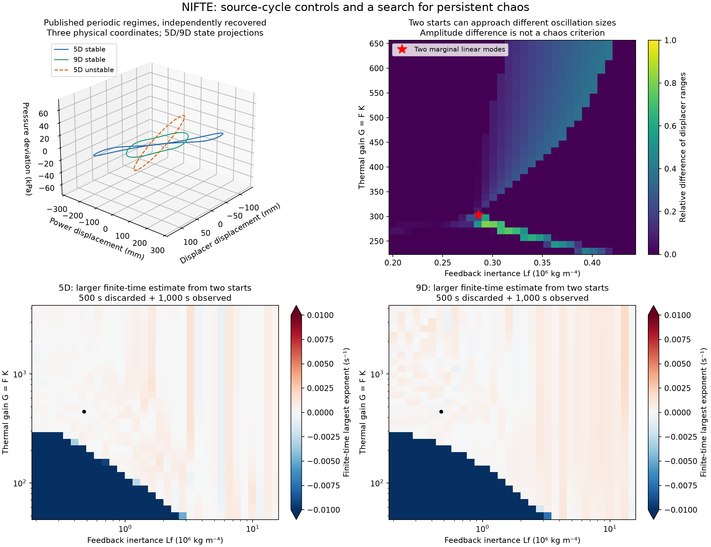
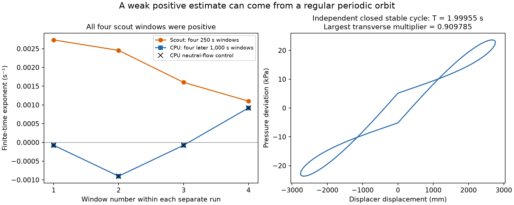

# NIFTE: a two-mode heat engine, with no validated chaos candidate

Research date: 30 October 2026. **The five-state and nine-state published NIFTE models reproduce their reported periodic regimes, but our searches have not produced a validated chaotic attractor.** The useful results are reproducible negative evidence, an exact reduction of redundant parameters, and a precise local description of competing oscillation modes. None is presented as a first discovery of thermofluidic chaos.



The upper-left curves are periodic orbits, including an unstable one. They are projections of five- or nine-dimensional state spaces. The other panels show parameter space. Near-zero finite-time exponents and different oscillation amplitudes do not establish chaos or a new attractor type.

## The physical idea and the exact implementation

The non-inertive-feedback thermofluidic engine uses heat to sustain liquid/vapor motion. Its electrical analogy contains pressure compliances, fluid inertances and flow resistances. A smooth, saturating thermal profile supplies the nonlinear feedback [1,2].

We implement Wang, Markides and Chachuat's NTP equations (5D) and their complete four-pair thermal-loss network, NTP-TL (9D). The loss model adds **four** independent states. It is not replaced by a single relaxation variable. The literal equations, parameter table and source transcription checks are in the [source screening note](physical-candidate-screening.md); the [physical audit](nifte-physical-priority-audit.md) explains which component changes require additional apparatus calibration.

State coordinates are `(p,d,q,u,v)` and, for NTP-TL, four loss-capacitor coordinates. Pressure and flow retain the source scales `P0=101300 Pa`, `U0=8e-4 m^3/s`. Our integration time is **physical seconds**, rather than the source's `t/5 s`. Signed pressure deviations and signed flows are permitted. They are not concentrations to be clipped at zero.

Both systems have the form

```math
\dot X=A X+bF\tanh(Kd).
```

The component matrix is assembled directly from the equations. An independent dimensional implementation instead solves the two-by-two hydraulic mass balance before rescaling. The analytic Jacobian, independent mass balance, odd symmetry and constant divergence pass 128 randomized checks with maximum scaled discrepancy below `3e-13`. Independent DOP853 and Radau trajectories also agree. Six GPU controls check both state dimensions against Radau state/tangent integration, including zero-input cases checked with a matrix exponential; the largest discrepancy is below `5e-11`. See [CPU checks](../results/nifte/validation.json) and [GPU checks](../results/nifte/gpu-validation.json).

## Recovered published cycles

For these controls only `Lf` changes from the nominal `4.74e6` to `4.74e5`; the remaining source parameters are unchanged. Initial states and the unstable-cycle shooting seed are our choices because the complete cycle states were not supplied by the article.

| Exact model | Regime | Our period, seconds | Source period | Largest transverse multiplier modulus |
|---|---|---:|---:|---:|
| NTP, 5D | Stable cycle | 1.3081459983 | 1.31 in Table 3; 1.30 in prose | 0.5559680 |
| NTP, 5D | Unstable cycle | 0.8799959632 | 0.88 | 1.2645210 |
| NTP-TL, 9D | Stable cycle | 1.6906670800 | 1.69 | 0.4665259 |

Newton shooting closes the cycles, followed by independent Radau checks using the dimensional mass balance. Closure errors are below `3e-15`. For the unstable cycle, a second monodromy calculation uses the complex-step Jacobian of that independent balance; its multipliers agree with the analytic implementation below `1e-14`. A section check excludes a shorter period. The unstable orbit is a control, **not an attractor**: nearby perturbations have a pair of growing directions.

The printed Floquet multipliers are close but not identical to ours. For example, the stable five-state complex pair is `-0.47159701 ± 0.29444299 i`, while the source gives `-0.4704 ± 0.2959 i`. The largest unstable-cycle multiplier difference is approximately `0.00524`. Source integration/shooting tolerances and a higher-precision parameter table were not recovered. We leave this discrepancy unresolved rather than fit parameters or call it exact multiplier reproduction. See the [source precision audit](nifte-structural-audit.md#verification-and-source-precision).

The nine-state monodromy has extremely small contracting modes. Its direct FP64 determinant is about `1.3e-43`, whereas the exact constant-divergence Liouville value is about `9.1e-155`. **The direct determinant and smallest multiplier relative accuracies are unresolved.** The dominant multipliers and orbit closure do not justify treating those tiny numerical eigenvalues as accurate.

Data: [stable 5D](../results/nifte/source-5d-cycle.json), [unstable 5D](../results/nifte/source-5d-unstable-cycle.json), [stable 9D](../results/nifte/source-9d-cycle.json), with adjacent NPZ files containing trajectories, section states and multipliers.

## Parameter searches

All scouts use the GTX 1080, FP64 adaptive Dormand–Prince 5(4), analytic tangent equations, relative tolerance `1e-8`, absolute tolerance `1e-11`, maximum step `0.02 s`, a `500 s` discarded transient and `1000 s` observation split into four windows. Two explicit starts are retained per parameter tuple. The numerical magnitude cutoff `1e6` is not a physical vessel boundary.

The thermal amplitude stays `F=1.37`. We vary `G=FK` by setting `K=G/F`, because varying both independently duplicates dynamics after an exact amplitude scaling.

| Survey | Model | Parameter tuples × starts | Parameter domain | Largest scout mean, s⁻¹ |
|---|---|---:|---|---:|
| Broad gain/inertance grid | 5D | 1024 × 2 | Log grids: `Lf=2e5…1.5e7`, `G=50…4000` | 0.001416 |
| Broad gain/inertance grid | 9D | 1024 × 2 | Same component/gain grid | 0.001983 |
| Two-mode neighborhood | 5D | 1024 × 2 | Linear grids: `Lf=2e5…4.4e5`, `G=230…650` | 0.000493 |
| Random native components | 5D | 2048 × 2 | Nine varied component/gain quantities below | 0.003178 |
| Random native components | 9D | 2048 × 2 | Same sampled native components; all four loss pairs retained | 0.002612 |

All **14,336 scout trajectories completed**. None passed the preliminary criterion `mean > 0.01/s` and every window `> 0.005/s`. This criterion alone would miss weaker chaos, so the follow-up selection also includes **every trajectory with all four windows positive**, however small, plus the largest 24 means in each survey.

The random samples use seed `2026103008`, log-uniform independent factors relative to nominal: `Rf,Rl` in `0.1…10`, `Rth` in `0.2…5`, `Lf` in `0.02…4`, `Lp` in `0.25…4`, and `Cad,Cd,Cp` in `0.5…2`; gain is log-uniform `50…5000`. `Ld,Ll`, fluid scales and the four thermal-loss RC pairs stay nominal. These are exact model-component variations, **not experimentally calibrated redesigned engines**. All sampled vectors and starts are stored.

The **984 selected follow-ups** discard another `2000 s` and request `8000 s` of observation, starting at the saved scout endpoints with warmed new tangents. Tolerances are tightened to `rtol=1e-10`, `atol=1e-13`, and maximum step `0.01 s`. The cap is four million accepted plus rejected step attempts per trajectory.

| Follow-up cohort | Requested | Completed | Step-budget unresolved | Largest completed mean, s⁻¹ | All four windows still positive |
|---|---:|---:|---:|---:|---:|
| Broad 5D | 132 | 129 | 3 | 0.0001373 | 4 |
| Broad 9D | 168 | 27 | 141 | 0.0000235 | 0 |
| Focused 5D | 153 | 153 | 0 | 0.0000585 | 6 |
| Random 5D | 270 | 218 | 52 | 0.0002589 | 10 |
| Random 9D | 261 | 32 | 229 | 0.0002239 | 2 |

**559 completed; 425 stopped at the step budget.** No completed run passed the weaker retention criterion `mean > 0.001/s` and every window `> 0.0005/s`. Twenty-two completed runs still have tiny positive values in every window; the threshold result is not a proof that all their asymptotic exponents are nonpositive. Their evidence is weaker than a validated chaotic candidate, and only the specific independently closed cases below are identified as periodic. Incomplete runs have endpoints, tangents, elapsed times and step counts, but no complete observation exponent; their partial window-log sums were not retained and must not be combined as a full measurement.

No trajectory is counted as negative merely because it reached a numerical budget. See the [machine-readable summary](../results/nifte/summary.json) and each adjacent survey/refinement JSON/NPZ pair. Scouts took about 204 GPU wall seconds and follow-ups about 1078 seconds on the GTX 1080; these are run timings, not a controlled CPU-versus-GPU speedup benchmark.

Six step-budget endpoints received a separate CPU investigation: all three on the broad 5D grid, two random 5D cases and one broad 9D case, selected by the strongest original minimum window. All six closed as stable periodic orbits, with independent mass-balance Radau errors below `1.4e-14` and maximum transverse multiplier at most `0.918266`. This resolves those particular saved endpoints without converting their unfinished GPU intervals into completed measurements. The other **419 budget cases remain dynamically unclassified**. Selection, file hashes, trajectories and multipliers are in [the endpoint-control record](../results/nifte/budget-endpoint-controls.json).

### A weak positive signal independently identified as a cycle

Random 5D row 215 had the largest minimum over its four scout windows: all four were positive, with a mean of `0.00197339/s`. An independent CPU calculation discarded another `1000 s`, warmed the full tangent basis, and observed `4000 s` with QR every `0.5 s`. The spectrum was approximately

```math
(-0.00003327,-0.0472841,-0.0478274,-0.955759,-0.955909)\ \mathrm{s}^{-1}.
```

Its sum agrees with the constant divergence within `4e-11/s`. The leading window estimates match a separately propagated neutral flow vector within `1.1e-10/s`, including a positive final window. This finite-interval expansion comes from the changing speed along the orbit.

Newton shooting then closed a stable periodic orbit with `T=1.9995486235 s`; an independent dimensional-mass Radau integration closed it within `3e-15`. The largest transverse multiplier is `0.9097851`. The Floquet exponents have one exact neutral direction and four negative directions. Thus this saved endpoint supports a regular cycle, not chaos. Its several-metre displacement reconstruction also illustrates why random component samples are mathematical controls rather than a calibrated apparatus prediction.



See [CPU spectrum settings](../results/nifte/cpu-row215-spectrum.json), [cycle verification](../results/nifte/cpu-row215-cycle.json), and the adjacent arrays. The graph compares separate windows from the scout and later CPU run; it is not a single continuous estimate.

## What the mathematics adds

The [structural audit](nifte-structural-audit.md) contains the derivations and executable checks.

- **One thermal gain controls the dynamics.** Setting `X=F Y` gives a system depending on `F,K` only through `G=FK`. Periods and Lyapunov exponents are unchanged under the corresponding amplitude scaling. Physical excursions still change.
- **Two competing modes meet at a concrete point.** With the other components nominal, `Lf≈286255.18318` and `G≈302.87167639` give eigenvalues `-4.00681552`, `±5.17564246i` and `±7.34206644i`. This is a numerically located double-Hopf candidate with a checked two-parameter unfolding.
- **The local cubic expansion predicts competition.** Its two radial-mode self coefficients are negative, but the mixed-mode coefficient matrix has negative determinant. A mixed positive-amplitude solution is a saddle at this order. This supports competing periodic states rather than a locally attracting mixed torus; it does not exclude distant chaotic regimes. The source already reported coexistence of stable cycles.
- **Mathematical boundedness is available.** The zero-input passive component matrix is Hurwitz by its stored-energy balance. The actual `tanh` drive is bounded, giving an ultimate bound by variation of constants. This is stronger than a finite numerical escape check, but it does not certify physical cylinder clearances.
- **There is a unique equilibrium and an exact sign symmetry.** The state inversion `X→-X` preserves the equations. A rotated, stretched or symmetry-related view of a known orbit is not a new dynamical mechanism.

The upper-right figure shows different displacer ranges from two starts at some identical parameter values. Finite-time range differences are consistent with the known multiple-regime structure, but they are not independent proof of two asymptotic attractors at every colored pixel.

## Physical and novelty limits

The [physical audit](nifte-physical-priority-audit.md) supplies pressure/interface conversions, component-to-geometry relations and unresolved source conventions. With the nominal working fluid, `d=0.01` already represents roughly `166 mm` of interface displacement. Published exchanger heights are not mechanical stroke limits. Independent variation of resistance, inertance and compliance may require changing tube dimensions, fill levels or the thermal-loss calibration together.

The three recovered source cycles have positive reconstructed absolute pressure. A conditional cylindrical vapor-volume reconstruction also remains positive along them. In contrast, 878 scout trajectories have nonpositive reconstructed absolute pressure during observation (64 on the broad 5D grid, 814 in the random 5D sample). Those are inadmissible under that pressure convention regardless of their mathematical behavior. These are limited diagnostics; missing vessel clearances and the validity of laminar drag/linear compliance still prevent a complete operating-envelope claim.

The exact equations belong to the established Lur'e family of a linear network with static saturating feedback. `tanh` feedback is not a new mechanism. Thermoacoustic chaos was reported decades ago [3]. Our bounded primary-source and citation search did not verify a chaos demonstration in these exact NTP equations, but did not establish its absence either. Wang's thesis PDF remains inaccessible after ordinary retries; that priority gap is recorded explicitly.

The defensible outcome is **a checked model, recovered known cycles, a structured negative search and a concrete local mode-interaction calculation**. No new chaotic attractor, experimental prediction, global no-chaos theorem or confirmed publication gap is claimed.

## Reproduction

From the repository root with its Python/OpenCL dependencies installed:

```bash
python research/nifte.py
python research/nifte.py --control
python research/nifte.py --control --loss
python research/check_nifte_cycle.py
python research/check_nifte_cycle.py --loss
python research/nifte_unstable_cycle.py
python research/audit_nifte_structure.py
python research/nifte_gpu.py --controls
python research/nifte_gpu.py --resolution 32
python research/nifte_gpu.py --resolution 32 --loss
python research/nifte_gpu.py --resolution 32 --focus
python research/nifte_gpu.py --random-tuples 2048
python research/nifte_gpu.py --random-tuples 2048 --loss
python research/nifte_gpu.py --refine results/nifte/scout-5d.npz
python research/check_nifte_spectrum.py --row 215
python research/check_nifte_budget_endpoints.py
python research/summarize_nifte.py
python research/plot_nifte.py
```

Run the same `--refine` command for the other four survey NPZ files. Model files and kernels are resolved relative to their scripts; numerical outputs are under `results/nifte`. CPU orbit checks use SciPy. Mass searches require an FP64-capable OpenCL GPU. Saved data are not author-provided trajectories; they were generated by this project's independent implementation.

## References

1. Wang, Y., Markides, C. N., and Chachuat, B. (2019). Optimization-based investigations of a two-phase thermofluidic oscillator for low-grade heat conversion. *BMC Chemical Engineering* **1**, 20. [Primary article](https://doi.org/10.1186/s42480-019-0019-3). Equations 7–8, Tables 2–3 and cycle-multiplicity discussion; CC BY 4.0.
2. Markides, C. N., Osuolale, A., Solanki, R., and Stan, G.-B. V. (2013). Nonlinear heat transfer processes in a two-phase thermofluidic oscillator. *Applied Energy* **104**, 958–977. [DOI](https://doi.org/10.1016/j.apenergy.2012.11.056).
3. Yazaki, T. (1993). Experimental observation of thermoacoustic turbulence and universal properties at the quasiperiodic transition to chaos. *Physical Review E* **48**, 1806–1818. [Primary abstract](https://doi.org/10.1103/PhysRevE.48.1806). This excludes a broad first-thermofluidic-chaos claim; it is not an equivalence proof for NTP.
