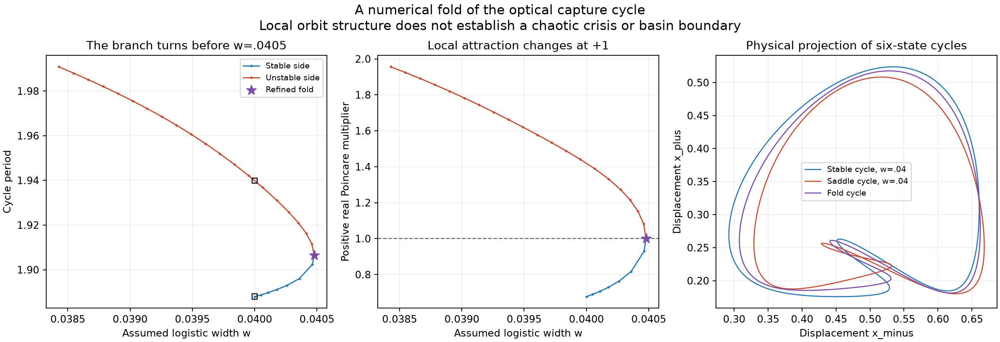

# A fold of the optical capture cycle

**Numerical finding:** the capture-cycle branch turns at logistic width **0.0404788044126**, with period **1.90641218355**. A nontrivial Poincare multiplier reaches +1 there, and the continuation proceeds onto an unstable partner branch. Independent Radau checks confirm the closed orbits and multipliers. This resolves the local obstruction behind the earlier failed fixed-width step to 0.0405; it does not show that no other cycle exists at that width.

The equations and reference-A parameters are exactly those of the [optical cycle study](optical-cycle-continuation.md). The logistic illumination profile remains an explicit modeling assumption, not a measured beam profile. No new dynamic variable or forcing is introduced.



## Two cycles at the same broad width

At `w=0.04`, which also supports the [long-lived irregular numerical cohort](optical-lifetime-extension.md), shooting now identifies both the familiar attracting capture cycle and a distinct saddle cycle:

| Quantity | Attracting cycle | Saddle cycle |
| --- | ---: | ---: |
| Width | 0.04 | 0.04 |
| Period | 1.88793013094 | 1.93987509363 |
| Largest Poincare multiplier magnitude | 0.6768480440 | 1.4193795419 |
| Number of nontrivial multipliers outside the unit circle | 0 | 1 |
| Independent Radau closure, balanced maximum norm | 2.40e-14 | 8.79e-13 |
| Radau/DOP853 multiplier discrepancy | 6.99e-14 | 1.11e-13 |

The black squares in the first panel mark these two cycles. The right panel is a projection onto the two physical displacements of the six-state flow. Its loops are periodic orbits, not newly discovered chaotic attractors. The nearby saddle is a concrete candidate for a future basin-boundary calculation, but its stable manifold and its relation to transient escape have **not** been determined.

## Why pseudo-arclength succeeds here

The earlier calculation held width fixed and solved for five free section coordinates plus period. At a cycle fold, this parameterization becomes singular even though the complete curve of periodic solutions remains regular. Pseudo-arclength treats width as another unknown and adds a tangent hyperplane. This is a standard continuation construction; the AUTO manual describes the use of parameter/state weights and adaptive arclength steps [2]. Our implementation uses direct shooting and is not an AUTO calculation.

Let `S=diag(1,sqrt(k),1,1,sqrt(k),1)` and fix the transverse section `x_minus=delta_minus`. The seven unknowns comprise five free balanced state coordinates, `T/2`, and `w/0.01`. The six closure equations are

```math
R(u)=S^{-1}\left(\Phi_T(y,w)-y\right)=0.
```

The width sensitivity is integrated exactly alongside the state and the full variational matrix:

```math
M'=J M,\qquad M(0)=I,
\qquad q'=Jq+f_w,\qquad q(0)=0.
```

Only the two thermal equations contribute to `f_w`; their analytic derivatives are implemented directly from the logistic response. With `S_free` denoting the five unfixed columns of `S`, the closure Jacobian is

```math
D R=
\left[
S^{-1}(M-I)S_{\mathrm{free}},\quad
2S^{-1}f(\Phi_T),\quad
0.01S^{-1}q(T)
\right].
```

A normalized null vector of this six-by-seven matrix provides the oriented branch tangent `t`. The predictor advances along that tangent; the corrector solves the six closure equations together with

```math
t^{\mathsf T}(u-u_{\mathrm{predictor}})=0.
```

The tangent orientation is kept consistent between steps. A failed corrector is retained in the record and retried at half the arclength step. The numerical section remains transverse: crossing velocity at the fold is approximately **0.91509**, far from grazing.

The analytic width derivative was checked against centered differences at 64 states, with maximum normalized discrepancy `7.09e-10`. The integrated width column of the shooting Jacobian agrees with an independent centered trajectory difference to `9.31e-12` in the stated scaled coordinates.

## Evidence for a nondegenerate local fold

The calculation retains 27 branch points, starting at `w=0.04` and following the unstable side back to `w=0.0384284727`. One corrector attempt failed near the turn; halving its step recovered the branch. There are no detected duplicate solutions. Maximum closure residual among the continued points is `1.92e-11`.

| Fold diagnostic | Numerical value |
| --- | ---: |
| Width | 0.04047880441263433 |
| Period | 1.9064121835478334 |
| Critical nontrivial multiplier | 1.00000000000312 |
| Other nontrivial multipliers | 0.2612150, 0.1178959, 0.0349097, 0.0228173 |
| Smallest singular value of fixed-width shooting Jacobian | 1.13e-12 |
| Smallest row singular value of complete arclength Jacobian | 0.0322096 |
| Oriented width-tangent magnitude at the refined point | 3.50e-13 |
| Independent Radau closure | 2.60e-14 |
| Radau/DOP853 multiplier discrepancy at the fold | 1.73e-13 |

The refined point solves closure plus the additional condition that the critical section multiplier equals +1. Its augmented residual is `3.13e-12`. The width tangent changes sign across the point, while the full arclength Jacobian retains rank. Thus the evidence is a resolved turning branch and unit multiplier, not an inference from a failed Newton solve.

We also checked the usual local nondegeneracy quantities in the declared scaled shooting coordinates. Let `l` and `v` be unit left/right null vectors of the fixed-width closure Jacobian, and let `nu=w/0.01`. The parameter coefficient `l^T R_nu` is `-0.0322887`. Centered directional second differences give `0.5*l^T R_vv = -3.38447, -3.38280, -3.38238` at difference steps `0.002, 0.001, 0.0005`. Both coefficients stay nonzero; their ratio predicts a local width maximum. These are numerical derivative checks without interval error bounds, not a computer-assisted bifurcation theorem.

Four independent Radau controls cover the starting stable cycle, the fold, the exact-width saddle and the last continued point. A separate event audit integrates each through **1.1 periods** and finds exactly one upward section crossing after the initial event; maximum return-time discrepancy is `1.14e-12`. Half- and quarter-period states do not close. The original one-period dense samples sometimes miss the endpoint crossing because roundoff places the final state just before it; those original sampled counts are preserved and explicitly qualified in `section-audit.json`.

The final unstable branch point has an additional negative multiplier approximately `-1.0284`. This flags more local structure farther from the fold, but its crossing and nonlinear consequences are not classified in this bounded study. In particular, the entire unstable branch must not be described as having exactly one unstable direction.

## What this does and does not explain

The fold provides a local mechanism by which the known capturing cycle meets an unstable partner. It occurs slightly before the earlier failed width value 0.0405. At width 0.04 there are now two independently checked periodic objects alongside the long-lived irregular regime found by trajectory integration.

This does not establish a boundary crisis, identify the basin separator, prove an asymptotic chaotic attractor, or exclude other periodic branches beyond the fold. It does not make the general saddle-node-of-cycles mechanism scientifically new. Those questions require separate global calculations and a continued priority audit.

## Reproduction and records

No GPU or broad trajectory survey is used. The main 27-point continuation, fold refinement and three Radau checks take **39.4 seconds**; the exact-width partner, four event checks and rendering take **14.2 seconds** on this machine. These are elapsed times for the targeted workflows, not universal performance guarantees.

To preserve the supplied results, use a fresh output directory:

```bash
python research/continue_optical_arclength.py --output outputs/arclength-reproduction --steps 100 --wall 780
python research/continue_optical_arclength.py --output outputs/arclength-reproduction --analyze
```

`--plot` regenerates the figure without new integrations. The [result directory](../results/light-operators/cycle-arclength) contains every accepted branch point, the rejected attempt, derivative controls, the fold refinement, independent monodromies, physical trajectories, section-event checks and the exact numerical driver used for the first run. Canonical LF hashes identify the source continuation and that driver. The original fixed-width continuation files are unchanged.

## References

1. H. Guo et al. *Light-mediated communication in responsive materials ranging from individual self-oscillators to feedback-driven network*. **Nature Communications 16**, 11315 (2025). [DOI:10.1038/s41467-025-66395-3](https://doi.org/10.1038/s41467-025-66395-3). Source physical system; the continuous-heat interpretation and assumed logistic modification are documented in the [source audit](light-operators-audit.md).
2. E. J. Doedel and B. E. Oldeman. *AUTO-07P: Continuation and Bifurcation Software for Ordinary Differential Equations*, January 2012. [Author manual, University of Washington copy](https://depts.washington.edu/bdecon/workshop2012/auto-tutorial/documentation/auto07p%20manual.pdf), Sections 10.5 and 11.4–11.5. Standard continuation background; its algorithm is not used as an independent validator here.
