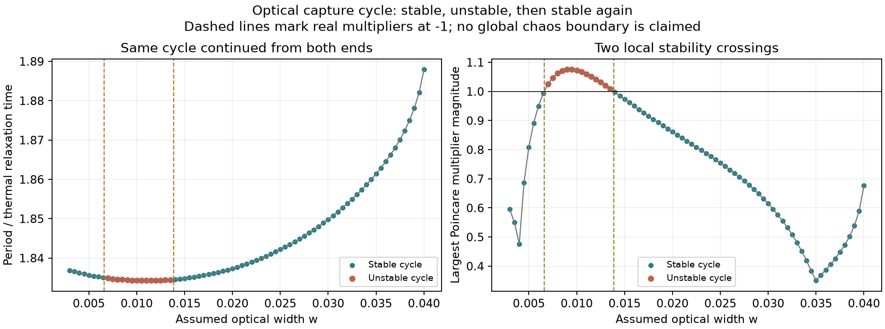
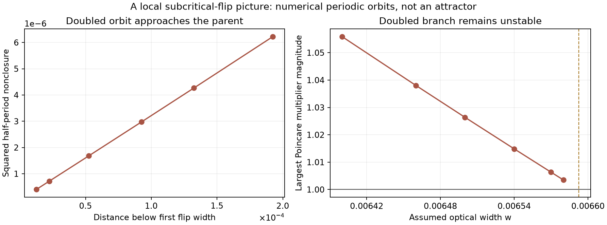

# The optical capture cycle loses and regains stability

**Numerical finding:** the periodic controls at optical widths 0.003, 0.005 and 0.04 belong to the same continued cycle branch. This branch is stable, becomes unstable near width **0.006592493**, and becomes stable again near **0.013881532**. A separate unstable doubled-period branch approaches the first crossing from its stable-parent side, supporting a local **subcritical period-doubling picture**.

This concerns the explicitly assumed logistic illumination law in the [six-state optical model](coupled-operators-research.md). It is a model observation, not a calibrated experimental prediction, a rigorous bifurcation proof, or a new attractor type. The [priority audit](coupled-operators-priority-audit.md) explains the older feedback-system precedents.

A subsequent [pseudo-arclength continuation](optical-cycle-arclength.md) resolves the fixed-width failure below: the branch folds at width 0.0404788044 and returns as an unstable branch. At width 0.04, independently checked stable and saddle cycles coexist. Their relation to the chaotic transient's basin boundary remains an open question.



## Why follow a periodic orbit during a chaos search?

The long-run experiments show some apparently chaotic trajectories eventually reaching a stable cycle. To understand that destination, we continued the cycle itself as the optical width changed. Direct forward integration usually loses an unstable cycle; full-state shooting can retain it and reveal where attraction changes to repulsion.

The two stable controls at the ends of this study are therefore connected through an intervening unstable segment. They are not unrelated periodic objects just because irregular motion is observed between their parameter values. Local stability does not determine the size of the cycle's basin, the fate of every initial condition, or the existence of a coexisting chaotic set.

## Fixed model and numerical method

The reference-A parameters remain

```math
k=74.1567393414624,\qquad b=1.784180421282182,
\qquad \delta_-=0.4139517339970917,
\qquad \delta_+=0.25683679452165964.
```

Only the positive logistic width varies. We solve the six-component closure equation for five free initial coordinates and the period, fixing the section $x_-=\delta_-$ with positive crossing velocity. A Newton step uses the complete variational matrix, not a finite-difference trajectory Lyapunov estimate. Velocities are divided by $\sqrt{k}$ when measuring residuals and state differences.

If $M$ is the full-period variational matrix and $f$ the final vector field, the derivative of the section return is obtained from

```math
D\mathcal P=
\left[\left(I-\frac{f e_0^{\mathsf T}}{f_0}\right)M\right]_{1:5,1:5}.
```

The notation removes the section-normal coordinate and leaves five tangent coordinates. Its eigenvalues are the Poincare multipliers. All magnitudes below one imply local numerical attraction; a multiplier outside the unit circle implies instability. The autonomous flow's neutral direction is removed by this projection.

We continued at width increments 0.0005 in both directions, starting from the independently checked controls at 0.003 and 0.04. There are **75 common widths**, with maximum discrepancies of $1.37\times10^{-10}$ in balanced state, $2.23\times10^{-10}$ in period, and $2.04\times10^{-8}$ in matched multipliers. This agreement checks branch tracking; it is not an exhaustive inventory of periodic solutions.

## Two isolated real-multiplier crossings

| Quantity | Loss of stability | Recovery of stability |
|---|---:|---:|
| Width | 0.0065924931754 | 0.0138815315593 |
| Period | 1.8350161119634 | 1.8345770443383 |
| Critical multiplier | −1 | −1 |
| Numerically differentiated multiplier slope versus width | −70.1376 | +23.3608 |

Other section multipliers remain strictly inside the unit circle at both crossings. Independent implicit Radau integrations checked four representative cycles and the two crossing cycles, using a smaller maximum step and tighter tolerance than the original continuation. Maximum closure discrepancy was $1.86\times10^{-10}$ and maximum multiplier discrepancy $2.98\times10^{-11}$. All six controls have one upward section crossing per full period; their half-period states do not close. The variational determinant also agrees with the exact integrated divergence $-2(b+1)T$.

These are isolated, transverse numerical crossings of −1. They identify local flip candidates. By themselves, they do not establish the nonlinear criticality, a cascade, or a route to a chaotic attractor [2].

## An unstable doubled branch near the first crossing

At width **0.0064**, a perturbation in the critical section direction leads shooting to a distinct closed orbit with period **3.67032710049**, two upward section crossings and largest multiplier **1.05588589**. It is unstable. Its half-period discrepancy is about 0.002495 in the stated balanced norm, so it is not simply the parent orbit traversed twice. Independent Radau integration closes it to approximately $4\times10^{-13}$.

Continuing that doubled orbit through six widths up to 0.00658 yields:

| Width | Doubled-orbit period | Half-period nonclosure | Largest multiplier magnitude |
|---:|---:|---:|---:|
| 0.00640 | 3.6703271005 | 0.0024950 | 1.055886 |
| 0.00646 | 3.6702340415 | 0.0020660 | 1.038059 |
| 0.00650 | 3.6701725755 | 0.0017239 | 1.026381 |
| 0.00654 | 3.6701115721 | 0.0012970 | 1.014866 |
| 0.00657 | 3.6700661255 | 0.0008482 | 1.006336 |
| 0.00658 | 3.6700510352 | 0.0006319 | 1.003513 |



The doubled branch stays on the stable-parent side, approaches the parent's shape and twice its period, and its unstable multiplier approaches +1. Squared half-period separation is approximately proportional to distance from the first flip in these samples. Together, these observations support a **subcritical** local picture: an unstable doubled orbit approaches the cycle that is about to lose stability. No normal-form coefficient or interval-arithmetic certification was computed, so this remains numerical evidence rather than a theorem.

All six doubled cycles were checked with Radau; the largest balanced closure discrepancy is $1.07\times10^{-10}$ and the largest multiplier discrepancy $8.38\times10^{-13}$. Each has two upward section crossings and fails half-period closure. Five shooting attempts above the crossing, at 0.0067, either return the repeated parent or fail; their records are retained. That finite set of attempts does not prove absence of other doubled cycles.

## What this explains, and what remains open

The cycle that captures long transients is a continuous family with a finite unstable interval. A narrow positive-exponent window cannot therefore be interpreted solely through equilibrium stability. In particular, the first local flip has evidence for an unstable doubled branch; it should not be described as an already demonstrated stable period-doubling cascade into chaos.

The saddle doubled cycle has a possible role in separating local outcomes, but its stable manifold and the transient escape mechanism have not been computed. No basin-boundary, boundary-crisis or global trapping claim follows from its existence. The separate stable two-crossing control previously found at width 0.01 has period 2.3551155363, unlike the approximately 3.67-period doubled branch studied here; it must not be silently identified with this branch.

Forward fixed-width continuation first fails at **0.0405**. The last successful multiplier magnitude is only 0.676848 at 0.04. A Newton failure is not evidence for a fold or crisis; smaller parameter steps or pseudo-arclength continuation would be needed to resolve that region. The present figure deliberately ends at the last validated point.

## Reproduction

From the repository root, with the normal scientific dependencies installed:

```bash
python research/continue_optical_cycle.py --branch from-narrow
python research/continue_optical_cycle.py --branch from-broad
python research/analyze_optical_cycle.py
python research/probe_optical_doubled.py
python research/continue_optical_doubled.py
```

These are targeted CPU orbit calculations, not GPU parameter surveys. They write the named continuation outputs, so use a disposable checkout to preserve the archive. All branch states, periods, multipliers, tolerances, Newton histories, failed attempts and independent checks are in [the result directory](../results/light-operators/cycle-continuation). The first continuation's failure is preserved separately from the complete reverse pass.

## References

1. H. Guo et al. *Light-mediated communication in responsive materials ranging from individual self-oscillators to feedback-driven network*. **Nature Communications 16**, 11315 (2025). [DOI:10.1038/s41467-025-66395-3](https://doi.org/10.1038/s41467-025-66395-3). The continuous-heat interpretation and our assumed logistic modification are detailed in the [source audit](light-operators-audit.md).
2. C. Tresser, P. Coullet and E. de Faria. *Period doubling*. **Scholarpedia 9**(6), 3958 (2014). [DOI:10.4249/scholarpedia.3958](https://doi.org/10.4249/scholarpedia.3958). Standard distinction between supercritical and subcritical local period doubling; it does not certify this numerical branch.
