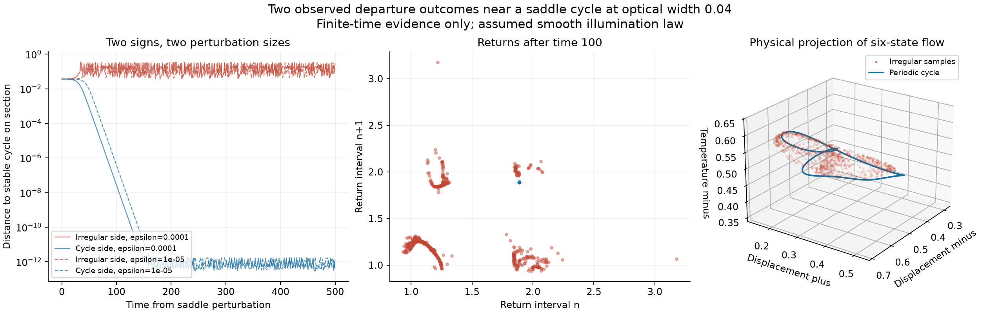
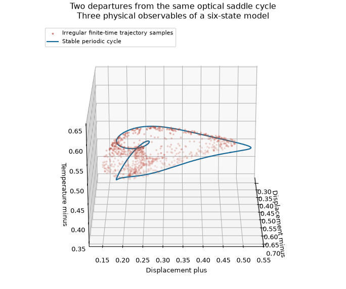

# Two departure outcomes near an optical saddle cycle

Status: 30 October 2026. **Small perturbations on opposite sides of the same saddle cycle show different behavior over 500 time units:** one sign approaches the known stable cycle, while the other remains irregular with positive finite-time expansion. The outcome repeats at two perturbation sizes. This supports a specific basin-boundary hypothesis; it does not prove that hypothesis or establish a new attractor.



## The unchanged model and the question

This follows the [periodic-orbit fold study](optical-cycle-arclength.md) of the six-state optical operator pair. It retains the same continuous thermal balance and the same explicitly assumed logistic illumination profile. That profile is not calibrated to the apparatus in Guo et al. [1]. No additional feedback, forcing or state is introduced here.

The parameter vector is `(k, b, delta_minus, delta_plus, width) = (74.1567393414624, 1.784180421282182, 0.4139517339970917, 0.25683679452165964, 0.04)`. At this width, the earlier continuation independently closed both a stable periodic orbit of period 1.88793013094 and a saddle periodic orbit of period 1.93987509363. The saddle has one unstable section multiplier, approximately 1.41937954187; its four other section multipliers have modulus below one.

The relevant question is whether departure along its unstable direction leads toward the two kinds of behavior already seen in the [long lifetime study](optical-lifetime-extension.md). That study used a different, fixed cohort; its 100,000-unit observations must not be assigned to the four trajectories introduced here.

## Reproducible departure construction

We use the upward section `x_minus = delta_minus`. Velocities are divided by `sqrt(k)` when computing norms; the archived trajectories themselves retain the original six coordinates. We integrate the full state-transition matrix over one saddle period and project it onto the section. For a section normal `n`, endpoint velocity `f` and state-transition matrix `M`, the derivative is

```math
D\Pi=\left(I-\frac{f n^T}{n^T f}\right)M,
```

restricted to the five section coordinates. The real eigenvector of its largest multiplier is normalized in the balanced section norm. Its largest-magnitude component is chosen positive, fixing an otherwise arbitrary sign convention. Its balanced components, excluding the fixed section coordinate, are approximately `(0.60390021, -0.10565455, 0.53063173, 0.24493295, 0.53158204)`.

Four starts are formed as the section state plus or minus this vector times `1e-4` or `1e-5`. These points are linear approximations to the local unstable direction, not exact points on a computed global unstable manifold.

DOP853 integrates each start for 500 original thermal-time units. A tangent evolves simultaneously and is normalized every unit. The first 100 units are discarded from the reported exponent; the remaining 400 are also split into four 100-unit windows. Settings are `rtol=2e-10`, `atol=2e-12`, `max_step=0.02`. All four runs complete, taking about 69 CPU seconds including the orbit controls.

## What the four trajectories do

| Perturbation size | Sign | Mean leading estimate, time 100–500 | Range of four window estimates | Final section behavior |
| ---: | ---: | ---: | ---: | --- |
| 0.0001 | Negative | 0.332753 | 0.306672–0.373698 | Irregular returns; no capture observed |
| 0.0001 | Positive | 0.000879 | 0.000577–0.001155 | Known stable cycle |
| 0.00001 | Negative | 0.319146 | 0.275449–0.362314 | Irregular returns; no capture observed |
| 0.00001 | Positive | 0.000801 | 0.000578–0.000979 | Known stable cycle |

Both positive-sign trajectories have their last 20 section returns within `1.9e-12` of the independently known stable-cycle section state. Their return interval is 1.88793013094. Their small positive finite-time tangent averages are another concrete reminder that **positive finite-time expansion by itself does not identify chaos**: the phase direction of an autonomous periodic flow is neutral asymptotically, and a finite endpoint-normalization effect remains.

Both negative-sign trajectories have variable section intervals and much larger positive estimates in every reported window. Their sampled temperatures remain between approximately 0.1796 and 0.6331, and no growth or physical thermal-domain violation is observed. This is finite numerical evidence of irregular departure, not a new proof of boundedness or asymptotic attraction.

The DOP853 and independent Radau one-period checks give balanced saddle closure below `8.9e-13`; the unstable multipliers agree within `4e-14`.

The independent Radau departure audit completes both signs at perturbation size `1e-4` through time 500. It agrees on proximity versus nonproximity to the known cycle; it does **not** independently compute the positive Lyapunov estimates. Both solvers agree through time 20 within `5.9e-13`. The smaller negative perturbation also passes its short check, but its long Radau run reaches the declared 420-second total CPU budget; the fourth planned Radau run is not started. Thus this audit has **two complete, one incomplete and one unstarted** long controls. All are explicitly recorded in [the independent audit](../results/light-operators/saddle-departure/independent-controls.json) and [derived summary](../results/light-operators/saddle-departure/analysis.json). Incomplete solver callbacks are not treated as accepted endpoints.

A check using saved samples further supports the periodic phase explanation: the logarithmic change of the balanced flow norm between times 100 and 500, divided by 400, is 0.0008791834 and 0.0008006757 for the two cycle-side trajectories. These closely match their tangent averages, and the final tangents are parallel to the flow to roundoff. [Analysis code](../research/analyze_optical_saddle.py) reproduces this check without integration.

## Interpretation and geometric limits

The saddle is now a concrete candidate for organizing the separation between the stable cycle and the irregular regime. Its stable manifold has codimension one locally. Opposite departures giving different outcomes is consistent with that manifold forming part of a basin boundary. Four perturbed starts do not locate a whole boundary, demonstrate that the irregular set attracts forever, or prove a boundary crisis. They also do not show that all nearby initial conditions share these outcomes.



The rotation shows two displacements and one temperature. Red points are sampled irregular motion; the blue curve is the previously closed stable cycle. The full flow has six state variables. Apparent intersections or overlapping sheets in this projection are not intersections of full-state trajectories, and this appearance does not establish a new topological class.

## Files and reproduction

- [Departure implementation](../research/probe_optical_saddle.py) and [unaltered run driver](../results/light-operators/saddle-departure/numerical-driver.py).
- [Independent Radau checks](../research/audit_optical_saddle.py).
- [Saved settings and numerical summaries](../results/light-operators/saddle-departure/probe.json); the adjacent NPZ files contain sampled states, tangent growth and section returns.
- [Plot and rotation generator](../research/plot_optical_saddle.py).

`python research/probe_optical_saddle.py --output outputs/new-saddle-probe` writes a new run without overwriting the archive. The independent audit uses the archived cohort and refuses to overwrite an existing audit. The plotting command uses saved arrays and performs no integration.

## Reference

1. H. Guo et al., “Light-mediated communication in responsive materials ranging from individual self-oscillators to feedback-driven network,” *Nature Communications* **16**, 11315 (2025). [DOI](https://doi.org/10.1038/s41467-025-66395-3). The [source audit](light-operators-audit.md) and [priority comparison](coupled-operators-priority-audit.md) explain the equation interpretation and earlier related feedback systems. No absence-of-prior-publication claim is made for this departure test.
