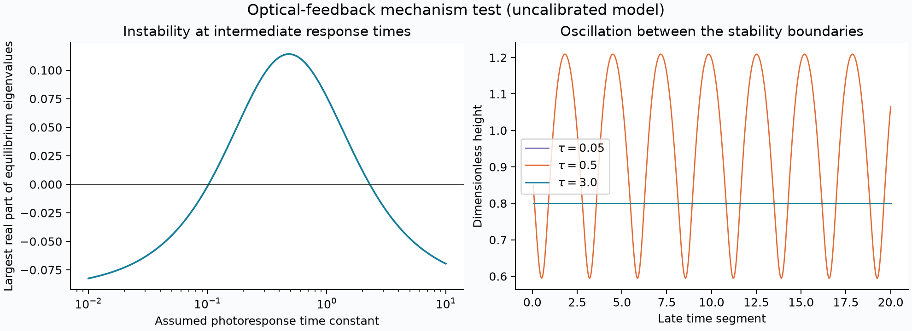

# Optical feedback: what extra dynamics can change

Research notebook, 29 October 2026. This follows the [energy argument for the physical meminductor](candidate-research.md).

**A finite photoresponse can destabilize the mechanical equilibrium in an explicit illustrative model. No chaos survived our search in that model.** This resolves a possible mechanism, not the calibration of the published device.



## The missing feedback state

The moving-coil experiment of Dinavahi and Harris [1] uses optical feedback: a moving LED changes the photoresistor branch, which redistributes current. Their uncoupled mechanical equation has positive damping. At constant current, or when current is an instantaneous function of height alone, its force depends only on position and

$$E=\tfrac12\dot x^2+U(x),\qquad \dot E=-b\dot x^2.$$

This excludes a sustained non-equilibrium attractor in a compact interior region of that mechanical model. It does not exclude the experimentally observed oscillation, because the experiment includes additional feedback physics.

Combining the printed flux approximation `Phi=L(x)*i` with a current source feeding a coil branch and a photoresistor branch gives the phenomenological electrical closure

$$L(x)\dot i=R_p I_0-(R_s+R_p)i-L'(x)i\dot x.$$

**Subsequent consistency audit:** this closure omits permanent-magnet flux linkage. Paired with the paper's linear-in-current force, it is not a complete reciprocal magnetic transducer. The [energy and reciprocity audit](meminductor-energy-audit.md) derives the missing back-EMF issue and an exact exclusion for a reciprocal model under fixed DC drive. The assumed optical model below remains explicitly phenomenological; none of its archived data is retroactively interpreted as a calibrated passive circuit simulation.

Here an LED voltage drop has been folded into an approximate branch resistance; it would need separate treatment in a fitted model. With the reported order of magnitude `L <= 0.15 H`, `Rs ~= 6000 ohm` and `Rp >= 2500 ohm`, the electrical relaxation time is at most about `18 microseconds`, much shorter than the mechanical period. This alone does not rule out a coupled instability: feedback gain and the motional term also matter. It does make an explicit model of the response delays necessary.

The article does not give a fitted dynamical photoresistor response. We therefore introduce one transparently, rather than treating an invented time constant as measured data. The printed force coefficient also needs reconciliation with the illustrated operating heights before quantitative device calibration.

The subsequently recovered official supplement does not provide that missing response law. Its **628-ohm winding resistance** is a different quantity from the approximately **6-kilohm circuit series resistance** used in the timescale estimate above; the two must not be interchanged. It also discusses contact-induced measurement distortions under bipolar excitation. See the [updated source and passive-impact audit](meminductor-energy-audit.md).

## An assumed three-state extension

Our dimensionless states are height `x>0`, velocity `v`, and photoactivation memory `z`:

$$
x'=v,\qquad
v'=a\mu(x)j(z)/x^4-1-bv,\qquad
z'=[j(z)S(x)-z]/\tau,
$$
$$
\mu(x)=8-\frac7{1+\exp[-8.75(x-6/7)]},\quad
j(z)=\frac1{1.04+kz},\quad
S(x)=\exp[-((x-1)/w)^2].
$$

The bell-shaped illumination profile and first-order activation law are **modeling assumptions**, not equations fitted by the source authors. The parameter `a` sets force strength; `b` is damping; `tau` is response time; `k` is optical feedback gain; `w` is the illumination width. For positive parameters, `0 <= z <= 1` is forward invariant: its derivative points inward at both boundaries.

We choose an equilibrium height `xe` and solve its activation/current relation analytically, then set `a` to balance gravity. This parameterization makes a stability survey easier without solving a nonlinear equilibrium for every sample.

## A useful analytic result

At equilibrium the Jacobian has the form

```math
J=\begin{pmatrix}0&1&0\\-K&-b&-c\\d&0&-r\end{pmatrix},\qquad K,c,r>0.
```

Its characteristic polynomial is

$$p(\lambda)=\lambda^3+(b+r)\lambda^2+(K+br)\lambda+Kr+cd.$$

On the rising side of the illumination profile, `d>0`. The Routh–Hurwitz boundary is

$$cd=b(K+br+r^2).$$

Writing `r=r0/tau`, `d=d0/tau` gives a quadratic for the critical response times:

$$bK\tau^2+(b^2r_0-cd_0)\tau+br_0^2=0.$$

Two positive boundaries exist when `cd0 > b^2*r0 + 2*b*r0*sqrt(K)`. Very fast and very slow responses can both be stable, with an unstable interval between them. On the falling side, `d<0`, this Hopf-type condition cannot hold; a real-eigenvalue instability is still possible if the constant coefficient changes sign.

For `xe=.8, b=.184, k=2.36, w=.2`, the calculated boundaries are **0.102154** and **2.302743**. Direct Jacobian eigenvalues cross the imaginary axis there with nonzero speed. We did not calculate the first Lyapunov coefficient, so this is a linear Hopf-boundary calculation, not a full bifurcation classification. Independent DOP853 trajectories converge to the equilibrium at `tau=.05` and `tau=3`; at `tau=.5` a sustained periodic-looking oscillation remains, with late height span approximately `0.6153`.

## GPU search and negative result

A scrambled Sobol survey selected 1,024 parameter tuples and three initial states per tuple, totaling **3,072 trajectories**:

| Parameter | Range |
| --- | --- |
| Chosen equilibrium height | 0.55–1.25 |
| Damping | 0.025–0.4, logarithmic |
| Photoresponse time | 0.01–10, logarithmic |
| Feedback gain | 0.2–10, logarithmic |
| Illumination width | 0.06–0.36, logarithmic |

The scout discarded 200 time units and observed 400 with adaptive FP64 Dormand–Prince 5(4). It returned 12 preliminary positive-exponent candidates. All originated from the start close to the selected equilibrium. After discarding 2,000 and observing 4,000 at tighter tolerances, **none survived**. Eleven remained inside the numerical domain; one reached a height/amplitude cutoff. A cutoff is not a proof of physical escape. The largest valid refined estimate was `0.000442`, consistent with a slow transient or a neutral direction rather than a retained chaos signal.

GPU short trajectories match independent DOP853 references to better than `4e-12` in the recorded validation. A directional finite-difference Jacobian check has error below `4e-10`. This supports the implementation; a finite survey cannot prove that this entire model has no chaotic regime.

## Reproduction and remaining questions

```bash
python research/search_photofeedback.py --validate
python research/search_photofeedback.py --power 10
python research/search_photofeedback.py --refine results/photofeedback/scout --transient 2000 --duration 4000 --rtol 1e-9 --output results/photofeedback/refined
python research/analyze_photofeedback.py
```

Code: [photofeedback.py](../research/photofeedback.py) and its OpenCL kernel. Compact numerical data and settings: [results/photofeedback](../results/photofeedback/). The analytic roots, eigenvalues and independent trajectories are saved under `stability/`.

Useful next questions concern the actual optical transfer function, measured photoresistor response times, LED current-voltage relation, magnetic force calibration, and mechanical friction. Adding arbitrary extra states until chaos appears would not establish a result for the published apparatus. The current result is narrower: delayed optical feedback supplies a mathematically explicit route to self-oscillation, while this particular search found no lasting chaos.

## Reference

1. **Dinavahi, A., and Harris, H. R.** (2025). Edge-of-chaos operation and persistent dynamics for neuromorphic meminductor computing. *Scientific Reports*, **15**, 40672. [doi:10.1038/s41598-025-12529-y](https://doi.org/10.1038/s41598-025-12529-y). The original device, mechanical model and reported circuit scales; the assumed dynamic photoresponse law above is our extension.
