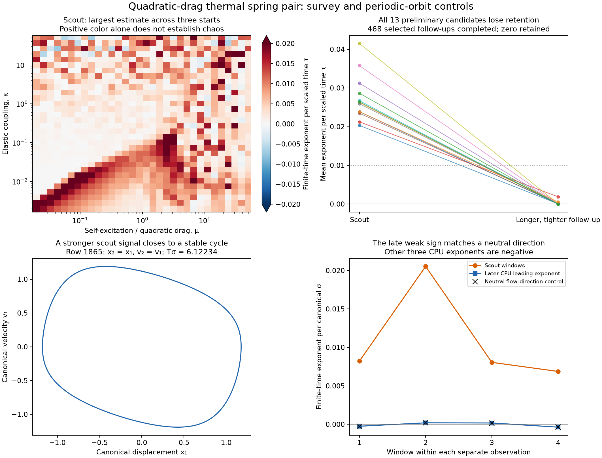
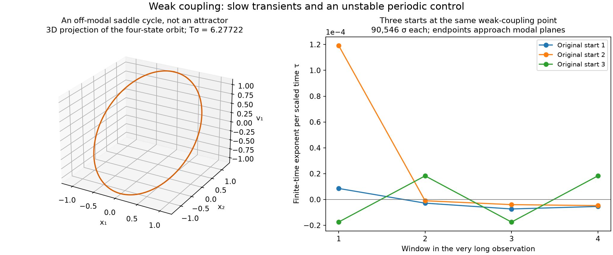
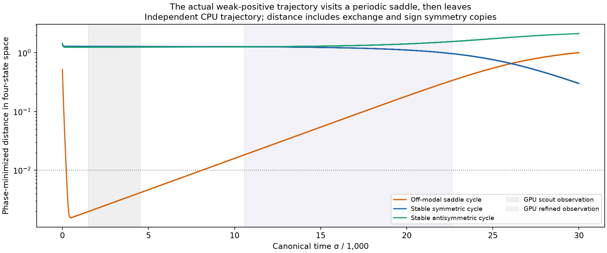

# A thermal spring pair: slow transients, periodic saddles, and a negative chaos search

**Status, 30 October 2026:** 3,081 GPU survey trajectories and 468 completed tighter follow-ups produced **no retained chaos candidate** in the tested ranges. Three exceptionally long checks of the strongest remaining weak signal approached the known modal planes. Independent CPU calculations resolve a stable periodic orbit and an off-modal saddle periodic orbit. The latter has a positive transverse exponent but is **not an attractor**. Neither these numerical results nor the literature review establish a new discovery or a global impossibility theorem.



The first panel shows finite-time estimates, including positive values that did not survive the selection criteria. It is not an existence map of chaotic attractors. The dashed threshold in the second panel is only the later mean-exponent cutoff; retention also requires four positive windows above a separate cutoff.

## Exact model and the meaning of its coordinates

Li et al. [1] study two thermally driven liquid-crystal-elastomer springs with elastic coupling. Their Equation 14 has already eliminated the thermal field through an approximation. Translating the equilibrium and rescaling displacement and time gives the following exact representation of that **reduced four-state model**:

```math
\begin{aligned}
\frac{dx_i}{d\sigma}&=v_i,\\
\frac{dv_i}{d\sigma}&=-x_i-\kappa(x_1+x_2)+\mu(1-|v_i|)v_i,
\qquad i=1,2.
\end{aligned}
```

Here `mu>0` controls self-excitation and quadratic drag, and `kappa>=0` is the elastic coupling. The canonical time `sigma` is not physical seconds. State order in every saved array is `(x1,v1,x2,v2)`. The vector field is continuously differentiable, including at zero velocity, with drag derivative `mu*(1-2*abs(v))`. There is no impact, reset, or saltation matrix.

The [source and equivalence audit](late-physical-candidates-2.md) records the physical conversion, missing physical initial positions, and approximation limits. We do not replace quadratic drag with cubic drag, add a thermal memory variable, or claim that arbitrary canonical starts represent the authors' experimental apparatus. Reflecting the second oscillator gives ordinary difference coupling; a further exact state transformation gives a known nonsmooth van der Pol family. Thus an unfamiliar mechanical interpretation alone does not establish a new dynamical mechanism.

The [structural analysis](rayleigh-pair-structure.md) proves an absorbing mathematical bound for fixed positive `mu` and nonnegative `kappa`. It also identifies two invariant modal planes, `x2=x1, v2=v1` and `x2=-x1, v2=-v1`. Each restriction is planar and cannot support a chaotic attractor. An off-modal search is therefore essential. Mathematical boundedness does not certify positive fiber lengths, tension, or the accuracy of the eliminated thermal dynamics.

## GPU search and independent controls

The adaptive FP64 Dormand–Prince 5(4) implementation runs the exact state and tangent equations on an NVIDIA GeForce GTX 1080. To cover both weak excitation and long relaxation oscillations, define

```math
s=\max(1,\mu,1/\mu),\qquad
\tau=\sigma/s,\qquad
\lambda_\tau=s\lambda_\sigma.
```

Integration intervals and screening thresholds below use computational time `tau`; saved arrays also contain canonical exponents and elapsed `sigma`. The maximum integration step is specified in canonical `sigma`. Renormalization occurs after every accepted step. An explicit `mu=0` linear control uses `s=1`.

Before the survey, 256 random-state checks compared the analytic Jacobian with finite differences and checked energy, modal restriction, and the van der Pol transformation. The largest relative Jacobian discrepancy was `2.54e-9`. Independent DOP853 and implicit Radau state integrations agreed within `1.4e-11`. Eight GPU controls, using four parameter tuples and two computational time factors, agreed with Radau to less than `4e-13` in state and `1.6e-9` in tangent/exponent. The zero-excitation control was also checked against a matrix exponential. See [CPU controls](../results/rayleigh-pair/validation.json) and [GPU controls](../results/rayleigh-pair/gpu-validation.json).

The survey uses a 32 by 32 logarithmic grid with `mu` from `0.02` to `50` and `kappa` from `0.002` to `50`. Three additional tuples are the source-derived point `(0.00880947943, 0.557378006)` and the modal-instability controls `(10,0.01)` and `(30,0.1)`. Each tuple has three chosen off-modal starts:

```text
( 0.1,  0.7, -0.3,  0.2)
( 1.7, -0.4,  0.2,  0.95)
(-0.7,  0.9,  1.1, -0.6)
```

| Stage | Trajectories | Discarded / observed time in tau | Relative tolerance | Maximum step in sigma | Outcome |
|---|---:|---:|---:|---:|---|
| Survey | 3,081 | 50 / 100 | `1e-8` | `0.05` | All complete; 13 preliminary candidates |
| Tighter follow-up | 468 | Additional 200 / 400 from saved endpoints | `1e-10` | `0.025` | All complete after two exact resumptions; zero retained |
| Weak-signal check | 3 | 1,000 / 2,000 from original starts | `1e-10` | `0.025` | All complete; zero retained |

Absolute tolerance is `0.001` times relative tolerance. Four equal observation windows are saved separately. Survey retention requires mean `lambda_tau>0.02` and every window above `0.01`. The tighter stage selects **all 462 trajectories with four positive signs**, union the preliminary candidates and the 24 largest means, giving 468 distinct trajectories. Its cutoffs are mean `0.01` and every window `0.005`. These are explicit screening rules, not mathematical definitions of chaos.

Two long trajectories exhausted the initial 12-million-attempt limit. Their complete state, tangent, clocks, accumulated window logs, and statistics were saved and continued to a 24-million-attempt limit. Both completed. A forced-interruption control reproduces the uninterrupted result bit for bit in all these arrays. The original partial files remain available; the [summary script](../research/summarize_rayleigh_pair.py) merges by recorded source indices. Thus no budget stop is silently counted as a negative result.

All 13 preliminary candidates lose the later retention criterion. However, **144 of the 468 completed follow-ups still have small positive signs in all four windows**; the largest mean is `0.00773790` per `tau`. We do not classify every such trajectory as periodic or prove its asymptotic exponent nonpositive. The survey, refinement, resumption, and three very long checks took approximately 74, 233, 60, and 72 seconds of wall time respectively, excluding CPU controls and analysis. This is not a matched CPU/GPU speed comparison.

## A stronger signal resolves to a stable cycle

Survey row 1865 has `mu=2.41901403473`, `kappa=0.1397421493`, and a preliminary mean exponent about `0.01092` per canonical `sigma`. Starting at its saved endpoint, a separate CPU calculation discards another 1,000 units and observes 4,000 units with a full four-vector QR spectrum. DOP853 uses relative tolerance `1e-11`, absolute tolerance `1e-13`, maximum step `0.025`, and QR interval `0.5`.

The finite-time spectrum is approximately

```math
(-0.00006731,\;-0.04248853,\;-1.25909649,\;-1.30151771).
```

Its sum agrees with the integrated divergence within `9e-16`. The leading window estimates coincide with the independently normalized flow direction within `4e-15`, demonstrating why a small positive individual window need not indicate chaos. There are 654 saved section crossings; plotting their roundoff scatter with a magnified axis would misleadingly suggest complicated geometry.

Independent shooting closes a symmetric modal cycle with period **6.12234473464392** and largest transverse multiplier **0.77121293**. Its Floquet exponents are approximately `(0,-0.04243321,-1.25886169,-1.30129490)`. Newton and an independent modal-coordinate Radau integration close it to about `4e-14` and `3e-14`. These are numerical local-stability controls; they are stronger evidence than the sign of a short largest-exponent estimate.

## Weak coupling and a periodic saddle

The strongest minimum-window signal remaining after refinement is survey row 193, at `mu=0.0331323264448661`, `kappa=0.002`. Its four refined estimates per `tau` are approximately `(0.008584,0.007924,0.007492,0.006952)`. The selected tuple was therefore checked from all three original starts for **90,546 canonical time units each**. The final mean exponents per `sigma` are approximately `(-5.80e-8,9.07e-7,1.40e-8)`, with mixed signs across windows. None passes the lower long-run thresholds: mean `0.001` and each window `0.0005` per `tau`.

The three endpoints lie about `2.0e-10`, `7.9e-8`, and `1.5e-10` from the symmetric, symmetric, and antisymmetric invariant planes, respectively. The corresponding known modal cycles are stable, but their slow transverse decay times are approximately **3,986** and **4,196** canonical units per e-fold. This explains why a few hundred ordinary oscillations are inadequate to assess convergence at weak coupling. Endpoint proximity and long-run behavior support convergence toward modal motion; they are not a proof that all basins have been exhausted.



At exactly the same parameters, full four-state shooting finds an off-modal periodic saddle with section state

```text
(x1,v1,x2,v2) = (0, 1.09780012057418, 1.23948783714481, -0.0262179937370664)
```

Its period is **6.27722415346621**. The three section multipliers are approximately `(0.91257711,0.89277623,1.0015415064)`. The unstable exponent is **+0.0002453823 per sigma**, or **+0.00740613 per tau**. Newton and independent modal-coordinate Radau closure errors are below `1.2e-14`; the full monodromy determinant agrees with the integrated-divergence identity.

This periodic orbit illustrates a precise distinction: an orbit can have an expanding transverse direction while tracing a regular closed curve. Generic nearby trajectories eventually leave a saddle. It is not a strange attractor. Its exponent is close to the weak GPU signal, but matching exponents alone would not establish proximity. The three-dimensional figure is a projection of a four-state periodic orbit, not a new attractor geometry.

### Did the suspicious trajectory actually visit that saddle?

Yes, within the finite numerical observation. A separate DOP853 integration from the original row-193 start runs to `sigma=30000`. At each saved time, it measures Euclidean distance in all four canonical coordinates to phase-shifted points of the closed cycles, including exchange and global-sign symmetry copies. Distances are minimized over polygon segments of 6,001-point cycle representations; a coarser representation supplies a resolution check. This is a geometric numerical comparison, not an infinite-time shadowing theorem.



The trajectory's minimum distance from the saddle is **0.00155**, around `sigma=500`. Samples remain within distance `0.01` from approximately `sigma=223` to `8089`, with a few further threshold crossings until `8111`; temporal sampling is one canonical unit. It later leaves: distance is **0.3378** at the refined GPU endpoint, and approximately **1.009** at `sigma=30000`. At that last time, distance to the stable symmetric cycle has fallen to **0.300**; this CPU interval alone does not yet demonstrate convergence to it.

At the original, scout, and refined GPU checkpoints, distances to the saddle are approximately `(0.5218,0.00416,0.3378)`. The independent CPU states agree with the two later GPU checkpoints within Euclidean errors `3.9e-7` and `1.9e-5`, despite different algorithms, tolerances, and step sizes. Together with the separately observed long-run approach to the symmetric plane, these data identify an actual long visit near a regular unstable cycle as the source of this misleading weak-positive regime. No claim is made that this explanation classifies every small positive value in the parameter survey.

As a post hoc diagnostic, a least-squares fit of log distance over `sigma=1000..12000` gives a departure rate **0.000245450**, with `R²=0.999991`, compared with the saddle's independently computed unstable exponent **0.000245382**. Coarsening the cycle polygon changes the distances by at most `5.2e-7`. This quantitative agreement supports the local unstable-cycle explanation; the fitted interval was chosen after inspecting the trajectory and is not an independent prediction or a proof of asymptotic dynamics.

Twelve additional modal controls also identify transverse instability of antisymmetric cycles at `(mu,kappa)=(10,0.01)` and `(30,0.1)`, with largest multipliers `1.01905` and `1.15098`. Symmetric cycles at those parameters remain stable. The [structural note](rayleigh-pair-structure.md) preserves the complete results and qualifications concerning tiny unresolved contracting multipliers.

## Reproduction and evidence

Run from the repository root with Python, NumPy, SciPy, Matplotlib, and PyOpenCL. An FP64-capable OpenCL GPU is required for the survey. The saved results can be summarized and plotted without a GPU:

```bash
python research/rayleigh_pair.py
python research/rayleigh_pair_gpu.py --controls
python research/rayleigh_pair_gpu.py --resume-control
python research/rayleigh_pair_gpu.py --resolution 32
python research/rayleigh_pair_gpu.py --refine results/rayleigh-pair/scout.npz
python research/rayleigh_pair_gpu.py --resume results/rayleigh-pair/scout-refined.npz
python research/rayleigh_pair_gpu.py --weak-followup
python research/check_rayleigh_pair.py
python research/rayleigh_quadrature_cycle.py
python research/rayleigh_saddle_shadowing.py
python research/rayleigh_modal_followup.py
python research/summarize_rayleigh_pair.py
python research/plot_rayleigh_pair.py
```

The resumption command is needed only when the preceding run actually reaches a step budget; a faster or different integration path may not leave such rows. The [results directory](../results/rayleigh-pair) includes raw compressed arrays, explicit settings, statuses, original start indices, spectra, orbit closures, and strict JSON records. The [summary](../results/rayleigh-pair/summary.json) is derived from those files, not entered by hand.

## What remains open

The exact active four-state model is mathematically bounded, and its modal restrictions are regular. The tested off-modal trajectories did not yield a persistent chaos candidate. This does not prove global absence of chaos, classify every bifurcation, or certify physical operation throughout the mathematical parameter box. The exact transformation to a nonsmooth van der Pol pair and the closely related 2026 LCE equations substantially narrow any future novelty claim. A changed drag law, delayed thermal response, or nonidentical springs would require a separate model and prior-work audit.

## References

1. K. Li, H. Wu, B. Zhang, Y. Dai, and Y. Yu, “Heat-Driven Synchronization in Coupled Liquid Crystal Elastomer Spring Self-Oscillators,” *Polymers* **15**, 3349 (2023). [DOI: 10.3390/polym15163349](https://doi.org/10.3390/polym15163349). Equation 14 supplies the reduced physical model; thermal elimination is an approximation made by the source.
2. The [source and equivalence audit](late-physical-candidates-2.md) records the primary nonsmooth van der Pol references, the related 2026 nonidentical-spring supplement, source access limits, and the exact coordinate transformation. Absence of an exact-model chaos claim in the material inspected is not proof of novelty.
3. The [structural audit](rayleigh-pair-structure.md) derives the absorbing bound, invariant planes, weak-excitation calculation, and independent Floquet controls. These are reproducible analyses in this repository, not assertions of publication priority.
