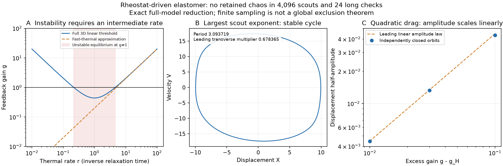

# An electrical rheostat oscillator: negative chaos search and exact scaling

We tested another specific published system: the electrically heated elastomer oscillator of Li, Li and Zhou [1]. The result is negative so far: **4,096 GPU scouts and 24 distinct long follow-ups produced no retained chaos candidate**. An independent periodic-orbit calculation explains the strongest weak positive estimate. This is a finite search, not a theorem excluding chaos everywhere.



## The model actually tested

The source combines a spring, an elastomer, a mass and a displacement-controlled rheostat. Dropping bars from its dimensionless variables, its full equations (15)–(17) reduce to

$$\dot u=v,\qquad
\dot v=-K u+\alpha T-C_1v-C_2|v|v,\qquad
\tau\dot T=Q_0-\beta u-T,\qquad K=1+j.$$

We retain the paper's assumed heating law `Q=Q0-beta*u`. It is not derived here from a newly chosen resistor characteristic. The full model has three states; the source's fast-thermal approximation (24) is a different, planar model. That autonomous planar approximation cannot have a classical strange attractor on a regular bounded region. This dimensional argument does not exclude chaos in the full three-state equations.

The equations describe a constitutive idealization. Negative electrical heating, negative temperature rise, loss of tension and large strains would require reconsidering that idealization. We do not clamp those quantities or add contact laws silently. No physical chaotic regime is claimed.

## Three parameters, exactly

For positive `alpha,C2,K,tau,beta`, shift to the equilibrium

$$u_0=\frac{\alpha Q_0}{K+\alpha\beta},\qquad
T_0=\frac{KQ_0}{K+\alpha\beta}.$$

With `s=sqrt(K)t`, set

$$X=C_2(u-u_0),\quad V=\frac{C_2v}{\sqrt K},\quad
Y=\frac{\alpha C_2(T-T_0)}K.$$

The exact transformed equations are

$$X'=V,\qquad V'=-X-cV-|V|V+Y,\qquad Y'=-r(Y+gX),$$

where

$$c=\frac{C_1}{\sqrt K},\qquad r=\frac1{\tau\sqrt K},\qquad g=\frac{\alpha\beta}K.$$

Thus `Q0` shifts the operating point, and `C2>0` sets the amplitude scale. Neither is an additional independent parameter of the normalized dynamics. Exponents quoted below use time `s`; multiplying by `sqrt(K)` converts them to the source's dimensionless time. The normalization is singular at `C2=0`, where the original equations become linear. No nonlinear attractor claim is made for that boundary.

The Jacobian and divergence are

```math
J=\begin{pmatrix}0&1&0\\-1&-c-2|V|&1\\-rg&0&-r\end{pmatrix},\qquad
\nabla\cdot F=-c-2|V|-r.
```

Negative divergence is volume contraction, not by itself a global boundedness proof. An algebra audit checks 64 randomly scaled source states against the normalized field. The maximum absolute conversion error is `4.55e-13`.

## A finite thermal-response window

The equilibrium's exact characteristic polynomial is

$$p(\lambda)=\lambda^3+(c+r)\lambda^2+(1+cr)\lambda+r(1+g).$$

For `c,r,g>0`, Routh–Hurwitz gives local asymptotic stability precisely when

$$g<g_H(c,r)=\frac cr+c^2+cr.$$

At equality the eigenvalues are `±i sqrt(1+cr)` and `-(c+r)`. This is an exact **linear crossing condition**, not an automatically certified nonlinear Hopf bifurcation.

For fixed `c>0`, the threshold is smallest at `r=1`, with minimum `c²+2c`. If `g>c²+2c`, the equilibrium is unstable only between

$$r_\pm=\frac{g-c^2\pm\sqrt{(g-c^2)^2-4c^2}}{2c}.$$

Both very fast and very slow heat exchange can restore local stability. For example, `c=.2,g=1` gives `r_-=.2182575771` and `r_+=4.5817424229`. Local stability does not rule out remote coexisting attractors.

The source's small-thermal-time threshold becomes `g≈cr`, which is the leading large-`r` part of the exact formula. It should not be extrapolated to very slow thermal response. This is a consequence of retaining the third state, not a modification of the source equations.

## Survey and independent periodic control

The Sobol survey covers `log10(c) in [-2.3,.3]`, `log10(r) in [-1.5,1.5]`, and `log10(g/g_H) in [-.3,1.5]`. Each of 2,048 parameter tuples uses the same two initial states, `[.01,0,0]` and `[1,.2,-.1]`. This explores the equation family beyond the article's fast-thermal examples; it is not a calibrated device survey.

The GTX 1080 uses FP64 adaptive Dormand–Prince 5(4), an analytic tangent equation, and tangent renormalization after each accepted step. Short-time comparisons against independent CPU DOP853 give state discrepancies below `9.44e-12` and finite-time exponent discrepancies below `2.03e-9`. Finite-difference Jacobian checks and the coordinate audit are recorded separately.

| Stage | Distinct trajectories | Discard + observation | Relative tolerance | Outcome |
| --- | ---: | ---: | ---: | --- |
| Scout | 4,096 | 500 + 1,000 | `1e-8` | All complete; zero candidates; 15.40 s |
| Follow-up of the 24 largest scout means | 24 | 2,000 + 4,000 | `1e-10` | Zero retained; all eventually complete |

Follow-ups halve the maximum step. Six initially exhaust a three-million-attempt budget; those six are explicitly retried with a fifteen-million budget. The first follow-up takes 34.18 s and the retry 58.74 s. Original unresolved statuses remain in the saved files; `survey-summary.json` reconciles them without double-counting. No unresolved case is reported as a negative result.

The screening rule requires a mean exponent above `.005` and all four window means above `.002`. The largest scout mean is only `.00303893`; its windows have mixed signs. The maximum mean after the long checks is `.00069808`. Values this close to the neutral flow exponent do not establish chaos.

At the strongest scout, index 777,

`c=1.7955178173, r=.2437837794, g=298.6099436`,

independent DOP853 integration and shooting close a periodic orbit of period **`3.0937187321`**. The resolved leading transverse multiplier is **`0.678365389`**, inside the unit circle; the other is approximately `1.1e-13`, with limited relative precision. Independent Radau closure is `3.01e-11`, and the two return Jacobians agree to `9.08e-12`. Its refined largest flow exponent is `.0000506`, with mixed-sign windows. This provides a concrete regular explanation for that weak positive estimate.

The finite scan and orbit control leave open unsampled parameter regions, other initial conditions and arbitrarily long transients. No global absence theorem or basin-volume estimate follows.

## Quadratic drag changes the onset amplitude law

The drag `|V|V` is continuously differentiable but not twice differentiable at zero. A textbook smooth cubic Hopf normal form should not simply be assumed. Its first harmonic for a sinusoidal velocity of amplitude `A_V` is equivalent to additional damping `(8/(3 pi)) A_V`.

Using that harmonic balance in the exact stability threshold gives the leading small-excess estimate

```math
A_X\sim\frac{3\pi}{8}\frac{g-g_H}{\sqrt{1+cr}\,(1/r+2c+r)}.
```

The prediction is linear in excess gain. At `c=.2,r=1`, independently closed stable orbits for excess gains `.1,.03,.01` give measured-to-leading amplitude ratios **`.96718,.98982,.99657`**. Their periods are `5.64042,5.70626,5.72582`, and leading transverse multipliers `.90215,.96845,.98925`. Radau return-Jacobian discrepancies stay below `3.9e-12`. This supports the leading approximation near onset; it is not an interval-certified bifurcation theorem.

## Literature status

The primary article already cites chaotic LCE pendula [2,3]; the material class is not new territory. Exact-title, DOI, rheostat-feedback and Lyapunov queries did not reveal a matching chaos demonstration for this specific model. OpenAlex listed one forward citation, an experimental NIR soft-actuator paper [4]; the accessible full article did not supply such a result. These checks are incomplete and cannot prove absence from the literature. Given our negative numerical result, this model is a lower-priority chaos candidate.

## Reproduction

```bash
python research/rheostat.py --validate
python research/rheostat.py
python research/rheostat.py --refine results/rheostat/scout --top 24 --transient 2000 --duration 4000 --rtol 1e-10 --step-factor .5 --output results/rheostat/refined
python research/rheostat.py --refine results/rheostat/scout --indices 2935 3655 1366 2183 1134 54 --transient 2000 --duration 4000 --rtol 1e-10 --step-factor .5 --max-attempts 15000000 --output results/rheostat/refined-retry
python research/analyze_rheostat.py
python research/render_rheostat.py
```

Retry indices are those unresolved on the recorded hardware/run; the general rule is to retry every unresolved selected trajectory, not to assume other hardware yields the same list. Scripts, normalized data, failed-attempt statuses, controls and the figure are original. Source article files stay local and are not redistributed under MIT.

## References

1. **Li, K., Li, Z., and Zhou, L.** (2025). Electrically Driven Liquid Crystal Elastomer Self-Oscillators via Rheostat Feedback Mechanism. *Polymers*, **17**(5), 617. [doi:10.3390/polym17050617](https://doi.org/10.3390/polym17050617). [Open full text](https://pmc.ncbi.nlm.nih.gov/articles/PMC11902770/).
2. **Sun, X., Ge, D., Li, K., and Xu, P.** (2024). Chaotic self-oscillation of liquid crystal elastomer double-line pendulum under a linear temperature field. *Chaos, Solitons & Fractals*, **189**, 115653. [doi:10.1016/j.chaos.2024.115653](https://doi.org/10.1016/j.chaos.2024.115653). Bibliographic context from [1]; not modeled here.
3. **Xu, P., Chen, Y., Sun, X., Dai, Y., and Li, K.** (2024). Light-powered self-sustained chaotic motion of a liquid crystal elastomer-based pendulum. *Chaos, Solitons & Fractals*, **184**, 115027. [doi:10.1016/j.chaos.2024.115027](https://doi.org/10.1016/j.chaos.2024.115027). Bibliographic context from [1]; not modeled here.
4. **Li, M., and Ma, Y.** (2025). Biomimetic Soft Actuator with Deformation and Motion Driven by Near-Infrared Light. *Polymers*, **17**(10), 1315. [doi:10.3390/polym17101315](https://doi.org/10.3390/polym17101315). [Open full text](https://pmc.ncbi.nlm.nih.gov/articles/PMC12115308/).
