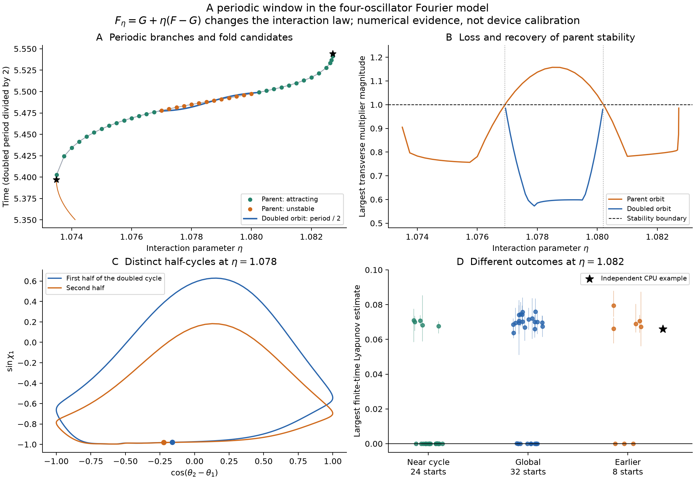

# Inside a periodic window: doubled cycles and competing outcomes

Research notebook, 29 October 2026. This continues the [four-oscillator investigation](synchronematic-research.md).

**The regular window contains a reproducible period-doubling interval, and nearby parameter values support an attracting periodic orbit alongside persistent numerical chaos candidates.** A single initial condition would miss this dependence on the basin of attraction.

These results concern the explicit family

$$F_\eta=G+\eta(F-G),\qquad G=-\nabla V,$$

where $F$ is the printed fixed-center Fourier approximation of Leyva et al. [1]. The source model is at $\eta=1$. Varying $\eta$ changes its interaction law; it is a mechanism experiment, **not a calibrated physical parameter scan**. The source coefficient-sign ambiguity, omitted interaction harmonics and known single-particle Quincke chaos remain as discussed in the main notebook. No first-discovery claim is made.



In panel A, the doubled orbit's period is divided by two to compare its branch with the parent; its actual period is about 10.96. Panel B omits the neutral flow multiplier. Panel D shows means and ranges across four observation windows, not uncertainty bars or basin-volume estimates. The local starts pool three different perturbation sizes, detailed below.

## Continue an orbit instead of coloring trajectories

We remove common phase using seven coordinates,

$$q=(\theta_2-\theta_1,\theta_3-\theta_1,\theta_4-\theta_1,\chi_1,\ldots,\chi_4).$$

A periodic orbit in this quotient satisfies

$$\varphi_T(q;\eta)-q=2\pi k,$$

with fixed integer winding vector $k$. For the parent branch, $k=(1,-1,1,0,0,0,0)$. A phase condition removes the freedom to start anywhere along the orbit. Newton shooting uses the analytically integrated monodromy matrix, and pseudo-arclength continuation follows the branch through a fold. These are periodic **relative configurations**; the common phase of the original system has been removed.

The initial fixed-parameter Newton sweep jumped to another unstable solution below the lower fold. Its raw converged solutions are retained and the jump is explicitly flagged. Those points are not connected to the regular branch in the figure. A small shooting residual alone does not establish that two solutions belong to the same continued branch.

## Numerical bifurcation candidates

| Event | Approximate $\eta$ | Parent period | Diagnostic |
| --- | ---: | ---: | --- |
| Lower fold | 1.073489703 | 5.397039029 | A transverse multiplier reaches +1; pseudo-arclength turns in $\eta$ |
| First flip | 1.076919520 | 5.477254241 | A transverse multiplier crosses −1; parent loses stability |
| Second flip | 1.080203830 | 5.498791547 | The multiplier crosses −1 in reverse; parent regains stability |
| Upper fold | 1.082713706 | 5.544237143 | Periodic closure and a transverse +1 multiplier coincide |

The numerical multiplier slopes at the two flip crossings are approximately −185.5 and +211.9 per unit $\eta$. Independent Radau integration and tighter DOP853 settings reproduce the orbit closures and relevant monodromy matrices. These are numerical bifurcation candidates, not interval-validated existence proofs or a full calculation of generic normal-form coefficients.

The primary orbit is attracting on the sampled branch before the first flip and after the second. Between them, a doubled orbit is attracting at all **34 continued sample points** from $\eta=1.07694$ to $1.08018$. At $\eta=1.078$:

$$T_2=10.963633079,
\qquad \max|\mu_{\rm transverse}|=0.584941.$$

Its state differs from its starting state after $T_2/2$, with circular-coordinate distance about 0.1025; it closes after $T_2$. This excludes a mere double traversal of the parent orbit. The half-period mismatch becomes smaller near both flip boundaries, and the doubled cycle's leading multiplier approaches +1. The observations support a **period-doubling bubble**: the period doubles and then returns, rather than an established cascade to chaos. No further doubling cascade was demonstrated here.

## Same parameters, different long-run outcomes

At $\eta=1.082$, independent shooting finds a stable parent orbit with

$$T=5.516596800,\qquad \max|\mu_{\rm transverse}|=0.793802.$$

A new GTX 1080 survey uses 64 starts at precisely this geometry and interaction law. It discards 4,000 time units and observes 8,000 more, with FP64 RK4 step 0.0025, half the previous survey step. All 64 integrations complete. A retained numerical chaos candidate requires mean largest exponent above 0.002 and all four window estimates above 0.001.

| Initial-state selection | Starts | Retained positive-exponent candidates |
| --- | ---: | ---: |
| Gaussian perturbations of periodic-orbit state, angular standard deviation 0.001 | 8 | 0 |
| Same, standard deviation 0.01 | 8 | 1 |
| Same, standard deviation 0.1 | 8 | 4 |
| Independent uniform angles | 32 | 19 |
| Eight starts from the earlier survey | 8 | 5 |
| Total | 64 | 29 |

The five previously positive starts remain positive in this longer, smaller-step run; the other three remain near zero. Tight perturbations of the periodic orbit remain regular, while larger perturbations can reach the irregular regime. This supports distinct basins in the numerical model. It does not show that the basin boundary is fractal, quantify basin volume, or exclude an exceptionally long chaotic transient.

The GPU calculation takes about 532 seconds on this machine. This is measured wall time, not a claimed speedup against a comparable CPU benchmark.

An independent CPU DOP853 calculation starts from earlier-survey index 612, discards 2,000 units and observes 8,000, with full tangent-frame QR every 0.25 units and relative tolerance $10^{-11}$. Its seven-dimensional quotient spectrum is approximately

$$\lambda=(0.065941,-0.000103,-0.089660,-0.922940,-2.464566,-3.367599,-6.602607).$$

All four 2,000-unit leading-exponent windows remain positive: **0.059485, 0.074426, 0.063295, 0.066560**. The sum of the spectrum agrees with integrated divergence to $9.55\times10^{-12}$. The near-zero second exponent is consistent with the neutral flow direction, not evidence of hyperchaos. For the same original start, the new GPU mean is 0.066181. Full settings and histories are under [n4-coexistence-chaos-cpu](../results/synchronematic/n4-coexistence-chaos-cpu/).

The angular state space is compact, so these trajectories do not escape to infinity. Nevertheless, persistent finite-time positive exponents plus a stable periodic orbit are numerical evidence for coexistence, not a validated proof of two attracting invariant sets.

## Numerical controls and limits

- The reduced coordinate maps compose to the identity exactly in the implemented matrices.
- Monodromy directional finite differences agree within $1.11\times10^{-9}$; parameter sensitivities within $1.24\times10^{-8}$.
- At the reference cycle, DOP853 and Radau differ by at most $1.06\times10^{-13}$ in state and $4.59\times10^{-12}$ in monodromy entries.
- Independent checks of the three representative cycles give closure errors below $3.35\times10^{-12}$ and monodromy differences below $2.77\times10^{-11}$.
- Independent fold checks reproduce the transverse unit multiplier within $8.72\times10^{-11}$.

Very small contracting multipliers are below reliable relative precision in direct monodromy integration. The dominant multipliers used for the stated stability changes are well separated from that limitation. The numerical stability evidence concerns the sampled orbit family; it does not enumerate all coexisting orbits or all chaotic regions.

## Reproduction

Run from the repository root after the earlier transition survey and reference periodic-orbit files exist:

```bash
python research/continue_synchronematic_orbit.py
python research/analyze_synchronematic_orbit.py
python research/locate_synchronematic_folds.py
python research/check_synchronematic_doubled_orbit.py
python research/continue_synchronematic_doubled.py
python research/probe_synchronematic_coexistence.py
python research/check_synchronematic_reference.py --source results/synchronematic/n4-transition --index 612 --transient 2000 --duration 8000 --rtol 1e-11 --output results/synchronematic/n4-coexistence-chaos-cpu
python research/render_synchronematic_bifurcations.py
```

The dependent orbit continuation and selected independent checks run on CPU. The ensemble uses the existing OpenCL implementation. Raw orbit states, winding vectors, monodromy eigenvalues, closure errors, failed corrections and settings are in [n4-periodic-branch](../results/synchronematic/n4-periodic-branch/); ensemble data and group labels are in [n4-coexistence-gpu](../results/synchronematic/n4-coexistence-gpu/).

## Why this is useful

A parameter map can mix several questions: whether a stable periodic orbit exists, whether some starts give long-lived irregular motion, and which basin a chosen initial condition reaches. This calculation separates those questions. It also replaces one unexplained regular patch with specific orbit branches and stability changes.

The remaining substantive question is whether the same mechanisms survive the actual, untruncated interaction functions and physical corrections. The present homotopy helps explain a mathematical model; it does not by itself predict a new experimental regime.

## Reference

1. Leyva, S. G., Zhang, Z., Olvera de la Cruz, M., and Bishop, K. J. M. (2026). Self-oscillating synchronematic colloids. *Nature Communications*, **17**, 1841. [DOI](https://doi.org/10.1038/s41467-026-68552-8). Our $\eta$ family modifies the printed Fourier approximation; it is not a parameter specified in the article.
