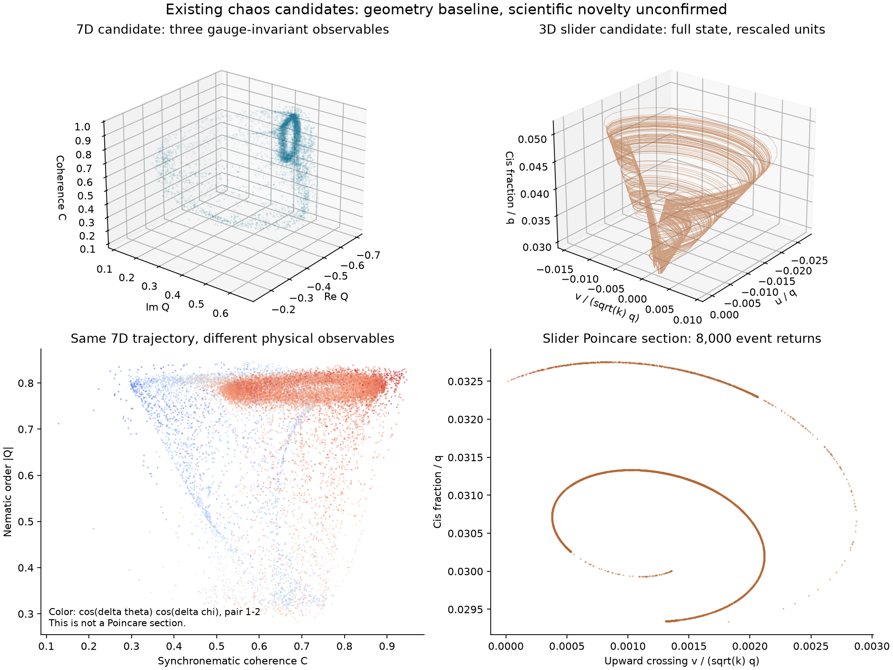
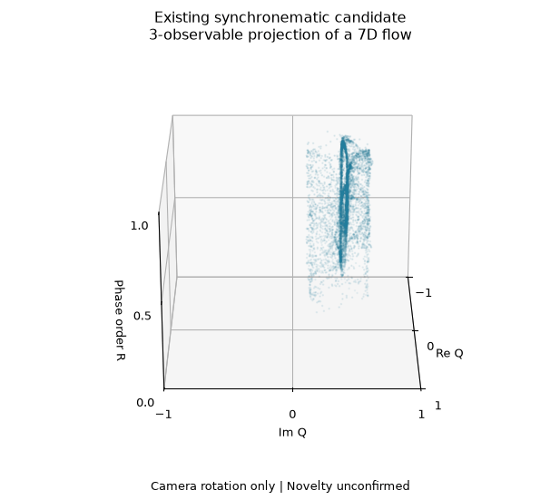

# Synchronematic priority and physical-observable audit

Audit snapshot: 29 October 2026, 23:45 UTC. This note separates a numerical candidate, an exact-model literature question, and a correction to how the candidate is drawn. It does not announce a new attractor.

**The strongest remaining lead is collective chaos in the specific, deterministic, fixed-center Fourier approximation of Leyva et al. [1]. Its scientific priority remains unresolved.** Chaos in Quincke particles, chaos in four coupled phase oscillators, and chaos in swarmalator models are already known. Our evidence therefore cannot support those broader novelty claims.

**A concrete correction was necessary:** the earlier phase-order axis was not invariant under the physical phase-angle equivalence. The saved dynamics and Lyapunov spectra are unchanged; the figures now use observables that respect this equivalence.

## What the nearest primary sources establish

| Primary source | Equations or result checked | Consequence for this candidate |
| --- | --- | --- |
| Leyva et al. [1], main Eqs. 10–12 and Supplementary Notes 1, 6 and 8 | Fixed centers; one phase and one orientation per particle; distance-dependent interactions with bond directions; a fitted, separable Fourier approximation. Note 8 already decomposes the field into gradient and divergence-free parts. | These equations, their decomposition, and their synchronematic interpretation are prior work. Our candidate concerns a regime of their stated approximation. |
| Zhang dissertation [2], pp. 29–32, 43–47 and Appendix B | Single-particle chaotic motion is already shown. Pair equations 3.31–3.32 are a more general Fourier fit; p. 46 explicitly anticipates possible strange attractors under other conditions. | Neither Quincke chaos nor the general suggestion of collective strange attractors is our discovery. The earlier fit is not the identical factorized model we integrated. |
| Bick et al. [3], Eq. 1 and Figs. 1–3 | Four identical, globally coupled phase oscillators can be chaotic. Their coupling has four Fourier harmonics; periodic windows, period doubling and coexistence also occur. | Four units and those bifurcation features alone are not novel. The exact vector fields differ. |
| O'Keeffe [4], model equations and chaotic regimes | A self-propelled one-dimensional swarmalator has a position angle and an orientation angle, with collective chaos in a larger population. | Two angles per unit and swarmalator chaos are not sufficient novelty criteria. Here position evolves; in our candidate it is fixed geometry, while orientation evolves. |

For a precise comparison, Bick et al. use

```text
d phi_k / dt = omega + (1/N) sum_j g(phi_k - phi_j),
g(phi) = sum_{m=1}^4 a_m cos(m*phi + xi_m).
```

Their N=4 reduction has three phases after removing the common rotation, full permutation symmetry, and invariant phase-coincidence planes. Our N=4 model has seven effective angles, geometric pair weights and bond directions. Equal phases with unequal orientations need not remain equal: at one recorded geometry and test state, the four phase velocities were `(-1.57656, 0.62477, -0.48279, 1.43458)`. This is a direct structural mismatch, not a proof that no lower-dimensional invariant dynamics or conjugate attractor could exist.

The one-dimensional model in [4] instead uses

```text
d x_i / dt     = v0*sin(theta_i) + (J/N) sum_j sin(x_j-x_i)*cos(theta_j-theta_i),
d theta_i / dt = (K/N) sum_j sin(theta_j-theta_i)*cos(x_j-x_i).
```

The self-propulsion term, evolving positions and uniform all-to-all interactions distinguish it from the fixed-center geometric model. No general nonequivalence theorem is claimed.

## The pair integral has a narrow scope

Our [pair-integral derivation](synchronematic-pair-integral.md) gives, inside a regular angular chamber,

```text
I = log(abs(sin(a)/sin(b))) + integral S_chi(delta)/S_theta(delta) d(delta),
dI/dt = 0.
```

The cancellation follows from the separable factors `cos(a) cos(b)` and `sin(a) cos(b)`. I did not find this identity in the inspected 2026 supplementary pair analysis or the 2023 dissertation discussion. That bounded observation is not a claim of first discovery.

The dissertation fit contains additional angle terms and separately fitted coefficients multiplying angle sums and differences. Consequently, its equations do not automatically inherit this cancellation. In particular, our integral does not refute the dissertation's broader suggestion of collective strange attractors. Nor does the N=2 result prove N=4 is minimal: the N=3 case needs its own analysis.

## A physical quotient changes which pictures are meaningful

Supplementary Note 1 of [1] identifies the same physical oscillation with either pair of labels

```text
(theta_i, chi_i) ~ (theta_i + pi, chi_i + pi).
```

This is an independent choice for every particle; Note 6, Eq. 6.61, states the corresponding interaction symmetry. A physical observable must therefore take the same value for all 16 equivalent descriptions of an N=4 state. The ordinary phase order

```text
R = abs(mean(exp(i*theta)))
```

fails that test. A single particle's relabeling reverses its contribution to the sum. The former color `cos(theta_2-theta_1)` and several former phase-only plot coordinates had the same problem. They were valid coordinates in a chosen covering-space convention, but were incorrectly presented as physical observables independent of that convention.

The replacement is

```text
Q = mean(exp(2*i*chi)),
U = mean(exp(i*(theta+chi))),
V = mean(exp(i*(theta-chi))),
C = sqrt((abs(U)^2 + abs(V)^2)/2).
```

`C` is synchronematic coherence, and `Q` is complex nematic order. Their relation to physical pair correlations is

```text
C^2 = mean over all ordered pairs (i,j) of
      cos(theta_j-theta_i)*cos(chi_j-chi_i).
```

The self-pairs are included. This identity proves nonnegativity and shows that C is sensitive to joint phase-and-axis alignment. A reversed axis accompanied by a half-period phase shift reinforces the same physical order. Both C and Q survive each local relabeling and a uniform phase shift. The complex U and V individually acquire a common phase factor, so their raw complex coordinates are not used here.

The main view now plots **(Re Q, Im Q, C)**. Its color in the alternative view is the even pair correlation above. The evidence panel uses phase-odd pair correlations

```text
P_ij = sin(theta_j-theta_i)*cos(chi_j-chi_i)
```

and `sin(2*chi_1)`. These also pass both invariance checks. Q is expressed in the fixed laboratory coordinate frame; rotating the entire apparatus can rotate its complex argument. That coordinate dependence is different from the local relabeling ambiguity addressed here.

### Checks on existing saved data

No trajectory was integrated for this audit. On 64,000 saved N=4 states:

| Check | Result |
| --- | --- |
| Largest range of former R across the 16 descriptions of one state | 0.998041 |
| Median of that range over the saved orbit | 0.693805 |
| Maximum difference of all replacement plot observables across the 16 descriptions | 1.89e-15 |
| Maximum replacement-observable change under a uniform phase shift | 8.89e-16 |
| Maximum residual in the all-pairs identity for C squared | 5.56e-16 |
| Vector field / Jacobian change at four sampled states under all relabelings | 2.23e-15 / 4.89e-15 |

The saved doubled periodic orbit also retains distinct physical half-cycles. Matching its two equal-time halves against all 16 constant relabelings gives a smallest maximum wrapped angular residual of about **0.7851 radians**. Their invariant pair-correlation and `sin(2*chi_1)` differences reach **0.5095** and **1.4077** respectively. The apparent doubling therefore does not disappear merely by making this quotient correction; this check is not a proof of the orbit's minimal period.

The shared implementation is [synchronematic_observables.py](../research/synchronematic_observables.py). Regenerate the corrected figures from saved data with:

```powershell
.venv/Scripts/python.exe research/attractor_geometry.py
.venv/Scripts/python.exe research/plot_synchronematic.py
.venv/Scripts/python.exe research/render_synchronematic_bifurcations.py
```

Run `.venv/Scripts/python.exe research/synchronematic_observables.py` to repeat the gauge, pair-correlation identity, and saved half-cycle checks without integration. Machine-readable findings and search scope are in [priority-audit.json](../results/synchronematic/priority-audit.json).





These are projections of a seven-dimensional angular flow, not embeddings. Smooth invariant observables can identify distinct states. A new silhouette after this correction is not new dynamics and does not establish a new topological type.

## What is still needed for a priority or geometry claim

1. **Resolve the model version.** The printed article and the author's NumPy branch have opposite signs for the orientation `sin(3*delta)` coefficient. The separate Numba branch also has asymmetric term omissions. Our [source audit](../results/synchronematic/source-audit.json) records these differences; both principal coefficient variants have numerical chaotic candidates, but that does not determine the intended physical fit.
2. **Recover or independently reconstruct the untruncated interaction.** Robustness within the fitted equations is not evidence that the complete hydrodynamic reduction or experimental device has this collective attractor. The reported approximation error cannot simply be interpreted as independently bounded coefficient errors.
3. **Compare mechanisms on the physical quotient.** The periodic-window and coexistence results are useful characterizations, but common in earlier phase networks. A convincing difference would require more specific invariant or periodic-orbit organization, with a justified reconstruction if three-dimensional topological tools are used.
4. **Complete a broader exact-equation priority search.** The latest author-repository snapshot examined has only commit `016614ad6debe11e0353f0a01b1fad937fc77461` and no returned issues. OpenAlex returned one indexed citing work, an electroconvection paper [6]. Neither an empty issue search nor one citation index exhausts subsequent or equivalent work.

Letellier and Aguirre [5] explicitly separate new equations from a new attractor type. Only their publisher abstract was inspected here; its cord-attractor example is a warning against declaring novelty from appearance. We have not performed its periodic-orbit comparison or established a topology invariant for this seven-dimensional candidate.

The defensible current label is **a reproducible numerical collective-chaos candidate in a specified published approximation, with scientific novelty unconfirmed**. The pair integral and the physical-observable correction are useful analytical controls. The current search does not establish that either is unpublished.

## References and inspection scope

1. Leyva, S. G., Zhang, Z., Olvera de la Cruz, M., and Bishop, K. J. M. (2026). Self-oscillating synchronematic colloids. *Nature Communications* **17**, 1841. [Article and supplement](https://doi.org/10.1038/s41467-026-68552-8). Main equations and cited supplement sections inspected. [Author code snapshot](https://github.com/slevinskygra/ReducedSynchronematic/tree/016614ad6debe11e0353f0a01b1fad937fc77461); source inspected as evidence, not copied or executed.
2. Zhang, Z. (2023). *Quincke Oscillators: Dynamics, synchronization, and assembly of self-oscillating colloids*. Columbia University dissertation. [DOI](https://doi.org/10.7916/0pgk-pw45). Chapter 3 and Appendix B inspected, including the pair fit and single-particle chaotic examples. Related article: [Physical Review E **107**, 054603](https://doi.org/10.1103/PhysRevE.107.054603); the dissertation is the detailed evidence used here.
3. Bick, C., Timme, M., Paulikat, D., Rathlev, D., and Ashwin, P. (2011). Chaos in Symmetric Phase Oscillator Networks. *Physical Review Letters* **107**, 244101. [DOI](https://doi.org/10.1103/PhysRevLett.107.244101); [full primary preprint](https://arxiv.org/html/1105.2230v2). Model and bifurcation examples inspected, beyond the abstract-only earlier notebook check.
4. O'Keeffe, K. P. (2026). Self-propulsion in the 1D swarmalator model. [Primary preprint arXiv:2606.10282](https://arxiv.org/html/2606.10282v1). Model equations and chaotic-regime sections inspected. This is adjacent-model prior art, not an assertion of exact equivalence.
5. Letellier, C., and Aguirre, L. A. (2012). Required criteria for recognizing new types of chaos: Application to the cord attractor. *Physical Review E* **85**, 036204. [DOI](https://doi.org/10.1103/PhysRevE.85.036204). Publisher abstract inspected; full text not obtained in this block.
6. *Particle-Induced Electroconvection in Nonpolar Liquids* (2026). *Langmuir*. [DOI](https://doi.org/10.1021/acs.langmuir.6c02032). Citation-index metadata only in this block; not a completed full-text priority audit. [OpenAlex source-work record](https://openalex.org/W7125514816).
