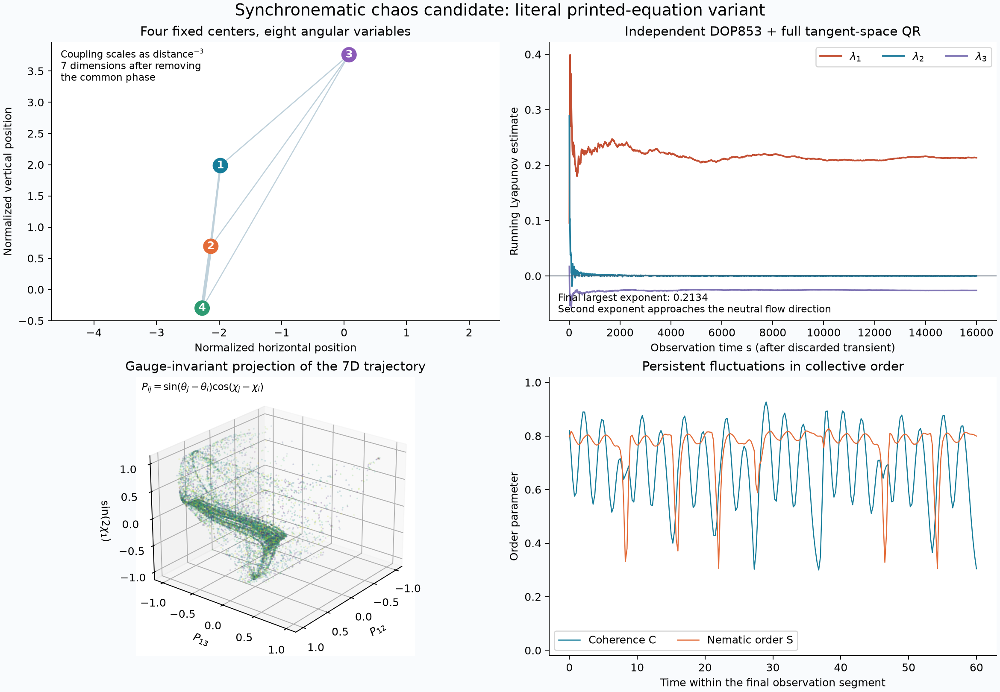
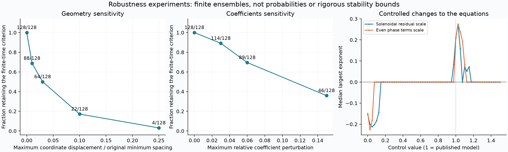
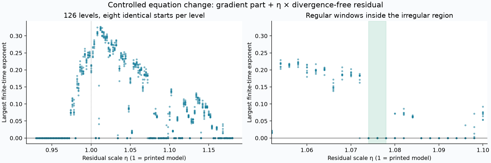

# Four synchronematic oscillators: a numerical chaos candidate

Research notebook, 29 October 2026. This continues the [search beyond Chua](candidate-research.md).

**We found persistent positive Lyapunov exponents in the published, deterministic Fourier approximation of a synchronematic colloid model.** The strongest checked examples use four oscillators at fixed centers. Independent CPU integration, a full Lyapunov spectrum, smaller GPU steps, different initial states, and local perturbations support the result. This is numerical evidence in a specified reduced model. Publication novelty, an asymptotic strange attractor, and chaos in the physical experiment are not established.

**Source discrepancy found during the audit:** the article and its supplied TeX print `B3_chi=-1.359`, whereas the authors' repository NumPy branch implies `B3_chi=+1.359334`. The main results below use the **literal printed equations**. In a separate long GPU comparison, both signs retain chaos candidates: `128/128` starts for the printed coefficients and `124/128` for the repository coefficients. Neither source is silently substituted for the other. See [source-audit.json](../results/synchronematic/source-audit.json) and the [pinned source](https://github.com/slevinskygra/ReducedSynchronematic/blob/016614ad6debe11e0353f0a01b1fad937fc77461/simulation_numba.py).



The later [symmetry and priority audit](synchronematic-priority-audit.md) corrects the plotted observables to respect each particle's physical phase/orientation equivalence. The figures now use invariant pair signals and synchronematic coherence; the trajectories and Lyapunov estimates are unchanged. That audit also compares the full equations with older four-phase-oscillator chaos and swarmalator models. Neither an unusual projection nor the already published gradient/solenoidal decomposition establishes novelty.

## Why this candidate?

Leyva et al. [1] study coupled Quincke oscillators with both a phase and an orientation. Their reduced equations provide a concrete target for investigating deterministic irregular motion. We use their reported coefficients without fitting them to produce chaos. The centers stay fixed and both noise terms are set to zero. The paper's low-order interaction approximation has about 6% error; omitted harmonics and physical effects therefore matter.

The main article, supplementary material, peer-review file, author project page, author repository, an indexed forward citation, and the author's dissertation were checked. We did not locate an explicit deterministic-chaos/Lyapunov result for these exact coupled phase-orientation equations. This is a bounded search, **not proof that the result is unpublished**. General Quincke chaos [2] and chaos in other swarmalator models [3] already exist. More directly, Zhang's 2023 dissertation [6], Chapter 3 and Appendix B.4.2, explicitly presents **single-particle chaos in the underlying charge-moment model**, associated with the work in [5]. Thus a claim of first chaos in that physical model would be wrong. The narrower question here concerns collective chaos of coupled phase/orientation variables around a periodic single-particle regime. The [search record](../results/synchronematic/literature-search.json) records the scope and exclusions.

Our Python/OpenCL implementation was written independently from the equations. The authors' public code was subsequently inspected to compare the mathematical coefficients; no simulation source was copied or executed. Its separate Numba reverse-pair expressions also omit two terms present in the forward pair. Our source-variant comparison targets the symmetric equations of its NumPy branch, not that differing Numba branch or its Euler time discretization.

The three-way comparison in [n4-source-variants](../results/synchronematic/n4-source-variants/) uses the same 128 initial states and geometry, discards 2,000 time units, and observes 4,000 with step 0.005. Printed rounded negative coefficients retain 128 starts (ensemble mean LLE `0.20589`); repository precision with the negative sign retains 128 (`0.22723`); repository precision with its positive sign retains 124 (`0.18947`). The four rejected positive-sign trajectories show that source differences can still change individual outcomes. A broader positive-sign survey retains 65 of 2,048 preliminary candidates and **58 of those 65** after long follow-up.

An [independent DOP853/QR check of the repository-coefficient variant](../results/synchronematic/n4-repository-cpu/spectrum.json) gives leading exponent **0.194821**, with four windows `0.192258, 0.192838, 0.206931, 0.187256`. Its second exponent is `-0.000546`, consistent with the neutral flow direction; the spectrum/divergence discrepancy is `1.1e-11`. Thus the positive signal in that variant is independently supported, rather than inferred from the printed-sign calculation.

## Exact model and units

For each ordered pair, let

$$
\Delta_{ij}=\theta_j-\theta_i,\qquad
\mu_{ij}=\arg(\mathbf r_j-\mathbf r_i),\qquad
\psi_i=\chi_i-\mu_{ij},\quad \psi_j=\chi_j-\mu_{ij}.
$$

After removing the common phase, the implemented field is

$$
f_i=\sum_{j\ne i}d_{ij}^{-3}F_\theta(\Delta_{ij})\cos\psi_i\cos\psi_j,
\qquad \theta_i'=f_i-N^{-1}\sum_k f_k,
$$
$$
\chi_i'=\sum_{j\ne i}d_{ij}^{-3}F_\chi(\Delta_{ij})\sin\psi_i\cos\psi_j,
$$
$$
F_\theta(\Delta)=2.921\cos\Delta+2.070\sin\Delta-0.781\cos3\Delta+0.312\sin3\Delta,
$$
$$
F_\chi(\Delta)=-5.351\cos\Delta+0.223\sin\Delta+3.009\cos3\Delta-1.359\sin3\Delta.
$$

The common-phase subtraction is a symmetry reduction, not a change to relative-phase or orientation dynamics. Four oscillators leave seven effective dimensions. All coordinates are angles: the state space is compact, so a trajectory cannot escape to infinity on this space. A three-dimensional projection is not the full attractor and does not establish its dimension.

Geometries are normalized to minimum separation one. If physical dimensionless separations are `L` times these coordinates, the reported integration variable is `s=t/L^3`; exponents per original time are smaller by `L^3`. For example, `L=10` separates particles by at least ten radii, while an exponent of `0.2` becomes `0.0002` per original time unit. Using the paper's `0.44 ms` unit gives about `0.45 s^-1`. This conversion does not validate the far-field approximation quantitatively or show that deterministic separation dominates experimental noise.

## What survived the checks?

| Experiment | Trajectories | Observation after transient | Outcome |
| --- | ---: | --- | --- |
| Three-oscillator scout | 1,024 | 200 + 400, step 0.01 | 2 preliminary candidates |
| Three-oscillator selected follow-up | 16 | 2,000 + 4,000, step 0.005 | 0 retained |
| Four-oscillator scout | 2,048 | 200 + 400, step 0.01 | 37 preliminary candidates |
| Four-oscillator follow-up | 37 | 2,000 + 4,000, step 0.005 | 26 retained |
| Three selected four-oscillator geometries, eight starts each | 24 | 2,000 + 4,000, step 0.0025 | 24 retained |
| Six-oscillator scout | 1,024 | 200 + 400, step 0.01 | 99 preliminary candidates; not independently confirmed |
| Eight-oscillator scout | 512 | 200 + 400, step 0.01 | 150 preliminary candidates; not independently confirmed |

The retention rule requires a mean exponent above `0.002`, every one of four observation-window estimates above `0.001`, continued motion, and a valid integration status. These thresholds identify finite-time candidates, not a theorem. The three-oscillator failure does not prove that four oscillators are the minimum required number.

Additional small-cluster controls found no retained candidates among 1,024 starts for two oscillators with either source variant. Six preliminary three-oscillator candidates with repository coefficients also disappeared in a 16-trajectory long follow-up. Sixteen selected two-oscillator printed-variant trajectories likewise failed long follow-up. These checks narrow the numerical search without proving minimality.

A later [two-oscillator first integral](synchronematic-pair-integral.md) supplies an analytical constraint behind the pair-model negative controls: regular trajectories lie on two-dimensional invariant level surfaces after common phase is removed. The cancellation holds for both coefficient signs, but does not extend directly to three or more oscillators.

The reproducible reference is four-oscillator scout index **43**. Its exact geometry and initial angles are in [the independent check record](../results/synchronematic/n4-cpu-long/spectrum.json). With transient 1,000 and observation 4,000, adaptive DOP853 and thin QR give the seven-dimensional spectrum

```text
 0.173844,  0.001293, -0.023744, -1.722779,
-2.678712, -4.059498, -6.513999
```

The four largest-exponent windows are `0.181586, 0.176043, 0.180182, 0.157563`. The small second estimate is consistent with the neutral direction along an autonomous flow; it is not a hyperchaos claim. The sum, `-14.823595834`, agrees with independently integrated divergence to `1.2e-11`. This checks the variational/QR calculation and establishes average contraction along this numerical trajectory, not a trapping-region theorem.

The shorter CPU check and GPU runs give somewhat different averages. **Positivity is much better established than a precisely converged exponent magnitude.** Chaotic trajectories from different numerical schemes cease to track one another, and long finite-time averages still fluctuate. Longer checks are retained alongside, rather than overwriting the earlier evidence.

The [extended CPU run](../results/synchronematic/n4-cpu-extended/spectrum.json) discards **2,000** and observes **16,000** time units at `rtol=1e-12`, `atol=1e-14`. Its spectrum is

```text
 0.213421,  0.000169, -0.025989, -1.697132,
-2.668940, -4.053816, -6.520146
```

All four 4,000-unit leading-exponent windows remain positive: `0.219563, 0.217488, 0.190721, 0.225911`. The spectrum/divergence error is `1.3e-12`; the second estimate is closer to zero. The main figure uses this extended run when its files are present. These longer observations strengthen the persistence evidence while retaining measurable fluctuations between windows.

Validation also includes analytic-Jacobian finite differences and short-state comparisons to DOP853. For the four-oscillator reference, halving RK4's step decreases the state error by approximately sixteen each time: `3.17e-8`, `1.97e-9`, `1.22e-10`. A separate test exercises perturbed coefficients. See [validation-n4.json](../results/synchronematic/validation-n4.json).

## Geometry, basins and coefficient sensitivity



For the reference geometry, all **128** new random angular starts passed the four-window criterion after transient 1,000 and observation 2,000. This is evidence for a substantial basin within that ensemble, not a proof about every initial state.

Each geometry experiment draws 32 perturbations and four starts per perturbation. Each coordinate is displaced uniformly within the indicated fraction of the original minimum separation; the resulting geometry is renormalized to remove uniform time scaling.

| Maximum coordinate displacement | Retained trajectories / tested |
| ---: | ---: |
| 0 | 128 / 128 |
| 0.01 | 88 / 128 |
| 0.03 | 64 / 128 |
| 0.10 | 22 / 128 |
| 0.25 | 4 / 128 |

Thus the signal survives some nearby geometries but is geometrically selective. These are fractions in a designed finite ensemble, not confidence intervals or probabilities for arbitrary physical clusters.

Independent relative perturbations of the eight Fourier coefficients retain `114/128` candidates at 3%, `89/128` at 6%, and `46/128` at 15%. This tests sensitivity to those coefficients. It **does not bound the error caused by missing harmonics**, nor establish that the original untruncated interaction functions are chaotic.

## A mathematical control: turn off the non-gradient part

For a harmonic `n=1,3`, define

$$C_n=\frac{A_n^\chi-nB_n^\theta}{n^2+1}.$$

The potential

```math
V=\sum_{i\lt j}d_{ij}^{-3}\left(C_1\cos\Delta_{ij}+C_3\cos3\Delta_{ij}\right)\cos\psi_i\cos\psi_j
```

gives a gradient field `G=-grad V`. Direct differentiation yields phase sine coefficients `-n C_n` and orientation cosine coefficients `C_n`; all other coefficients vanish. For the published numbers these are

```text
phase:       [0, 3.7105, 0, -0.6219]
orientation: [-3.7105, 0, 0.2073, 0]
```

The residual `R=F-G` has zero divergence. The sum over pairs and common-phase reduction preserve this identity. We checked the potential gradient by finite differences and the residual divergence numerically; their maximum errors in the recorded sample are `6.7e-10` and `2.7e-15`.

The controlled family `F_eta=G+eta R` has the published model at `eta=1`. At `eta=0`,

```math
\frac{dV}{ds}=-\|\nabla V\|^2\le0.
```

Since `V` is smooth and bounded on the compact angular space, non-equilibrium recurrent motion cannot be a gradient-flow attractor. This supplies an analytic no-chaos endpoint. Removing only the even phase terms is a different control: it does **not** make the full coupled phase-orientation system a gradient flow. Both experiments are saved separately.

In a coarse 61-value scan from 0 to 1.5, with eight starts per value, the gradient endpoint converges (`median LLE=-0.1542`). Positive four-window candidates occur at `eta=0.975, 1.000, 1.025, 1.050, 1.100, 1.125, 1.150`, with all eight starts retained at each. The gap at `1.075` motivates a finer study of regular windows; this coarse scan does not locate exact bifurcation boundaries. The separate even-phase-term control retains candidates at scales `1.000` through `1.100` on the sampled 0.025 grid.

The follow-up samples 126 values from `eta=0.93` to `1.18` in steps of `0.002`, using the **same eight initial states at every value**, discarding 2,000 and observing 4,000 units. It retains 552 of 1,008 trajectories. All eight starts are regular-looking at `1.074, 1.076, 1.078`; partial retention occurs at `1.080` (2/8) and `1.082` (5/8), followed by 8/8 at `1.084` and another regular window. Differences between starts can reflect coexistence or long transients; this scan alone cannot distinguish them.



An independent CPU spectrum at `eta=1.074`, with 1,000 discarded and 4,000 observed units, is `[-0.0000152, -0.044947, -0.330186, -1.079680, -2.636193, -3.565713, -6.470759]`. One approximately neutral exponent and six negative exponents support a stable periodic regime. The divergence identity error is `1.1e-11`. This is a control experiment that changes the interaction law, not a newly sampled physical parameter of the original paper.

A subsequent [orbit-closure check](../results/synchronematic/n4-regular-window-cpu/recurrence.json) identifies period **`5.434302289`**, with angular residual about `2e-14` after removing common phase. The leading Floquet multipliers are approximately `1, 0.783336, 0.166123, 0.002833`; all resolved transverse multipliers lie inside the unit circle. This supplies numerical evidence for an attracting periodic orbit inside the irregular region. The smallest contracting multipliers approach floating-point resolution, and the calculation is not a validated existence proof.

The subsequent [orbit-continuation notebook](synchronematic-bifurcations.md) locates two fold candidates and a period-doubling bubble, checks a stable doubled cycle with an independent solver, and probes different basins at identical parameters. At `eta=1.082`, a stable periodic orbit exists while 29 of 64 long GPU trajectories retain positive exponents. The model modification and finite-time limitations remain explicit.

## Reproduce and inspect

From the repository root, with the [project dependencies](../requirements.txt):

```bash
python research/search_synchronematic.py --validate
python research/search_synchronematic.py --n 4 --geometries 256 --seeds 8
python research/search_synchronematic.py --refine results/synchronematic/n4-scout --top 16 --dt .005 --transient 2000 --duration 4000 --output results/synchronematic/n4-refined
python research/check_synchronematic_reference.py --transient 1000 --duration 4000 --rtol 1e-11 --output results/synchronematic/n4-cpu-long
python research/check_synchronematic_reference.py --transient 2000 --duration 16000 --rtol 1e-12 --output results/synchronematic/n4-cpu-extended
python research/robust_synchronematic.py --validate
python research/robust_synchronematic.py --mode step --dt .0025 --transient 2000 --duration 4000
python research/robust_synchronematic.py --mode geometry
python research/robust_synchronematic.py --mode coefficients
python research/robust_synchronematic.py --mode solenoidal --seeds 8
python research/robust_synchronematic.py --mode nonreciprocity --seeds 8
python research/continue_synchronematic.py
python research/check_synchronematic_reference.py --source results/synchronematic/n4-transition --index 576 --transient 1000 --duration 4000 --rtol 1e-11 --output results/synchronematic/n4-regular-window-cpu
python research/check_synchronematic_period.py
python research/audit_synchronematic_sources.py --mode reference
python research/audit_synchronematic_sources.py --mode survey
python research/audit_synchronematic_sources.py --mode refine
python research/check_synchronematic_reference.py --source results/synchronematic/n4-source-variants --index 259 --transient 1000 --duration 4000 --rtol 1e-11 --output results/synchronematic/n4-repository-cpu
python research/analyze_photofeedback.py
python research/plot_synchronematic.py
```

`scan.npz` files retain positions, initial/final angles, all four exponent windows, integration statuses and diagnostics. New robustness runs additionally retain the actual per-trajectory coefficients and experiment labels. JSON files record integration settings and selection rules. The CPU check integrates the full tangent frame, projects out common phase, performs thin QR every `0.25`, and integrates divergence separately.

## Questions still open

- Which coefficient sign was intended, and which implementation generated the published simulation figures? The current repository snapshot predates publication; the disagreement alone does not resolve this.

- Does the exact, untruncated interaction law retain these regimes? The publisher's source-data ZIP contains article TeX and figure PDFs, not the sampled interaction-function arrays needed for this check.
- What bifurcations and periodic windows delimit the chaotic geometry region? Is there multistability near its boundary?
- Which non-gradient terms are necessary, and does the gradient-to-full-field continuation expose a reproducible route to chaos?
- Can a validated invariant-set or return-map calculation establish an attracting chaotic set, rather than long-lived numerical irregularity?
- Does any corresponding regime survive position evolution, near-field corrections and experimental noise?
- Is a matching result already present under different terminology or in unindexed work?

## References

1. **Leyva, S. G., Zhang, Z., Olvera de la Cruz, M., and Bishop, K. J. M.** (2026). Self-oscillating synchronematic colloids. *Nature Communications*, **17**, 1841. [doi:10.1038/s41467-026-68552-8](https://doi.org/10.1038/s41467-026-68552-8). Main Eqs. 10–12; Supplementary Note 8 for the interaction decomposition.
2. **Peters, F., Lobry, L., and Lemaire, E.** (2005). Experimental observation of Lorenz chaos in the Quincke rotor dynamics. *Chaos*, **15**, 013102. [doi:10.1063/1.1827411](https://doi.org/10.1063/1.1827411).
3. **O'Keeffe, K. P.** (2026). Self-propulsion in the 1D swarmalator model. Preprint. [arXiv:2606.10282](https://arxiv.org/abs/2606.10282). A related class already exhibiting chaos; not the equations investigated here.
4. **Feng, L., Sen, D., Wang, Z., and Vlahovska, P. M.** (2026). Particle-Induced Electroconvection in Nonpolar Liquids. *Langmuir*, **42**, 22713–22719. [doi:10.1021/acs.langmuir.6c02032](https://doi.org/10.1021/acs.langmuir.6c02032). Forward-citation screening only.
5. **Zhang, Z., and Bishop, K. J. M.** (2023). Synchronization and alignment of model oscillators based on Quincke rotation. *Physical Review E*, **107**, 054603. [doi:10.1103/PhysRevE.107.054603](https://doi.org/10.1103/PhysRevE.107.054603).
6. **Zhang, Z.** (2023). *Quincke Oscillators: Dynamics, synchronization, and assembly of self-oscillating colloids*. PhD dissertation, Columbia University. [doi:10.7916/0pgk-pw45](https://doi.org/10.7916/0pgk-pw45). Printed pp. 33–34 describe single-particle chaos; p. 132, Fig. B.3 explicitly shows its strange attractor. Printed p. 47 anticipates richer collective behavior for three or more particles but does not itself establish the four-oscillator result investigated here.
