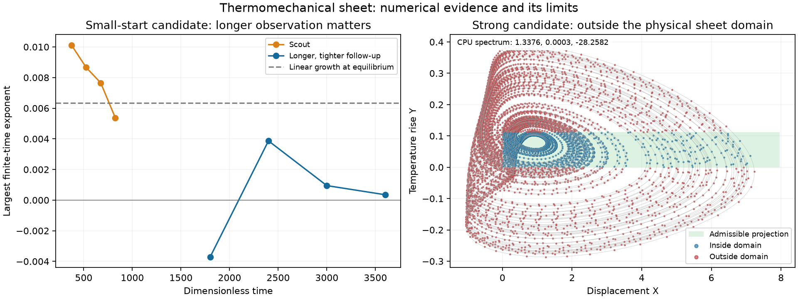

# Thermomechanical sheet: model audit and GPU survey

**Status: 29 October 2026. No physically admissible chaos candidate survived the completed follow-ups.** The printed mathematical ODE does support a strong numerical chaotic candidate outside the sheet's assumed operating domain. This distinction emerged from 8,192 survey trajectories and 84 longer follow-ups; 322 difficult scout cases remain computationally unresolved.

Shen's 2025 article [1] studies a heated elastic sheet using displacement, velocity and temperature. It reports regular oscillations in its examples. The full publisher PDF was retrieved and its equation page visually checked. A cubic velocity damping term is introduced in the numerical section, although absent from initial Eq. 1; that term must be included when investigating the simulated model.

Write `theta=T-T0` and `Delta=TH-T0`. The equations to investigate are

$$m\ddot A+c\dot A+(k_0+\alpha\theta)A+\beta\dot A^3=\gamma\theta,
\qquad \tau\dot\theta=\Delta-\theta-\mu A.$$

## An equilibrium inconsistency

Our substitution of `theta*=Delta-mu A*` gives

```math
-\alpha\mu A_*^2+(k_0+\alpha\Delta+\gamma\mu)A_*-\gamma\Delta=0.
```

The paper's Eq. 3 omits the quadratic term. Its displayed expression is therefore not an exact equilibrium of the printed equations in general. It can be a small-deflection approximation only when that term is negligible; we must not use it uncritically as the center of a numerical scan.

For an illustrative mathematical example `m=c=k0=gamma=mu=tau=Delta=1`, `alpha=-0.1`, the exact positive displacement is `0.5124921973`. The displayed expression gives `0.5263157895`, with nonzero force-balance residual `0.0277008310`. These are deliberately simple audit values, **not** an experimental fit or a reproduction of a source figure.

## Exact dimensionless model

For positive `Delta,mu,tau`, put

$$s=t/\tau,\quad X=\mu A/\Delta,\quad V=\tau\mu\dot A/\Delta,\quad Y=\theta/\Delta.$$

Our transformation yields

$$X'=V,\qquad V'=GY-K(1-SY)X-BV-DV^3,\qquad Y'=1-Y-X,$$

where

$$K=\frac{k_0\tau^2}{m},\quad G=\frac{\gamma\mu\tau^2}{m},\quad
B=\frac{c\tau}{m},\quad S=-\frac{\alpha\Delta}{k_0},\quad
D=\frac{\beta\Delta^2}{m\tau\mu^2}.$$

The physical equilibrium satisfies `X*=1-Y*` and `K(1-SY*)(1-Y*)=G Y*`. For positive `K,G` and nonnegative `S`, there is a unique root with `0<Y*<min(1,1/S)` (interpret `1/S` as infinity for `S=0`). The other algebraic branch is outside this interval.

Set `Ke=K(1-SY*)` and `F=G+KSX*`. The characteristic polynomial is

$$p(\lambda)=(\lambda+1)(\lambda^2+B\lambda+K_e)+F.$$

At this physical equilibrium all coefficients are positive. Local stability is equivalent to `B(Ke+B+1)>F`; equality is a linear Hopf candidate with squared frequency `Ke+B`. The cubic damping has zero derivative at equilibrium, but affects nonlinear saturation. This local criterion follows from the literal equations and retains the displacement-dependent feedback omitted by substituting the plate temperature directly for the sheet temperature.

The divergence is `-1-B-3DV^2`. Negative divergence does **not** prove boundedness. The constraints `X>=0`, `0<=Y<=1`, and positive effective stiffness `1-SY>0` must be monitored separately: the smooth equations do not automatically enforce contact with the plate or all thermal constraints. Excursions outside those conditions cannot be advertised as a physically valid sheet attractor.

## Survey outcome: mathematical chaos versus physical scope

The initial scout completed in 119.2 seconds on a GTX 1080:

| Outcome | Trajectories |
| --- | ---: |
| Completed the requested time | 6,025 |
| Crossed the state-magnitude cutoff of 10,000 | 1,845 |
| Exhausted the attempted-step budget; unresolved | 322 |
| Completed without observed physical-domain exits | 4,088 |
| Passed the preliminary positive-exponent criterion | 51 |
| Preliminary candidates without observation-domain exits | 37 |

We reran 84 distinct trajectories with transient 1,500, observation 2,400, `rtol=1e-9`, and half the maximum step. The first batch selected the 64 largest mean exponents; the second explicitly covered the 20 preliminary candidates absent from that selection. Thus **all 51 preliminary candidates received follow-up**, along with 33 additional high-mean cases. All 84 completed. Only six trajectories, representing three parameter tuples and two starts each, retained the criterion. Every retained trajectory violated the domain conditions; none of the 37 initially domain-clear candidates retained it. The two follow-up batches took 165.4 and 73.7 seconds.

For the strongest family, scout index 3573 has

`(K,G,B,S,D) = (424.376516807412, 1040.1687798954433, 14.906307116853698, 8.89452874485259, 0.005441408445857237)`.

An independent DOP853 full-spectrum calculation, transient 600 and observation 1,600, gives

```math
\lambda\simeq(1.337613,\;0.000273,\;-28.258189).
```

All four leading-exponent windows remain positive (`1.331..1.345`); the integrated divergence identity agrees to `5.7e-11`. The small second exponent is consistent with the neutral flow direction, **not** hyperchaos. The observed ranges include `X=-1.049..7.378`, `Y=-0.294..0.398`, and a minimum stiffness ratio of `-2.539`. This is strong finite-time evidence for chaos in the polynomial equations, but it crosses the assumed noncontact/thermal/positive-stiffness domain. Contact or postbuckling physics would need a different, justified model. There is no calibrated physical-chaos claim and no rigorous attractor-existence or boundedness proof.

The weak positive scout at index 5906 illustrates a different failure mode. Its four initial exponents are roughly `0.0101, 0.0087, 0.0077, 0.0054`, near the equilibrium's unstable growth rate `0.00635`. Longer observation removes the apparent positive asymptotic rate. Independent shooting finds a periodic orbit of period `0.2650092638`, with scaled closure error `2.3e-13` and Floquet multipliers approximately

$$1,\quad0.99663815,\quad0.76411713.$$

Both transverse multipliers are inside the unit circle, providing a numerical stable-cycle control. Sampled displacement and temperature stay positive and the stiffness ratio exceeds `0.9843`. This is a concrete example of a slow departure from an unstable equilibrium masquerading as chaos in a short run.



The compact arrays, selection provenance, unresolved statuses and aggregate counts are under `results/thermomechanical-sheet/`. A finite survey cannot exclude remote basins or all physical parameter choices; the unresolved scout cases have not been reclassified as regular.

## Jerk representation and older thermal chaos

Eliminate the mechanical variables with `X=1-Y-Y'` and `V=-Y'-Y''`. Our exact affine coordinate change gives

$$Y'''+(1+B)Y''+[B+K(1-SY)]Y'+GY-K(1-SY)(1-Y)+D(Y'+Y'')^3=0.$$

The transformation was checked numerically on the same 32 algebra samples, with residual below `5.4e-15`. This is the same model, not an added degree of freedom.

Thermomechanical chaos is long established. For example, Balmforth and Craster [2], Eqs. 3–5, investigate the Moore–Spiegel equation `x'''+x''+(T-R+Rx^2)x'+Tx=0`, including period doubling and homoclinic bifurcations. The sheet has different nonlinear terms. For `D>0`, its state-dependent divergence precludes a global invertible affine state transformation and constant time rescaling to that constant-divergence Moore–Spiegel field. For `S>0`, the sheet also has two algebraic equilibria globally, whereas the displayed Moore–Spiegel system has one for `T>0`; only one sheet equilibrium is in the physical domain. These limited observations do not exclude nonlinear or restricted-domain equivalences, or other published thermal models. No claim of first thermomechanical chaos is appropriate.

## Reproducibility and numerical method

`python research/thermomechanical_sheet.py` independently checks the coordinate transformation on 32 samples, the analytic Jacobian by finite differences, and the equilibrium characteristic polynomial. Recorded errors are `1.8e-15` for coordinate conversion and `8.9e-10` for the Jacobian. Results are in `results/thermomechanical-sheet/algebra-audit.json`.

The exploratory search is explicitly over the mathematical parameter family. It does not reproduce a calibrated device or a particular source figure: the base value of cubic damping was not located, and the paper labels `mu` dimensionless while using displacement in the dimensional thermal balance. The source's Fig. 3 gives relative damping factors, which do not resolve that calibration.

The independent OpenCL implementation uses FP64 Dormand–Prince 5(4), an analytic tangent vector and normalization after accepted steps. Short trajectories at three distinct parameter sets agree with CPU DOP853 to `3.4e-11` in state and `1.5e-10` in the finite-time leading exponent. Accepted nodes are checked for negative displacement, temperature outside `[0,1]`, and negative stiffness. Domain excursions are recorded separately for the transient and observation; the ODE is never clamped. A finite sample of accepted nodes does not certify the entire continuous trajectory stays in the domain. Numerical failure and amplitude-cutoff statuses are distinct from regular dynamics.

Trajectories advance through their observation windows independently. The default budget is three million attempted steps per trajectory and 600 seconds per batch; cases exceeding either budget are saved as **unresolved**, not regular. The initial implementation waited for the slowest trajectory at each window boundary; a stiff tail made that inefficient. Its interrupted attempt is recorded in `aborted-window-barrier-run.json` and contributes no classifications. The revised scheduler reruns the same deterministic sample set and passes the state/tangent validation again.

The first survey uses 4,096 scrambled Sobol parameter tuples with two perturbations of the physical equilibrium. In logarithmic coordinates it spans `K=0.1..10000`, `G/K=0.001..10`, `S=0.01..100`, `B/B_H=10^-1.5..10^0.5`, and `D*K*Xeq^2=0.001..100`. Here `B_H` is the positive local instability threshold derived above. The observation protocol discards 300 time units and measures four windows of 150 units. This samples both sides of local onset without assuming the article's printed threshold is exact. Positive finite-time exponents still require long independent follow-up.

```bash
python research/thermomechanical_sheet.py
python research/search_thermal_sheet.py --validate
python research/search_thermal_sheet.py
# Largest-mean follow-up and the remaining preliminary candidates:
python research/search_thermal_sheet.py --refine results/thermomechanical-sheet/scout --top 64 --transient 1500 --duration 2400 --rtol 1e-9 --step-factor .5 --max-attempts 20000000 --output results/thermomechanical-sheet/refined
python research/search_thermal_sheet.py --refine results/thermomechanical-sheet/scout --indices 810 1150 1154 2166 2504 2570 3126 3614 3754 4506 4598 4898 4974 5290 5870 6122 6520 7206 7870 7958 --transient 1500 --duration 2400 --rtol 1e-9 --step-factor .5 --max-attempts 20000000 --output results/thermomechanical-sheet/remaining-candidates
python research/check_thermal_sheet.py results/thermomechanical-sheet/scout --index 3573 --transient 600 --duration 1600 --output results/thermomechanical-sheet/cpu-reference.json
python research/check_thermal_sheet_period.py
python research/render_thermal_sheet.py
```

`research/check_thermal_sheet.py` supplies an independent full-spectrum CPU calculation with QR orthogonalization and the integrated divergence identity. DOP853 and implicit Radau agree on a two-unit validation trajectory to `3.7e-15` in state and `2.1e-14` in all three finite-time exponents; the validation record includes all settings. A nonzero near-neutral flow exponent must not be mistaken for a weak positive chaos result.

An OpenAlex snapshot returned five forward records, saved in `results/thermomechanical-sheet/literature-forward.json`. The access and verification limits are recorded in `literature-audit.json`. The auxetic-network review really lists the sheet as reference 41; its citation is not dismissed as an index error. Several complete primary texts or citation contexts remain unavailable. Exact-title/DOI chaos queries found no matching result in the material inspected, which is not proof of novelty.

## References

1. **Shen, X.** (2025). Heat Conduction and Its Related Interdisciplinary Areas: Self-Excited Oscillations in a Thermomechanical Elastic Sheet. *Chinese Physics Letters*, **42**, 090801. [doi:10.1088/0256-307X/42/9/090801](https://doi.org/10.1088/0256-307X/42/9/090801). [Publisher article](https://cpl.iphy.ac.cn/article/doi/10.1088/0256-307X/42/9/090801). [Publisher PDF](https://cpl.iphy.ac.cn/en/article/pdf/preview/10.1088/0256-307X/42/9/090801.pdf).
2. **Balmforth, N. J., and Craster, R. V.** (1997). Synchronizing Moore and Spiegel. *Chaos*, **7**(4), 738–752. [doi:10.1063/1.166271](https://doi.org/10.1063/1.166271). [Author-hosted paper](https://personal.math.ubc.ca/~njb/Research/ms.pdf).
