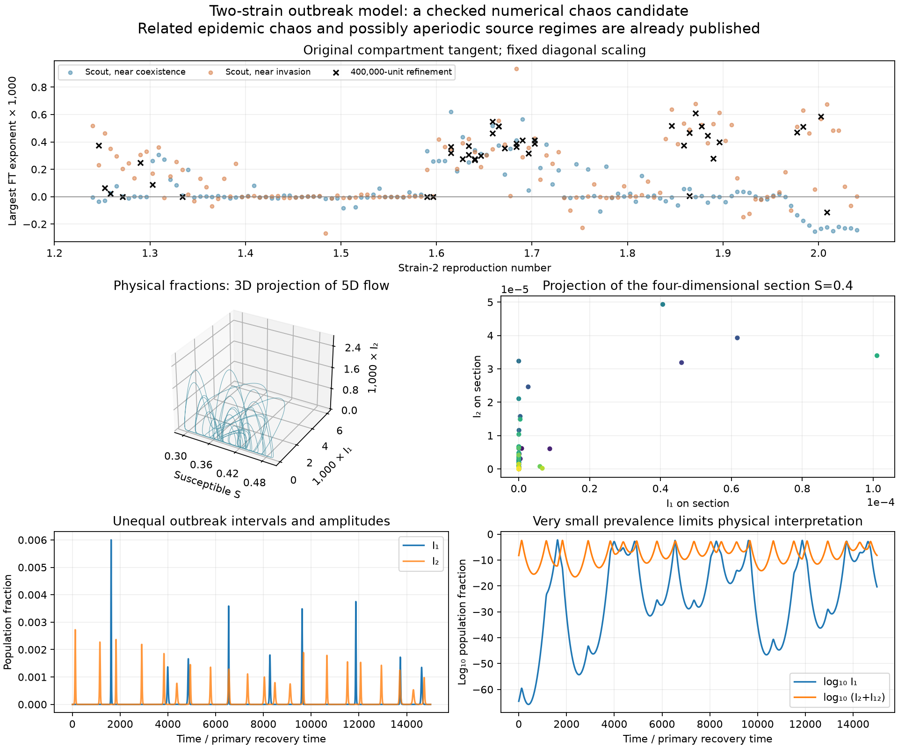
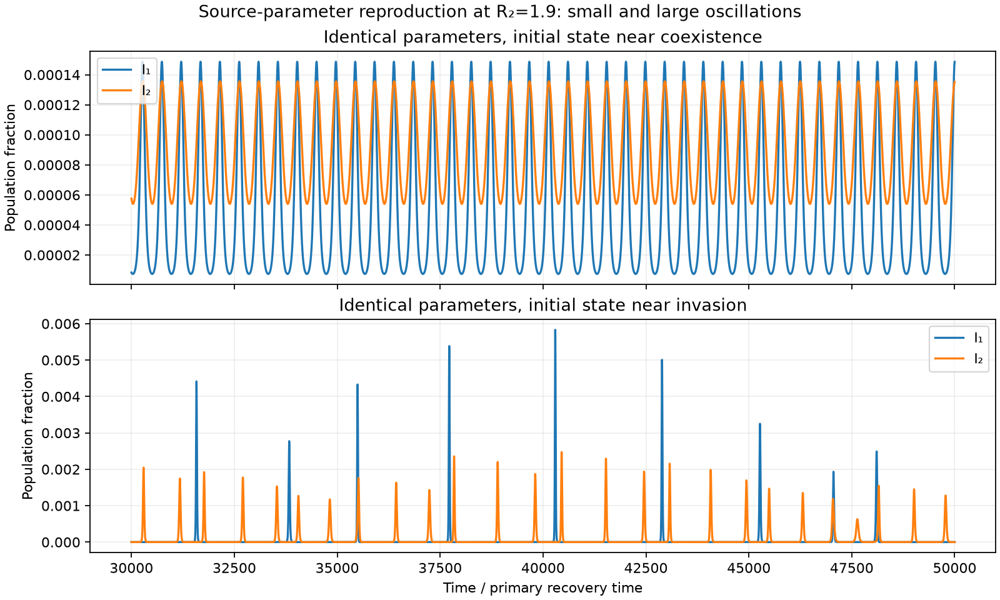
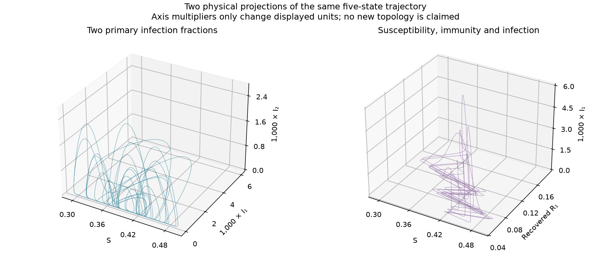
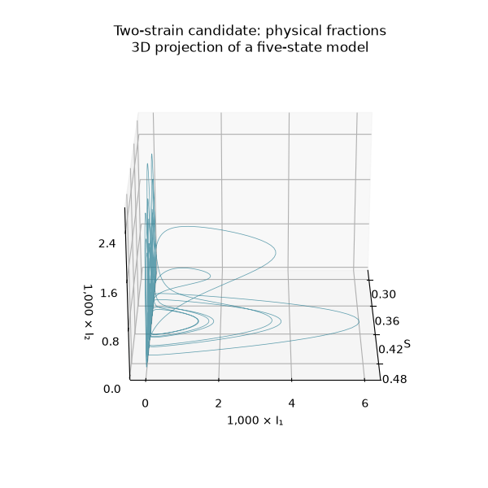

# Two-strain outbreak dynamics: chaos candidates and a boundary obstruction

We independently implemented the five-state baseline of Gavish [1] and found persistent positive-exponent numerical regimes. This is a mathematical-model result, **not a newly discovered class of epidemic chaos or a calibrated prediction for a real population**. The source already describes some trajectories as possibly aperiodic and announces a companion analysis of a Shilnikov-like mechanism. Older two-strain models explicitly exhibit chaos [3,4].

Our additions are reproducible GPU/CPU checks, a careful treatment of extremely small prevalence, an independently verified periodic control, and a simple obstruction to a literal interior homoclinic return to the single-strain equilibrium.



## Exact model and bounded state space

Let `S` be susceptible population, `I1,I2` primary infections, `I12` secondary infection with strain 2, and `R1` recovery from strain 1. Recovery from strain 2 prevents further infection in this baseline. The remaining fully protected fraction is `R=1-S-I1-I2-I12-R1`. With `F2=beta2*(I2+eta2*I12)`, primary Eq. 2 is

```math
\begin{aligned}
\dot S &= \mu(1-S)-\beta_1 I_1 S-F_2 S,\\
\dot I_1 &= (\beta_1 S-\mu-\gamma_1)I_1,\\
\dot I_2 &= F_2 S-(\mu+\gamma_2)I_2,\\
\dot I_{12} &= \sigma_{12}F_2R_1-(\mu+\gamma_{12})I_{12},\\
\dot R_1 &= \gamma_1I_1-\sigma_{12}F_2R_1-\mu R_1.
\end{aligned}
```

All parameters are positive. Each compartment has nonnegative inflow on its zero boundary; adding `R'=gamma2*I2+gamma12*I12-mu*R` preserves unit total population. Hence the nonnegative population simplex is forward invariant and bounded. This guarantees bounded fractions, not chaos or an interior lower bound on prevalence.

We use the source's slice `mu=0.00025`, `gamma1=1`, `gamma2=1.1`, `sigma12=eta2=1.1`, reproduction number `R0,1=2.5`, and secondary transmission advantage `q=1.33`. We interpret the latter literally, setting

```text
gamma12 = sigma12 * eta2 * gamma2 / q = 1.0007518796992483
beta_i  = R0,i * (gamma_i + mu).
```

The source rounds `gamma12` to approximately one. Our settings are explicit and introduce no extra dynamical state or feedback term. The equations are asymmetric: there is no strain-exchange symmetry because one secondary-infection direction is absent. Population normalization removes one state; it does not make the five-state dynamics planar.

## Numerical survey and independent checks

The first slice has 129 evenly spaced values `R0,2=1.24...2.04` and two source-inspired starts per value: a small perturbation of coexistence, and a small strain-1 invasion near the strain-2 equilibrium. The initial conditions are saved explicitly.

| Stage | Trajectories | Time discarded + observed | Settings and outcome |
| --- | ---: | --- | --- |
| GPU scout | 258 | 20,000 + 40,000 | `rtol=1e-8`, maximum step 1; all complete, 35 pass screening |
| GPU refinement | 41 | additional 100,000 + 400,000 | All 35 positives plus the twelve largest scout estimates, with duplicates removed; `rtol=1e-10`, maximum step 0.5; all complete, 30 retain the criterion at 23 distinct tuples |
| Further step/tolerance checks | 3 | additional 100,000 + 400,000 | `rtol=1e-11`, maximum step 0.25; all four windows remain positive in all three cases |

The screening criterion is mean exponent above `1e-5` and all four observation-window estimates above `5e-6`. It is a triage rule, not a theorem. The first two batches took 3.63 and 57.57 seconds on a GTX 1080. Non-retained cases have not all been classified as periodic or stationary.

Reference scout 203, refinement 32, has **`R0,2=1.87125`**. Its refined largest physical-coordinate exponent is **0.000610877**, with four windows `0.000560969, 0.000553548, 0.000610108, 0.000718883`. The further tighter continuation gives about **0.0006094**, again positive in every window. These rates are per unit of primary strain-1 recovery time.

An independent CPU DOP853 calculation, with 20,000 units of full tangent burn-in and 80,000 observation units, gives the following spectrum in the explicitly stated **log-prevalence coordinates**:

```text
(0.000573730, 0.000011851, -0.000142652, -0.001590773, -1.026040662).
```

The four leading-window estimates are `0.000566116, 0.000897275, 0.000604278, 0.000227252`. The second direction is close to neutral and changes sign across windows; this is **not a hyperchaos claim**. The sum agrees with the integrated divergence of that coordinate field to `3.9e-11`. The data contain 100 upward crossings of `S=0.4`, a four-dimensional section whose displayed two-coordinate projection is not a complete return map.

Independent DOP853 versus Radau state comparisons over 1,000 units at three retained parameter sets agree within `1.2e-11` in integration coordinates and `7e-13` in fractions. Separate algebra checks cover the Jacobians, closed-form coexistence equilibrium, mass balance, coordinate transformation and a CPU/GPU tangent comparison.

## Why the coordinate and population caveats matter

We integrate

```text
(S, u=log(I1/mu), v=log((I2+I12)/mu), r=I12/(I2+I12), R1).
```

This preserves the logarithm of an extremely small invader population without clipping it to zero. The GPU tangent equation still evolves perturbations of the **original five compartments**, using only the constant scale `(1,mu,mu,mu,1)`. Thus its leading estimate is not a silently substituted log-coordinate exponent.

Full physical-coordinate QR is much harder to interpret over finite intervals here. A saved diagnostic with a random basis, tangent burn-in and a passing divergence check yields an unordered set of QR rates, including a second positive rate larger than the first. We do not interpret it as a converged ordered Lyapunov spectrum. The transformation becomes extremely ill-conditioned near the population boundary; a divergence check alone cannot settle the individual rates. The log-coordinate full spectrum and the original-coordinate leading-vector results are presented separately.

For this transformation, the determinant of the physical-coordinate Jacobian is `I1*(I2+I12)^2`. Consequently,

```math
\mathrm{div}\,F_{\rm physical}-\mathrm{div}\,F_{\rm log}
=\dot u+2\dot v.
```

Our CPU integrals satisfy the corresponding endpoint identity to `4.3e-16`. Its finite-time correction is approximately `-0.00156874` for the 80,000-unit reference interval, which is not negligible relative to the small exponents. Equality of asymptotic spectra needs a bounded or suitably subexponential coordinate transformation along the limiting dynamics; finite-time values need not coincide. We therefore avoid assigning an attractor dimension from these numbers.

The reference CPU trajectory reaches `I1` around **6e-70**, and some surveyed trajectories go lower still. Such deterministic fractions do not represent a plausible count of infected individuals in a finite population. A stochastic population model could extinguish a strain instead of allowing its later return, and would be a different model. The present candidate is mathematically interesting; biological persistence is not established.

## Periodic control and physical geometry

At `R0,2=1.9`, the near-coexistence start approaches a small cycle; the near-invasion start produces much larger oscillations. This reproduces the source's qualitative coexistence example.



An independent shooting calculation confirms the small cycle with **period 469.8264523867**, orbit-closure error `2.8e-13` in integration coordinates and largest Poincare multiplier magnitude **0.886087**. Its other resolved multiplier is `0.741846`; the dominant pair is `0.295033 ± 0.835527 i`. The smallest multiplier is below reliable double-precision relative resolution. The corresponding long CPU leading exponent is `5.1e-7`, close to the neutral flow direction, rather than the much larger positive candidate rate.



The candidate alternates nearly infection-free intervals with unequal bursts. In raw population coordinates, the projection contains excursions of different heights near a common low-prevalence region; including the recovered fraction exposes another part of the slow evolution. The three-dimensional pictures are projections of a five-state flow. Axis multipliers merely make small fractions readable. These shapes are not evidence of a new topological attractor type.



## A boundary obstruction to a literal homoclinic return

The source suggests a Shilnikov-like connection associated with a single-strain equilibrium. That language should not automatically be replaced by a proved physical homoclinic orbit. The following elementary observation narrows the question.

Write reproduction numbers as `A=beta1/(gamma1+mu)` and `B=beta2/(gamma2+mu)`. At the strain-2-only equilibrium,

```math
E_2=\left(\frac1B,0,\frac{\mu(B-1)}{\beta_2},0,0\right),
\qquad \lambda_{\rm inv}=(\gamma_1+\mu)\left(\frac AB-1\right).
```

For the coexistence regime `A>B>1`, this invasion eigenvalue is positive. Suppose a physical trajectory with `I1(t0)>0` converged to `E2` as time tends to positive infinity. Then `S(t)` would approach `1/B`, so eventually

```math
\frac{d}{dt}\log I_1=\beta_1S-\mu-\gamma_1
\geq\frac12\lambda_{\rm inv}>0.
```

It follows that `I1` grows exponentially from a strictly positive value, contradicting convergence to zero and boundedness. **An interior trajectory therefore cannot make a homoclinic return to this boundary equilibrium.** This does not exclude arbitrarily long near-boundary passages, a singular-limit construction, other global bifurcations, or chaos.

The remaining eigenvalues factor into `-mu*[1+sigma12*(B-1)]`, `-mu-gamma12`, and the roots of

```math
\lambda^2+\mu B\lambda+\mu(\gamma_2+\mu)(B-1)=0.
```

At the numerical reference, the unstable rate is `0.336089`; the weak stable pair is `-0.000233906 ± 0.0154788 i`. Thus a positive local saddle quantity does not supply the missing global return. The algebra is independently checked at 128 parameter sets; the impossibility argument is analytic, not inferred from those samples.

## Novelty status and remaining work

The strongest conclusion is a numerically checked mathematical chaos candidate in this particular baseline, plus a useful boundary argument. General epidemic chaos was published decades ago. The source itself already flags possible aperiodicity, so we do not claim its first observation or resolve scientific priority.

The primary 2014 article [3] describes a nine-dimensional temporary-cross-immunity model with chaotic regimes and Lyapunov calculations; it is not the same literal five-state system. The original 1999 abstract [4] explicitly reports chaos, but its complete equations were not recovered during this pass. Exact reductions, the promised companion paper, and the full global mechanism remain open comparison tasks. No absence-of-search-results argument establishes novelty.

## Reproduction

Run from the repository root:

```powershell
python research/two_strain.py
python research/two_strain.py --controls
python research/two_strain_gpu.py --levels 129
python research/refine_two_strain.py
python research/refine_two_strain.py --step-control
python research/audit_two_strain_precision.py
python research/audit_two_strain_boundary.py
python research/check_two_strain.py --index 32 --source results/two-strain/slice-refined.npz --transient 20000 --duration 80000 --output cpu-refined32-log
python research/check_two_strain.py --r2 1.9 --start coexistence --transient 20000 --duration 40000 --output cpu-small-cycle-log
python research/check_two_strain.py --index 32 --source results/two-strain/slice-refined.npz --coordinates physical --transient 20000 --duration 20000 --output diagnostic-physical-qr
python research/analyze_two_strain.py --cycle
python research/analyze_two_strain.py --densify
python research/analyze_two_strain.py --gif
```

Code, parameters, initial states, statuses, interval exponents, CPU traces and verification outputs are in `research/` and `results/two-strain/`. Source-parameter trajectories and rendered figures are separate from the screening data. The implementation was written independently from the printed equations; author MATLAB code was not copied or executed.

## References

1. Gavish, N. (2026). An Analytically Tractable Framework for Multi-Strain Epidemics: Resolving Algebraic Complexity to Map Oscillatory Dynamics. [arXiv:2608.13995v1](https://arxiv.org/html/2608.13995v1), Eqs. 2, 12; Section 5; Appendix 11. Preprint. The linked code repository returned 404 during this audit.
2. Gavish, N. (2026). Hidden Oscillations: How Minimal Immunological Interactions Destabilize Two-Strain Epidemic Models. *SIAM Journal on Life Sciences* **1**(3), 420–443. [doi:10.1137/25M1826160](https://doi.org/10.1137/25M1826160). Related minimal model; not the five-state baseline simulated here.
3. Kooi, B. W., Aguiar, M., and Stollenwerk, N. (2014). Analysis of an asymmetric two-strain dengue model. *Mathematical Biosciences* **248**, 128–139. [doi:10.1016/j.mbs.2013.12.009](https://doi.org/10.1016/j.mbs.2013.12.009). Primary publisher abstract and introduction inspected; exact equation comparison unfinished.
4. Ferguson, N., Anderson, R., and Gupta, S. (1999). The effect of antibody-dependent enhancement on the transmission dynamics and persistence of multiple-strain pathogens. *PNAS* **96**(2), 790–794. [doi:10.1073/pnas.96.2.790](https://doi.org/10.1073/pnas.96.2.790). Primary abstract inspected; full-text retrieval failed in this pass.
