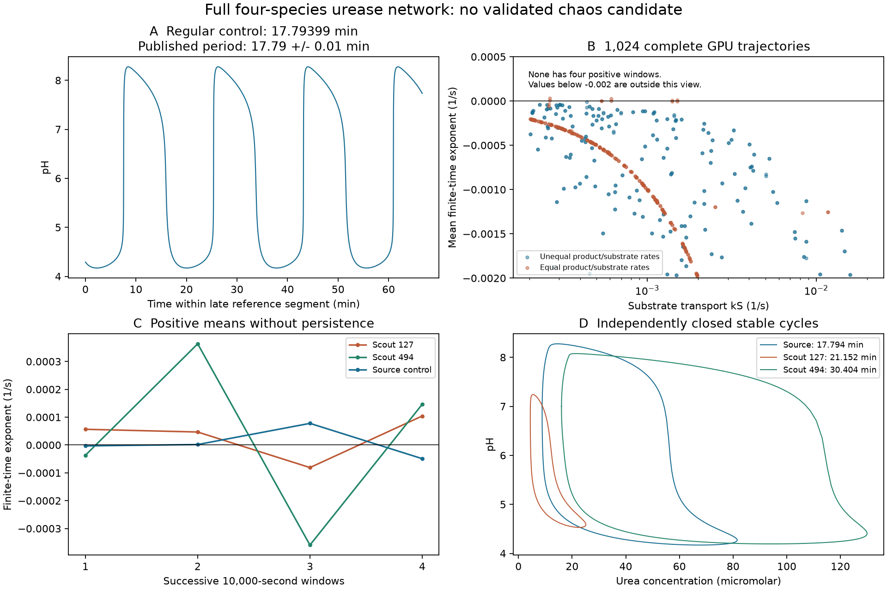

# Full urease network: an implicit GPU search and a regular control

Research note, 30 October 2026. **No validated chaotic candidate emerged.** All 1,024 initial trajectories completed. Eight had a positive mean finite-time exponent, but none had positive estimates in all four observation windows. The independent source control and the two largest weak positive signals close onto stable periodic orbits. Six of sixteen tighter long follow-ups completed without a retained signal; ten exhausted the wall-time budget and remain unclassified by that test. These observations do not prove a general absence of chaos.



## The model being tested

We implement the original four-species deterministic network from Straube et al. [1,2], before their additional quasi-steady reductions. Urea `S` and protons `H` exchange with maintained external reservoirs; ammonia `P` and ammonium `Q` leave at a common product rate `k`. The reaction rates and equations are

```math
v=\frac{v_{\max}S}{K_M+S}\frac{H}{H+H^2/K_{E1}+K_{E2}},
\qquad j=k_2PH-k_{2r}Q,
```

```math
\dot S=-v+k_S(S_e-S),\quad
\dot H=-j+k_H(H_e-H),\quad
\dot P=2v-j-kP,\quad
\dot Q=j-kQ.
```

All constants and units are listed in the [structural audit](urease-structural-audit.md). The nonnegative domain is invariant and concentrations are bounded for fixed positive parameters. This supplies a mathematical boundedness argument; it does not establish chemical validity at every parameter value.

The exact mass coordinate `N=2S+P+Q` obeys `N'=kS*(2Se-N)` when `k=kS`, so recurrent dynamics then lie on a three-dimensional hyperplane. Setting all three transport rates equal gives a further exact planar restriction with negative divergence and no periodic orbit. These are useful controls. The full unequal-rate network is not excluded by the same arguments. The frozen fast reaction has a unique stable root, but no exact finite-rate planar theorem has been established for the oscillatory source parameters.

## Why an implicit GPU method was needed

The source protonation constant is `k2=4.3e10 M^-1 s^-1`. Replacing it by a convenient smaller value would change the chemistry. A stability-limited explicit scan would waste most of its work following the fast relaxation. We retain the original constant and solve the complete stiff equations.

The implementation uses a fixed concentration scale of `1e-4 M`, retaining seconds as the time unit. An exact linear coordinate change

```math
(S,H,P,Q)\longmapsto(S,D=P-H,Z=H+Q,H)
```

puts the large protonation term into one equation. The three other balances avoid subtraction of large opposing chemical rates. Species are reconstructed exactly by the inverse linear transformation; no quasi-steady approximation or concentration clipping is used.

Each GPU trajectory uses a two-stage SDIRK base with `gamma=1-1/sqrt(2)`, Newton stages with the analytic Jacobian, step doubling, and Richardson extrapolation. The base is L-stable; the accepted extrapolate is **not unconditionally A-stable**, so it must not be advertised as an unconditionally stable full integrator. Its scalar amplification modulus at `h*lambda=5i` is about `1.075`, making this distinction explicit. Adaptive error control acts on both state and tangent, and independent stiff CPU comparisons are required. The tangent is propagated through the implicit stage derivatives; it is not a finite perturbation between two clipped trajectories. Failed Newton solves or a nonphysical trial reduce the time step. Budget exhaustion remains an unresolved outcome.

The largest finite-time exponent uses the Euclidean norm in the stated fixed linear coordinates. This is a reproducible constant metric; finite-window values need not match another metric exactly. Independent CPU comparisons use the same coordinates. Physical figures use reconstructed species.

## Verification before the survey

| Check | Observed agreement |
|---|---:|
| Analytic physical Jacobian vs complex-step derivatives, 64 states | Maximum scaled error `9.88e-15` |
| Exact linear-coordinate field / Jacobian identities | `4.65e-13` / `3.26e-16` |
| Full Radau vs full BDF, 1,200 seconds | Scaled state difference `1.84e-9` |
| Exact mass-relaxation identity along the Radau trajectory | `1.73e-13` in scaled concentration |
| Original four-state vs exact three-state restriction, 1,000 seconds | Scaled state difference `1.16e-11` |
| GPU vs Radau state and tangent, fast initial relaxation and cycle-scale controls | State below `7.1e-8`, exponent below `2.9e-9 /s` |
| Four additional transport/rate controls, 3,000 seconds each | State below `9.6e-8`, exponent below `7.7e-11 /s` |

The early finite-difference Jacobian diagnostic suffered subtractive cancellation between large reaction terms. Complex-step differentiation resolves the small entries without subtracting those terms; the equations were not altered to make the test pass. Controls and tolerances are saved in [validation.json](../results/urease/validation.json), [gpu-validation.json](../results/urease/gpu-validation.json), and [gpu-parameter-controls.json](../results/urease/gpu-parameter-controls.json).

## Independent periodic-orbit control

At the source parameters a full Radau trajectory reproduces pH approximately **4.16994–8.27525**. The source specifies initial urea and proton concentrations but not initial products; our transient starts with `P=Q=0`, explicitly a choice made here.

A Newton solve of the proton section `H=1e-7 M`, crossed upward, on the exact invariant mass hyperplane gives:

| Quantity | Result |
|---|---:|
| Period | `1067.639503763483 s`, or `17.793991729391383 min` |
| Source period [1] | `17.79 ± 0.01 min` |
| Section closure | `9.25e-15` in scaled coordinates |
| Independent BDF closed-orbit error | `4.00e-12` |
| Largest transverse multiplier | `0.2243169425` |

The largest transverse multiplier here is the exact normal mass-relaxation factor `exp(-kS*T)`; the section multipliers inside the mass hyperplane are smaller. Extremely small multipliers have no reliable relative precision in double arithmetic. These are numerical orbit checks, not a rigorous interval proof. [Orbit data and metadata](../results/urease/source-cycle.json) retain the independent method and scope.

## Survey scope and outcome

The seeded survey chooses 512 parameter tuples, with two chemical starts each. Half use the source relation `k=kS`; half vary the product outflow. The first two tuples are replaced by the source point and the equal-transport negative control. Acid/base reaction constants, Michaelis constant and enzyme protonation constants remain fixed.

| Quantity | Sampling range |
|---|---:|
| Substrate transport `kS` | `2e-4 .. .02 /s` |
| Proton transport `kH` | `.001 .. .08 /s` |
| Maximum enzyme rate `vmax` | `2e-5 .. .002 M/s` |
| Substrate reservoir `Se` | `5e-5 .. .003 M` |
| Proton reservoir `He` | `1e-5 .. .002 M` |
| Product/substrate transport ratio, second half only | `.1 .. 10` |

The values are log-uniform independent choices, not inferred experimental distributions. Starts are `(0.3Se,0.2He,0,0)` and `(0.1Se,0.02He,0.1Se,1.7Se)` in species order `(S,H,P,Q)`. The second starts on the exact mass hyperplane when `k=kS`; neither complete start is attributed to the source.

The GPU discards 20,000 seconds and observes 40,000, with four equal observation windows, `rtol=1e-7`, `atol=1e-10` in scaled coordinates, and a ten-second step cap. All **1,024** trajectories completed in **57.78 seconds** on a GTX 1080. Eight mean estimates were positive; the largest was `3.16e-5 /s`. **None had four positive windows**, including under a zero threshold. Thus no initial persistent candidate met the stated rule of mean above `2e-5 /s` and every window above `1e-5 /s`.

The saved [scout metadata](../results/urease/scout.json) and [array data](../results/urease/scout.npz) include parameters, starts, final states, all four exponent windows, physical ranges and step counts. A negative screening result is limited to these tuples, starts, durations and tolerances; thin windows and longer transients can be missed.

The two largest positive means, source indices **127** and **494**, were independently resolved by Newton/Radau orbit closure and BDF verification:

| Scout index | Closed period (s) | Largest transverse multiplier | Independent BDF closure |
|---|---:|---:|---:|
| 127 | 1269.1195557174 | .7146485645 | `3.55e-11` |
| 494 | 1824.2501033010 | .3280931554 | `8.35e-12` |

Both are strongly supported stable periodic controls, explaining why positive finite-window means were not sufficient evidence of chaos. This checks selected final states, not every possible basin at their parameter tuples.

Long follow-up of all positive means and the strongest sixteen means uses additional 200,000 transient and 400,000 observation seconds, tighter `rtol=1e-9`, and a five-second cap. Its criterion is deliberately lower: mean above `1e-6 /s` and every window above `5e-7 /s`. **Six completed and none retained a signal; ten reached the 600-second wall-time budget.** Completed mean estimates range from `-7.46e-5` to `-2.76e-6 /s`; one completed run still has mixed-sign windows.

The ten incomplete source indices are `0,1,126,127,344,345,480,481,494,495`, including the independently closed source and selected weak-signal cycles. They reached approximately `71,271–516,007` of the intended 600,000 additional simulated seconds. They are **not classified as negative Lyapunov results**. [The saved follow-up](../results/urease/refined.json) retains elapsed times, final states/tangents, physical ranges and explicit budget flags; partial window sums were not retained. Tight error control in this stiff problem costs substantially more than the initial survey. Repeating it blindly would add little without a new numerical or dynamical question.

## Reproduction and limits

```bash
python research/urease.py
python research/urease.py --reference
python research/check_urease_cycle.py
python research/urease_gpu.py
python research/urease_gpu.py --parameter-controls
python research/urease_gpu.py --survey --tuples 512
python research/urease_gpu.py --refine
python research/check_urease_cycle.py --source results/urease/scout.npz --index 127
python research/check_urease_cycle.py --source results/urease/scout.npz --index 494
python research/plot_urease.py
```

The mathematical network omits some chemistry, including explicit carbon dioxide, and assumes effective well-mixed transport. The source's chemical simplifications are supported near its reference regime, not automatically across this survey. Tiny concentrations may also invalidate a deterministic molecular-population interpretation. No experimental chaos prediction or scientific-priority claim is made.

The [source audit](urease-structural-audit.md) and [earlier enzyme screening](enzyme-feedback-screening.md) record literature coverage. We did not identify an exact-model deterministic-chaos demonstration in that bounded search. That is not proof that none exists, and no new attractor was established by this survey.

## References

1. Straube, A. V., Winkelmann, S., Schütte, C., and Höfling, F. (2021). *Stochastic pH oscillations in a model of the urea–urease reaction confined to lipid vesicles*. J. Phys. Chem. Lett. **12**, 9888–9893. [DOI](https://doi.org/10.1021/acs.jpclett.1c03016), [author-hosted published article](https://publications.imp.fu-berlin.de/2630/1/acs.jpclett.1c03016.pdf), [preprint including supporting information](https://arxiv.org/pdf/2110.03465v1).
2. Straube, A. V., Winkelmann, S., and Höfling, F. (2023). *Accurate Reduced Models for the pH Oscillations in the Urea–Urease Reaction Confined to Giant Lipid Vesicles*. J. Phys. Chem. B **127**, 2955–2967. [DOI](https://doi.org/10.1021/acs.jpcb.2c09092), [inspected full preprint](https://arxiv.org/html/2212.14503v1).
