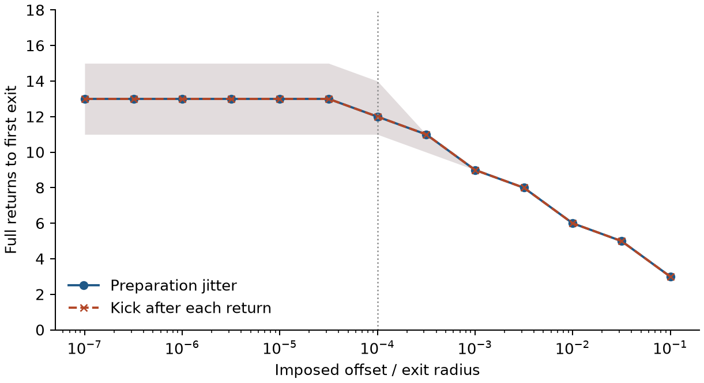

# Can a residence count distinguish two noise sources?

Near the saddle in the [voltage-start experiment](../../docs/chua-saddle-residence.md), a small error grows by a factor of 2.213 per circuit. An error at launch and a succession of smaller disturbances can produce nearly identical exit counts. This matters when interpreting the 11 simulated turns and eight measured turns in [Fig. 10 of the circuit experiment](https://doi.org/10.1007/s11071-022-08078-y).



At zero imposed displacement both models give a median of **13 turns**, with the middle 80% between **11 and 15**. The vertical line marks the chosen rms preparation error. Below this scale, tightening the nominal launch has little effect. These noise levels are illustrative.

## Calculation

Let $q_n$ be displacement in the left unstable direction after $n$ full returns, divided by the exit radius (0.02 in the section coordinates). Set $q_0=d+\eta$ and $q_{n+1}=\lambda q_n+\xi_n$, with independent zero-mean Gaussian preparation error $\eta$ and per-return kicks $\xi_n$. The exit count is the first $n$ such that $|q_n|\geq 1$. Iterating gives

```math
\operatorname{Var}(\lambda^{-n} q_n)
=\sigma_{\rm prep}^2+\sigma_{\rm kick}^2
\frac{1-\lambda^{-2n}}{\lambda^2-1}.
```

At long residence times a kick of rms size $\sigma_{\rm kick}$ contributes the same input variance as preparation jitter of size $\sigma_{\rm kick}/\sqrt{\lambda^2-1}$. This equality concerns the unconstrained displacement. We computed the plotted **first-exit** distributions by stopping each realization at its first crossing.

The preparation-only run uses rms error $10^{-4}$ of the exit radius. The kick-only run uses $1.9740\times10^{-4}$ per return. Each plotted point uses 65,536 realizations per model. In a second check we added the same kicks, along the unstable eigenvector, to the nonlinear two-dimensional Chua return. Of 288 paired trials, 285 had identical exit counts and three differed by one turn. The perturbations are discrete section kicks. A circuit noise spectrum would require a model of where the noise enters the circuit.

To separate the sources on a bench, record the actual precharge at release and the section coordinates on successive turns. In the linear model the residual $q_{n+1}-\lambda q_n$ removes the amplified preparation error. Applying that test to data also requires a measurement-noise estimate.

## Reproduce

```bash
python -m pip install -r requirements-certificate.txt
python research/chua_residence_noise.py --output outputs/residence-noise
```

[Quantiles and means](counts.csv) · [Section, seed and paired counts](settings.json) · [Simulation](../../research/chua_residence_noise.py)
